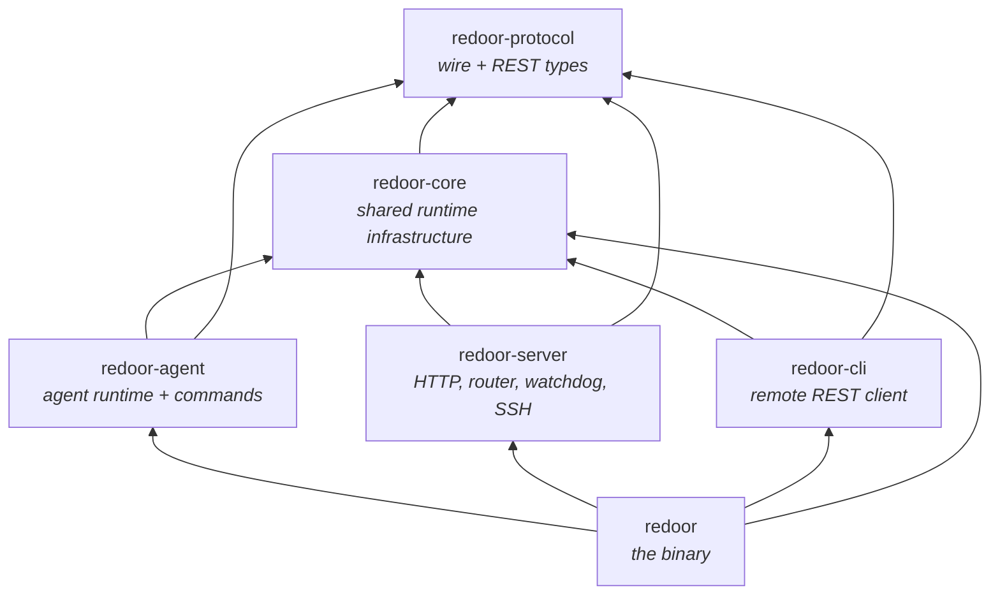
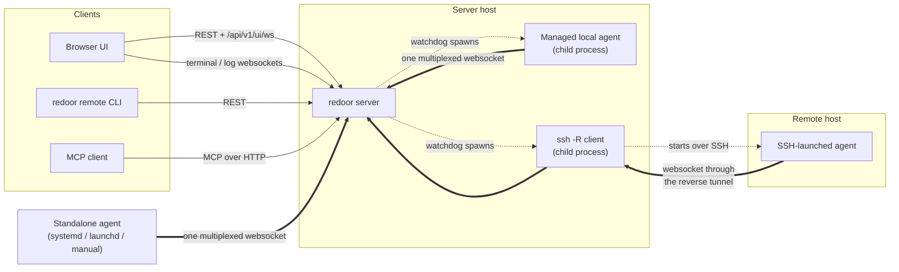
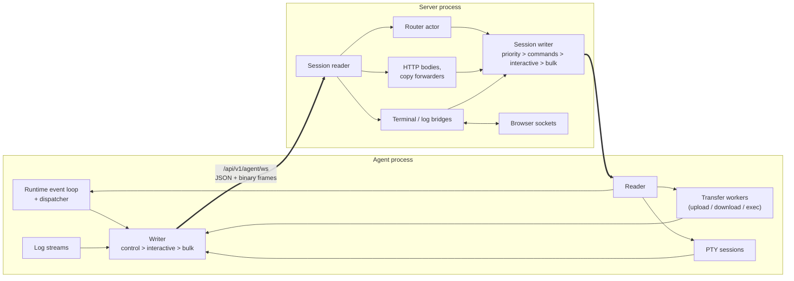
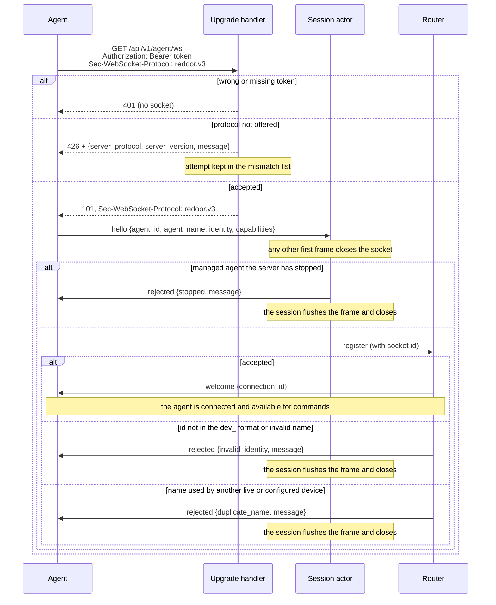
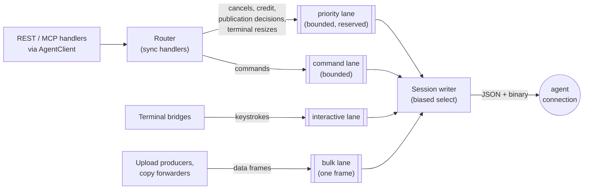
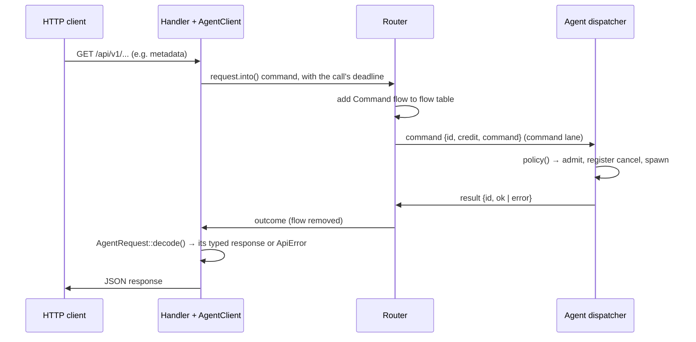
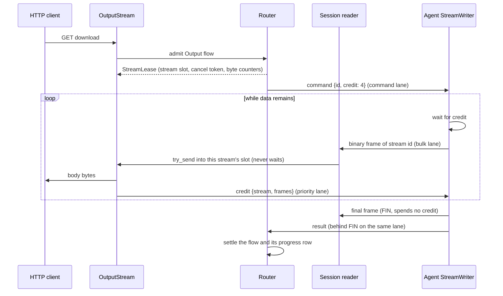
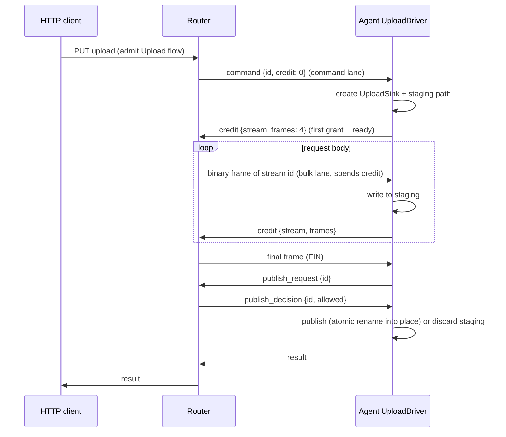
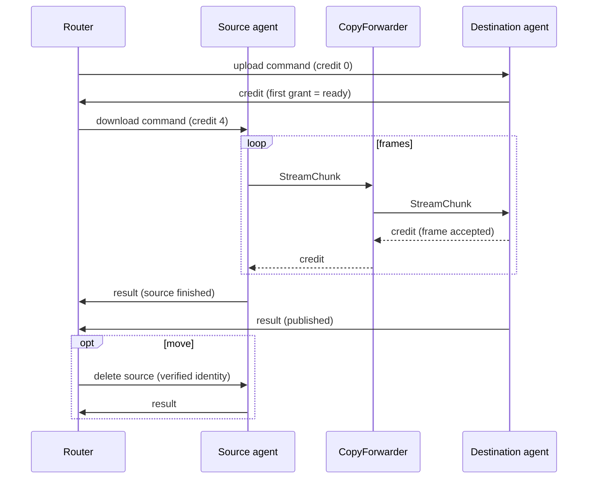
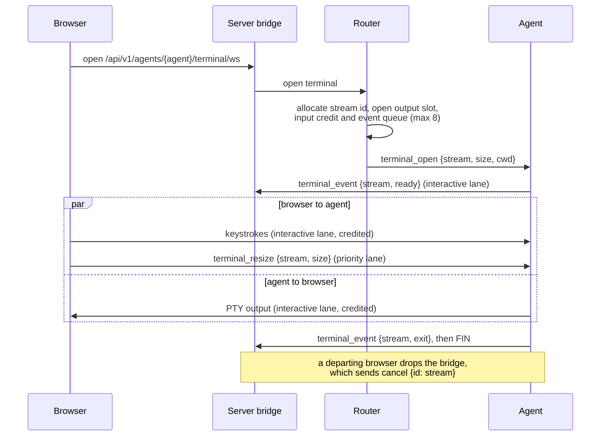

# Architecture

Redoor is a single `redoor` binary that plays several roles:

- **server**: REST API, browser UI, MCP endpoint and the websocket hub agents connect to
- **agent**: connects to a server and executes filesystem, exec, git, terminal and log commands on its host
- **remote CLI** (`redoor remote ...`): a REST client for scripting against a server, authenticated
  with an access token
- **service management**: installs the server, agent or a named relay as a systemd or launchd
  service
- **self-upgrade** (`redoor upgrade`): installs a release over the running binary and restarts
  the local redoor processes that run it

The Rust code is a cargo workspace under `crates/`. The roles live in separate crates so the
compiler enforces that agent and server code never depend on each other.

## Crates



Arrows point from a crate to what it depends on (the binary uses `redoor-protocol` only in its
tests). Dependencies only go downwards, and the three role crates in the middle are siblings
that cannot import each other.

### `redoor-protocol`

The contract between all parties, with no runtime dependencies (no tokio).

- `wire/`: the agent websocket protocol.
  - `handshake` holds the upgrade contract: the `redoor.v3` subprotocol, the agent endpoint
    path, the `426` body and the protocol-mismatch types the UI lists.
  - `ServerToAgent` and `AgentToServer` are the JSON control envelopes, one per direction,
    so each side's `match` is exhaustive. No frame except `hello` carries an agent id: the
    authenticated connection is the identity.
  - `Command` is the request payload. Its variants wrap the per-command structs in
    `request`, and each struct names its response type through the `AgentRequest` trait, so
    a command can only be answered (and decoded) as its own response.
  - `Command::policy()` is the single table that classifies every command: whether it
    streams bytes and in which direction, whether it is an upload, and how it is cancelled.
    Both the server and the agent read it, so they cannot disagree.
  - `stream` defines the binary frame (stream id, `FIN` flag, up to 64 KiB of payload)
    and the credit windows. `exec`, `log` and `terminal` hold the feature-specific wire types.
  - `registration` holds `AgentIdentity` and `AgentCapabilities`, which are flattened into
    the `hello` frame.
- `ids`: the strongly typed identifiers. `AgentId` is the stable device id (see "Device
  identity"); `validate_device_name` holds the device name rules.
- `api/`: REST request and response types grouped by domain (agents, auth, files,
  transfers, git, tokens, ...). Git is a directory with one module per feature area
  (`worktree`, `worktree_list`, `revision`, `commit`, `history`, `refs`), plus the vocabulary they share
  (including `GitPage`, the bounded offset and size every paged Git list uses), so later
  Git features (such as search) are added beside them rather than into one file.
- Types marked `#[ts(export)]` generate the TypeScript interfaces in `bindings/`, which the UI
  and the integration tests use, so REST JSON (and the wire types the browser shares, such as
  exec, log and terminal events) is checked from both sides. Agent-only wire types are
  covered by round-trip tests in the protocol crate and by the TypeScript fake agent.

### `redoor-core`

Infrastructure that more than one role needs:

- Configuration: serde parsing with a `validate()` pass, plus format-preserving edits through
  `toml_edit`.
- `RuntimeContext`: app name, `AppPaths` and websocket timeouts. It is built once in `main`
  and passed down instead of being read from process globals.
- Logging, behind a replaceable logger.
- `rotating_log`: every log file a process owns goes through `RotatingLogFile`, which keeps
  it under its `log_max_size` (10 MB by default) so long-running processes on small
  devices cannot fill the disk. The size is checked when the file is opened and after
  every 100 messages, counted in memory so writes between checks cost nothing. An
  oversized file keeps the newer half of its lines. The file is compacted in place
  instead of renamed, so every open append handle keeps writing to the live log, and it
  is streamed in fixed chunks so rotation never loads the log into memory. A process-wide
  lock orders truncation against appends, because a relay writes one file from several
  writers.
- Filesystem safety: `safe_fs` (including `safe_rm_all`), `atomic_rename`, `destination`
  (symlink-safe placement and merges) and `staging` (self-deleting hidden staging paths with
  atomic name reservation).
- `stream_credit`: the per-stream flow-control primitives that both the agent and server
  transfer paths use.
- `directory_measurement`: one directory walk that yields content bytes and the predicted
  tar size. The agent uses it for download totals and directory sizes, and the CLI uses it
  for the percentage of local directory uploads.
- Process helpers (`process`, `subprocess::run_checked`), `bounded_tail`, `paths::home()`,
  binary identity and build information.
- `upgrade`: installing releases and restarting the processes of a replaced binary, shared by
  `redoor upgrade` and the server. `upgrade::install` embeds the repository's `install.sh`
  (`include_str!`) and runs it with bash; it is the only code that downloads releases.

### `redoor-agent`

The agent runtime and the implementation of every command.

- `runtime/`: the agent's single event loop.
  - `links`: the one connection and its three outbound lanes (control, interactive, bulk),
    with a generation number so events from a replaced socket are ignored.
  - `dispatch`: applies `Command::policy()` once per command. It handles admission,
    cancellation registration, spawning, logging and the response in one place.
  - `cancel`: a `CancellationToken` registry whose entries unregister themselves when dropped.
  - `responder`: typed outbound frames, including actions that must run after a frame was
    written (for example, re-exec after a restart response), and the `ResultLedger` that
    lets each request send exactly one result.
- `commands/`: filesystem, git, file search, content grep, metadata and host commands.
  - `git/`: one module per Git feature area on top of shared plumbing in `git/mod.rs` (the
    failure type, the blocking runner that interrupts gix when the request is dropped, path
    validation and repository discovery). `status` and `diff` read the worktree; `revision`
    resolves a user-supplied revision to a commit once per request; `tree` and
    `commit_diff` read committed history; `history` lists the commits that changed a path
    and `refs` lists branches and tags (see "Git history, branch and tag lists");
    `worktree_list` lists the main and linked checkouts of a repository and
    `worktree_status` counts the uncommitted changes of the visible rows' checkouts within a
    time budget; `export`
    streams committed files and directory archives for downloads and copies (see "Git
    history downloads and copies"). All Git work runs in `spawn_blocking` and every
    response is bounded (entries, files, bytes per blob and per batch), because gix inflates
    whole objects and the reply is a single control frame. Object kinds and sizes are read
    from headers before inflating, commit diffs visit changes one at a time and stop at the
    file limit, and patch budgets count JSON-encoded bytes, since escaping can grow control
    characters sixfold inside the frame. Text patches carry their whole file
    (`full_context: true`) when the patch is at most 256 KiB, so the UI can expand context
    without another request. Each batch charges the default-context (3-line) patch to the
    8 MiB patch budget and only the extra unchanged lines to a separate 4 MiB context
    budget. Sending files whole therefore never turns a later file into `too_large`; a
    file whose whole patch does not fit falls back to default context.
- `transfers/`: shared upload and download drivers.
  - `UploadSink` covers raw files, tar directories and file edits. `ByteSource` covers file
    ranges and tar archives.
  - Cancel and failure always run in the same order: stop, clean up, unregister, respond.
  - `stream` is the writer of every outgoing stream (request output, terminal and log
    streams), and the only place payload frames leave the agent. It waits for credit before
    each data frame; `FIN` spends none.
- `trash/`: a `TrashProvider` with freedesktop (Linux and Android/Termux), macOS and
  unsupported implementations.
- `platform/`: mounts, accounts and identity, which keeps OS-specific code out of the
  commands.
- `terminal`, `logs`: PTY sessions and log streaming, each on one stream of the connection.
- `device_id`: the `<data_dir>/agent-id` file a standalone agent keeps its id in. Agents
  started with `--agent-id` (managed agents and relays) never read or write it.

### `redoor-server`

- `http/`: Axum routes, auth (sessions, PAM, OIDC), access tokens (`http/tokens`), access control
  (`http/access`), the UI assets and MCP.
  - `agent_client`: `AgentClient::call` for any protocol request that is also an
    `AgentCall`, which adds its deadline; all deadlines are defined in one place.
  - `error.rs`: `ApiError`, which owns all HTTP status mapping.
  - `user_state` and `editor_buffers`: per-account files in the account's private data
    directory (the preference document and one file per open file's editor buffer).
  - `git/`: Git REST handlers split by the same feature areas as the protocol, sharing
    path and revision validation in `git/mod.rs`.
  - `services/`: `TransferService` (copy and move), `OutputStream` (downloads, diffs, exec)
    and `AgentUpload`. REST and MCP handlers are thin adapters over these.
- `actors/`:
  - `agent_ws` (in `http/`): the agent endpoint. It checks the bearer token and the
    subprotocol before accepting the upgrade, and remembers protocol-mismatched attempts
    for `GET /api/v1/protocol-mismatches`.
  - `session`: one actor per agent connection. It requires `hello` as the first frame,
    asks the router to accept it and bridges the socket to the router through bounded lanes.
  - `lanes`: the typed outbound lanes to one agent (priority, command, interactive and bulk)
    and the write tickets that let a cancel withdraw a command that is still queued.
  - `router/`: the single owner of agent registrations and in-flight work.
    - `flows`: one table where every request belongs to exactly one flow (command, output
      stream, upload or copy). Every flow except a one-shot command has an explicit phase
      enum.
    - `streams`: the data path. Payload frames go from the connection reader to consumers
      (HTTP bodies, copy forwarders, terminal and log bridges) without passing through the
      router.
    - Every router handler is synchronous (enforced by `clippy::unused_async`), so the
      router mailbox never waits on a peer.
- `watchdog`: one dormant-until-started supervisor per managed agent, with restart backoff
  and generation counters.
- `ssh/`: preparing remote hosts (OS and architecture probe, binary install), launching
  agents through SSH reverse forwards, and the standalone `relay`.
  - `transport`: `SshHost` with a `HostKeyPolicy` and an `AuthPolicy`. `build_ssh_command`
    is the only place that creates an `ssh` command, so no connection (probe, upload or
    agent session) can bypass the policies.
  - `shell`: every remote command reaches the user's login shell as a single-line
    `sh -c '<script>' sh '<arg>'...` of single-quoted words. The login shell may be fish or
    tcsh, so it only ever starts POSIX `sh`, and arguments such as agent names with spaces
    are never split or interpreted. Remote paths are literal except for a known home or data
    directory prefix (`~/`, `$HOME/`, `${XDG_DATA_HOME:-$HOME/.local/share}/`), which is
    expanded on the device.
  - `provision`: the probe, launch and upload scripts and the `Installer` that picks,
    uploads and verifies the binary. A binary upload is one session: a script creates the
    directory, writes a temp file, marks it executable and renames it into place.
  - `keys` (`SshKeyStore`) and `managed_keys`: per-device SSH keys and pinned host keys,
    see "SSH device keys" below.
- `startup`: `ServerConfig::resolve`, then `ServerRuntime::build`, then
  `serve_until_restart`.

### `redoor-cli`

The `redoor remote ...` client. It uses `reqwest` against the REST API and authenticates
with an access token, and covers device inventory, copy (including tar archives), file
operations, exec and agent lifecycle (`login`, `logout`, `status`, `create-token`, `devices`,
`start`, `stop`, `exec`, `cp`, `mv`, `ls`, `stat`, `mkdir`, `rm`, `find`, `grep`). It only
depends on protocol and core, so it never links server or agent code.

The CLI and MCP offer roughly the same device operations. The difference is local files:
only the CLI streams files and tar archives between the local machine and a device; MCP
keeps file content inline and capped at 64 KiB.

- `credentials`: the token saved by `login` in `<data_dir>/remote-credentials.json` (0600,
  in a 0700 directory, never followed through symlinks). `REDOOR_REMOTE_SERVER` plus
  `REDOOR_REMOTE_TOKEN` override it, so CI jobs and AI agents need no saved login.
- `login`: `LoginFlow` behind a `Prompter` trait (dialoguer on a terminal, scripted answers
  in tests). Every prompt also has a flag, so the same command works in scripts.
- `progress`: the single redrawn stderr line of `cp`, shown only when stderr is a terminal so
  logs and pipes get no carriage-return noise. Directory transfers count file content bytes
  rather than tar or gzip bytes, because that is what the directory sizes (a local
  `directory_measurement` walk, or the agent's `directory-size` endpoint) report. The size
  walk runs beside the transfer, so a large tree starts moving at once and the percentage
  appears when the walk finishes.

### `redoor`

The binary crate. `main.rs` parses the CLI with clap and dispatches to a role. Every role
returns `anyhow::Result<ExitCode>`, and errors are printed once.

- `service/`: a `ServiceBackend` trait with systemd and launchd backends and one shared
  status formatter. The action set (`install`, `start`, `stop`, `restart`, ...) is one enum
  generic over its target, so the agent and server (no target) and relays (a relay ID) cannot
  drift apart. A relay service is `<app-name>-relay-<id>` and runs
  `redoor agent relay start <id>` in the foreground; its systemd unit is `Type=exec` because
  a relay retries SSH forever and never sends a readiness notification. `launchctl bootout`
  can return before launchd has removed the job, and a bootstrap in that window fails with
  status 5 or is silently discarded, so the launchd backend waits for the job and its process
  to disappear after every bootout, retries that conflict, and verifies the job is loaded.
- `process_control` and `process_logs`: PID files, stopping processes and reading logs.
  Every PID file is a JSON record with a top-level `pid`, a start time and the
  `BinaryIdentity` of the image that wrote it (relays add their launch metadata). The
  advisory lock, not the file, decides liveness. The process records its own build because
  after `redoor upgrade` the executable on disk no longer describes the one in memory;
  re-exec drops the close-on-exec lock, so the new image claims the file again and rewrites
  it. `status` prints that build and notes when it differs from the CLI's own. Bare-number
  files from older builds are still read so their processes can be stopped.
- `upgrade`: the `redoor upgrade` command on top of `redoor_core::upgrade`, plus the detached
  restart helper. See "Upgrading in place".
- The binary re-executes itself as the SSH askpass helper, so no second executable is
  shipped.

## Processes and connections



Agents always open the connections. The server never dials an agent, so an agent can run
behind NAT, on a phone (Termux) or on a host that is only reachable over SSH.

- **Standalone agents** are started by the user or a service manager, and connect to the
  server's `/api/v1/agent/ws` endpoint with the agent token.
- **Managed local agents** are `[[agents]]` entries in the server config. The server's
  watchdog spawns them as child processes and restarts them with backoff.
- **SSH-backed agents** are also watchdog-managed. The server runs `ssh -R
  <random-port>:<server>` and starts the agent on the remote host pointing at
  `ws://localhost:<random-port>/api/v1/agent/ws`. What looks like a local connection on the remote host
  reaches the server through the tunnel. The token is passed on SSH stdin and the password
  through askpass, so neither appears on a command line. A device can instead use a
  redoor-managed SSH key and a pinned host key (see "SSH device keys"). `redoor agent relay`
  runs the same mechanism without a server, for agents of a remote server.
- **Browsers, the CLI and MCP clients** only use the REST API, the `/mcp` endpoint and browser
  websockets. They never talk to agents directly; the server translates each request into
  agent commands.

## One connection per agent



Each agent keeps exactly one websocket to the server, at `/api/v1/agent/ws`. It carries:

- **Text frames**: JSON control messages (`ServerToAgent` / `AgentToServer`).
- **Binary frames**: stream data. Each frame is an 8-byte stream id, a flags byte (only
  `FIN`, which marks a successful end; failures are reported by the result) and up to 64 KiB
  of payload. Unknown flags are rejected.

Every stream has a `u64` id allocated by the server from the same router-wide counter as
request ids, and each id is interpreted per connection:

| Stream | Opened by | Data direction |
|---|---|---|
| Request output (download, exec output, copy source) | `command` | agent → server |
| Request input (upload, edit, archive upload, copy destination) | `command` | server → agent |
| Terminal | `terminal_open` | both |
| Log stream | `log_stream_open` | agent → server (NDJSON events) |

**Scheduling.** Each side has one writer that drains its lanes in strict order:

1. control frames (on the server: the priority lane first, then the command lane);
2. interactive frames: terminal input and output;
3. bulk frames: every other stream. The bulk lane holds a single frame, so producers wait in
   the lane's fair queue and streams that have data and credit take turns frame by frame.

Because no data frame exceeds 64 KiB, a control frame never waits behind more than one data
frame. Terminal frames go ahead of downloads, so typing stays responsive during transfers.
One TCP connection does mean one congestion window: a slow network is shared by all of an
agent's streams. `tests/raw-upload-toxiproxy.test.ts` and `tests/stream-isolation.test.ts`
keep that trade-off visible.

**Readers never wait on consumers.** The reader on each side hands binary frames straight to
the stream's bounded queue with `try_send`. Every stream is credited, so an honest peer can
never overfill it; an overflow fails only that stream.

**Memory bound.** A stream's receiver holds at most its credit window plus the final frame:

| Stream | Window | Per connection |
|---|---|---|
| Output streams (downloads, exec) | 4 frames | at most 32 concurrent ordinary commands, enforced by the agent |
| Upload streams (uploads, edits, copy destinations) | 4 frames | at most 32, enforced by the server's router |
| Terminals | 16 frames each way | at most 8 |
| Log streams | 4 frames | at most 8 |

So the worst case per connection is roughly (streams × (window + 1) × 64 KiB), for example
8 terminals × 2 directions × 17 frames × 64 KiB ≈ 17 MiB for a terminal-heavy agent, and
64 × 5 × 64 KiB ≈ 20 MiB for transfers. On top of that the server reads one websocket
message at a time, capped at 32 MiB (a control result such as a git diff batch can be a few
MiB; data frames are at most 64 KiB).

## Stream credit

Credit is the per-stream flow control that lets many streams share one websocket without a
slow consumer holding up the others.

**Why it exists.** All of an agent's streams share one socket, and each side reads it with a
single reader. Without credit, a reader holding a frame for a consumer that is not ready (a
browser downloading slowly, a copy destination on a slow disk) has two bad choices. It can
buffer without limit, which breaks the memory bound. Or it can stop reading the socket, which
freezes every other stream and the control frames behind them. TCP flow control does not help,
because it applies to the whole connection, not to one stream.

**The rule.** A sender may put a data frame on a stream only when it holds credit for that
stream. One credit is one frame (up to 64 KiB). The receiver hands credit back with a
`credit {stream, frames}` control message once its consumer has drained frames.

- **Window**: the most credit a stream can hold. It is 4 frames for transfers and 16 for
  terminals. Grants beyond the window are clamped, so a misbehaving peer cannot make the other
  side buffer more.
- **Batching**: receivers return credit 2 frames at a time, so grants stay rare. The batch is
  smaller than the smallest window, so a drained receiver never holds back all of the sender's
  credit.
- **Grants travel as control frames** (on the server's priority lane and the agent's control
  lane), so they never wait behind data.
- **`FIN` is free.** The receive queue keeps one extra slot for it, so a stream can always end,
  and its result can always follow, even when the consumer has stalled.
- **Initial credit**: output streams get their full window in the command frame, so they start
  without a round trip. Uploads start at zero, and the agent's first grant also says that its
  worker is ready.

**What it buys.**

- The receiver knows the sender can have at most a window of frames outstanding, so the
  reader drops each frame into that stream's bounded queue with `try_send` and never waits.
  The socket keeps being read, so control stays responsive.
- Backpressure goes all the way through. A stalled HTTP client stalls only the agent producer
  for its own download. A copy returns credit to the source only after the destination has
  accepted the frame.
- Memory is bounded per stream at window + 1 frames (see the table above).
- Sending without credit is a protocol violation for that stream only. The stream fails and
  the connection keeps going.

**Where it lives.** `redoor-protocol::wire::stream` defines the window and batch constants and
which frames spend credit. `redoor-core::stream_credit` holds the two primitives. On the sender
side, `CreditGate` is a semaphore of frames: producers wait on it before each data frame, and
incoming grants refill it. On the receiver side, `CreditLedger` counts drained frames and
produces the batched grants. Each side has one place that spends credit: the agent's
`transfers/stream` writer, and the server's `OutboundStream`, which upload producers, copy
forwarders and terminal input all send through.

## Connection setup



- **Authentication and negotiation happen during the HTTP upgrade.** An unauthenticated or
  incompatible client never gets a socket, so no session state exists for it. The agent
  treats `401` (wrong token) and `426` (other protocol version) as fatal and exits with a
  clear log line instead of reconnecting forever.
- A refused protocol mismatch is remembered, so a standalone agent of another release shows
  up in the Devices view instead of only in its own logs. Managed local and SSH agents are
  always provisioned with the server's own binary, so they never mismatch. There is no
  compatibility with earlier protocols: an agent and a server must speak the same
  `redoor.vN`.
- **Identity is the connection.** `hello` is the only frame that names the agent; every later
  frame is attributed to the session that received it. A second `hello` closes the socket.
- **Request ids are interpreted per connection.** The server allocates them from one
  router-wide counter, and the router indexes flows by agent and request id, so a frame can
  only resolve work that was sent to its own connection.
- A reconnect of the same agent id replaces the old connection, which receives `evicted`.
  A *different* agent id that claims the name of a live or configured device is `rejected`
  with `duplicate_name`. See "Device identity" for the id format and cloned agents.
- Every connection gets a **socket id**. The router only accepts frames and unregistrations
  from an agent's *current* session, so a slow-dying old connection cannot remove the agent
  that replaced it after a reconnect.
- **Credit is mandatory.** Every stream in both directions is credited; there is no
  capability flag and no uncredited fallback.
- On the agent side, each link has a **generation** number. Timers and tasks from a replaced
  connection carry the old generation and are ignored.

## Device identity

Every device has two identifiers with different jobs:

- **The id** (`AgentId`, `dev_` followed by 20 random lowercase base32 characters, 100 bits)
  never changes for the device's lifetime. Everything stored or used internally refers to
  it: router keys, watchdog supervisors, token scopes, resume manifests, MCP operations and
  `config.toml`. The `dev_` prefix only makes ids recognisable in logs and URLs, like
  `redoor_at_` on access tokens.
- **The name** is for people. It is shown in the UI and used to address a device in URLs,
  the REST API, MCP and the CLI, but it is never stored as a reference. Renaming a device
  changes only the name, so nothing else has to be rewritten.

The name used to be the identity, which meant a token scoped to `pi` silently lost access
when `pi` was renamed, and gained access to whichever device was later called `pi`. Keeping
stored references on ids removes that escalation.

**Who owns the id** depends on whether the server has a config entry for the device:

- **Managed agents (`[[agents]]`): the server.** The id is `id = "dev_..."` in the entry,
  generated when the device is added through the UI or API and passed to the spawned agent
  with `--agent-id`. Hand-written entries without an id get one at startup, written back
  with the same formatting-preserving rewrite agent edits use. If the file cannot be
  written (read-only mount, other owner), startup fails and prints a ready-to-paste
  `id = "dev_..."` line per entry; an id kept only in memory would change on every start.
  The server owns these ids because several entries can target the same `user@host` (and
  share its data dir), because it needs the id before the first connection, and because
  wiped remote state must not change the id. The edit handlers copy the id from the stored
  entry: a request never carries it, and dropping it would assign a new id on the next
  start.
- **Relays (`[[relays]]`): the relay.** The entry's `agent_id` is assigned like a managed
  id when `redoor agent relay start` runs and passed to the remote agent with `--agent-id`.
- **Standalone agents: the agent.** On first start it creates `<data_dir>/agent-id` (0600,
  written to a temporary file and published with a no-replace rename) and reuses it later.
  Deleting the file makes the agent appear as a new device, which is how a cloned machine
  gets its own identity.

Every programmatic rewrite of `config.toml` (id write-back at server or relay startup, and
the add, edit and delete routes) holds an exclusive `flock` on `.config.toml.lock` next to it
from read to replace. Each writer replaces the whole file, so a writer working from an older
read would otherwise drop another's change, such as an id already in use. The id write-back
first checks without the lock, so a read-only deployment whose entries all have ids never
creates the lock file.

Duplicate ids in `config.toml` (a copied block) fail parsing for every role and name both
entries. `hello` carries the id and the name in separate fields; the router rejects a
`hello` whose id is not in the id format or whose name breaks the name rules
(`invalid_identity`).

**Names** must not be empty, must not contain `:` (the CLI's `device:path` separator) or
`/` (URL paths), and must not be in the id format, because requests accept either and an
id-shaped name would be ambiguous. Names are unique: `[[agents]]` names are checked at
startup and before restarts, creating or renaming a device to a taken name is refused, and
a different id claiming the name of a live or configured device is rejected. A create or
rename reserves the new name in the router before it stops the agent and rewrites the
config, and `hello` treats a reserved name as taken, so a standalone agent cannot claim the
name in that window; the reservation is dropped when the edit finishes. A new
standalone agent may take the name of a disconnected standalone agent; the stale inventory
row is dropped so the name still points at one device. Uniqueness is not a security
property, since access control works on ids.

**Name-or-id resolution.** Every request value that addresses a device accepts a name or an
id: an exact id wins, otherwise the name is matched (`RouterMsg::ResolveDevice`). It happens
once, before access control:

- The access middleware resolves the `{agent}` path parameter and stores the id as the
  `ResolvedDevice` extension; handlers take the device from there and never read the raw
  parameter. It runs after authentication, so anonymous callers cannot probe names.
- Handlers with devices in the body (copy, move, diff, partials) and MCP tools resolve their
  device fields before calling `Principal::require`.
- Token scopes are resolved when a token is created or edited and stored as ids, so a scope
  stays tied to its devices and does not follow a name.

Addressing by name is intentional: a script that uses `pi` follows whichever device is
called `pi` now, so a device can be swapped by renaming. Scripts that must stay on one
device use its id. An unknown value is `404 Device not found`; the CLI then lists the
available devices with their names and ids.

**Cloned standalone agents.** Copying a home directory or an image with a baked-in data dir
copies the id file, so several machines report the same id, and since a reconnect replaces
the old connection, the clones would evict each other forever. Hostnames cannot tell clones
from reconnects (clones usually keep them), so the router detects the eviction loop itself
(`router/duplicate_ids.rs`):

- Each session owns a `ConnectionActivity` clock (`actors/activity.rs`) that it updates on
  every inbound frame; the stale check reads the same clock, and the router reads it
  directly when a `hello` arrives, so heartbeats never pass through the router mailbox. A
  connection is healthy while its last frame is no older than `min(2 × keepalive,
  stale_timeout)`: both ends ping every keepalive period, so a live link always delivers a
  frame within two periods.
- Only a `hello` that would replace a *healthy* connection of the same id counts. A real
  reconnect replaces a dead or dying connection, once, and is never counted.
- The third counted replacement within 60 seconds still goes through and starts the
  conflict: while the current connection stays healthy, every newcomer for that id is
  rejected with `duplicate_id`, and the device carries a `duplicate_id` warning with the
  hostnames of the competing `hello` frames. If the current connection goes silent, the next
  newcomer gets through.
- The warning clears after 60 seconds without any competing `hello`, rejected ones included;
  counting only replacements would clear it while a clone is still retrying and restart the
  loop once a minute. The router's periodic tick does the clearing.
- A rejected agent logs how to fix it (delete `<data_dir>/agent-id` on one machine, or check
  for duplicate config ids when it was started with `--agent-id`) and retries with its normal
  backoff, so a fixed clone, or a real reconnect after the current connection died, gets
  through. Other rejections still make the agent exit.
- On `evicted`, managed agents and relays exit as before, so an SSH-launched process that
  outlived its tunnel does not linger. A standalone agent holds the single-instance lock on
  its data dir, so being replaced means another machine has its id; it reconnects with
  backoff instead, otherwise the loop would end before the router could detect it.
- The agent still handles a `rejected` or `evicted` frame that arrived just before the
  server closed the socket, even if it notices the connection loss first.

Managed agents get their id from their own config entry, and duplicate config ids fail
startup, so in practice this only affects standalone agents. Like every agent check, it
trusts self-reported behavior.

## Managed agent lifecycle

Managed agents are the `[[agents]]` entries in the server config: local child processes and
SSH-backed agents. The server's watchdog runs them. Standalone agents manage themselves.

- **States** are `AgentConnectionStatus`. A managed agent moves between `Stopped`, `Starting`
  and `Connected`. `Disconnected` is only used for standalone agents. A managed agent whose
  socket drops goes back to `Starting`, because the watchdog is already bringing it back.
- **Dormant until started.** At startup every managed agent gets a supervisor in `Stopped`,
  and nothing is spawned until the user starts it. So a server restart never launches local
  or remote processes on its own.
- **Actions**:

  | Action | Endpoint | Effect |
  |---|---|---|
  | Start | `POST /api/v1/agents/{agent}/start` | Marks the agent desired-running; the supervisor spawns it |
  | Disconnect | `POST /api/v1/agents/{agent}/shutdown` | Cancels provisioning or backoff, kills and reaps the child, evicts its socket |
  | Retry start | `POST /api/v1/agents/{agent}/retry-start` | Abandons the current attempt and starts a fresh one with the backoff reset |
  | Restart | `POST /api/v1/agents/{agent}/restart` | Not a watchdog action: the agent re-executes itself, so it works for any connected agent |

- **Agent log files are forwarded, not inherited.** When a managed agent has a `log`, its
  child (the local `redoor agent` or `ssh`) gets piped stdout and stderr, and the watchdog
  forwards them line by line into a `RotatingLogFile` limited by `[server].log_max_size`.
  A descriptor inherited straight into the file could never be kept under a limit. The
  forwarder also returns the attempt's output tail, which explains a failed exit without
  rereading a file that may have been truncated meanwhile. The SSH launch script's
  report is read one byte at a time, so the output after it stays in the pipe for the
  watchdog. Relays forward their SSH output the same way into the relay log.
- **Supervision.** While an agent is desired-running, the watchdog restarts it when spawning or
  provisioning fails, when the child exits and when its heartbeat goes stale. The backoff
  starts at 1 s and doubles up to 30 s, and resets after 30 s of stable connection. The
  watchdog never gives up. The latest error is shown as the agent's `connection_issue` while
  it stays `Starting`.
- **SSH provisioning runs on every attempt**, so the UI always shows current results. The
  agent is started by a launch script that first reports the OS, architecture and version
  of the binary at the default install path, and `exec`s it only when the version matches
  this server. A device with a current binary therefore starts in one SSH session.
  Otherwise the script exits without starting anything, the server uploads the matching
  release from the local cache and starts again, and that second report verifies the
  upload.
- **Install paths identify the bytes, so devices never hash binaries.** Hashing a debug
  build of hundreds of megabytes on the device (Perl `shasum` on macOS, phones and boards
  without hashing instructions) made every start slow, and the hash only has to tell
  builds apart. Release installs live at versioned paths. A debug server uses its local
  debug build instead when the platform matches, at
  `binaries/debug-<hash>/redoor`, where `<hash>` is the first 16 hex characters of the
  build's BLAKE3 hash; a binary there that reports the expected version is that build. The
  expected version is the one the build itself reports, not the server's, because the
  build on disk can be newer than the running server after a version bump without a
  restart. The server hashes and runs the build lazily on the first provision after it
  starts or the file changes and caches the result keyed by path, size and modification
  time, so later starts only stat the file; it is not computed at startup because most
  servers never provision an SSH device. Every upload streams into a temp file whose byte
  count must equal the local file's size before it is renamed into place, because a
  stream that ended early would otherwise be trusted forever at a content-addressed path.
  The size check plus the post-upload `--version` probe replace the former SHA-1
  comparison for release, debug and forced uploads. After a debug upload verifies, a
  background task removes the other `debug-*` directories and the legacy `debug/`
  directory; an agent still running an old build keeps its deleted file open. Each step is
  published as `provisioning_status`, which the UI lists while the agent starts. The ssh
  child holds the remote agent's stdin, so killing ssh makes the remote agent exit
  (`--exit-on-stdin-eof`). Relays probe and install once before their first start instead,
  because they restart the agent many times from the prepared state; they prepare again
  only when the remote shell reports the binary missing (exit 127), which happens after
  another provision's cleanup removed their `debug-<hash>` directory.
- **A stop wins every race.** Every start, shutdown and retry bumps an attempt generation, and
  the router commits a registration only if its generation is still current. An agent that
  connects while its entry is not desired-running gets `rejected` with `stopped` and exits.
  Without this, a `hello` that was already in flight, or a remote process that outlived its
  ssh client, would reconnect and silently undo the user's stop. Socket ids likewise filter
  out late disconnect and stale events from replaced sockets.
- **Config edits apply at runtime.** Adding an agent generates its id and creates a new
  dormant supervisor. Editing or deleting one stops the agent, rewrites the config file
  (preserving its formatting, finding the entry by its id) and replaces the supervisor, so an
  edited agent comes back as `Stopped` with the same id. Supervisors are keyed by id, so the
  session finds its supervisor through the id in `hello` even after a rename. Changes made to
  `config.toml` by hand take effect on the next server restart.
- **Server restart** (`POST /api/v1/server/restart`, or the `redoor upgrade` signal) validates
  the config first. It then stops every managed child before re-executing, because `exec`
  would otherwise leave them orphaned. Standalone agents simply reconnect.

## Upgrading in place

`redoor upgrade [TAG]` replaces the binary it was run from and restarts every local redoor
process still running the old file. `install.sh` writes the new binary beside the old one and
renames it over the path, so running processes keep their old image and never see a
half-written file.

- **`install.sh` is the one downloader.** `redoor_core::upgrade::install` runs the embedded
  script for `redoor upgrade`, the server's update endpoint and the server's release cache
  (`BinaryCache`), which fetches binaries for agent upgrades and SSH provisioning. The cache
  picks another platform with `REDOOR_TARGET_OS`/`REDOOR_TARGET_ARCH` and installs into its
  versioned cache directory; `REDOOR_RELEASE_BASE_URL` points every caller at a mirror. A
  captured run gets its own process group, killed when the run is dropped, so a cancelled
  download also stops `curl` and `tar`. Hosts that download releases therefore need bash,
  curl and tar, which the container image installs.

- **Everything executes the binary's path** (`redoor_core::executable`). After the rename,
  Linux reports a running image as `<path> (deleted)` through `/proc/self/exe`, so
  `current_exe()` names nothing. Re-exec, managed local agents, SSH askpass, daemon spawning
  and agent upgrades from the running server strip that marker and use the path, which then
  holds the upgraded binary. Until the server restarts, a protocol change can therefore make
  its new local agents and running-server agent upgrades fail to connect; a default
  `redoor upgrade` restarts the server within seconds, so only `--no-restart` leaves that
  window open.
- **Roles restart themselves on `SIGUSR2`.** The server, standalone agents and relays catch
  it and re-exec in place, which keeps their PID, arguments, environment, working directory,
  terminal and supervisor, so the upgrade never has to rebuild a command line. The server
  goes through the same validated restart as the REST route. A relay drops its SSH session
  first (`kill_on_drop`). Agents launched by a server or relay do not catch it; their owner
  restarts them. SIGHUP was not used because a foreground process gets it when its terminal
  closes.
- **Processes are found by executable path, before the install.** The process table is
  scanned for the canonical path being replaced; macOS can no longer name a replaced file
  afterwards, and a failed install restarts nothing. The signal's default action terminates,
  so a process gets it only if its caught-signal mask (`/proc/<pid>/status`, `ps -o caught`)
  shows the handler. Older builds without it are listed for a manual restart rather than
  restarted through systemd or launchd: re-exec keeps a service's PID, so supervised and
  unsupervised processes need the same single restart path once every build has it.
- **All current builds are signalled before any is awaited.** A restarting server stops
  accepting at once, so restarted agents reconnect to the new server and not to the old one,
  which would reject a newer protocol with `426` and make the agent exit. On Linux the
  upgrade then waits until `/proc/<pid>/exe` names the new file and the handler is back.
- **Upgrading from inside a restarted process uses a detached helper.** When an agent's web
  terminal or exec runs the upgrade, restarting the server drops that agent's connection, and
  the agent kills its terminals and execs. So the upgrade re-runs itself with the hidden
  `--restart-pids` option in a new session (`setsid`), outside the process groups that teardown
  signals, and that helper finishes the restarts.
- **The server updates itself in-process.** `POST /api/v1/server/upgrade` (session only,
  like restart) validates the config, finds the processes of its binary and runs the
  installer. A failed install is answered with the script's output while the old server keeps
  serving. After a successful one the server starts its own validated restart, which stops
  accepting at once, then signals the other processes without waiting for them, since it
  cannot outlive the wait, and answers with each process's outcome; graceful shutdown
  delivers that answer before the re-exec. The home page's Update button then waits for the
  replacement server like the restart dialog does.

## Server-side lanes to an agent



- Frames stay typed (`ServerToAgent`, `StreamChunk`) until the session writer encodes them.
  JSON is produced in exactly one place.
- The **command lane** is bounded. When it is full, new work is rejected instead of buffered,
  which is the server's admission control.
- Every frame that starts work (a command, `terminal_open`, `log_stream_open`) carries a
  **write ticket**. The writer claims the ticket just before writing the frame, and a cancel
  first tries to withdraw it. Whichever wins decides: a withdrawn frame is skipped and never
  reaches the agent, otherwise the cancel is sent after it. So a `cancel` can never overtake
  its command, and the agent needs no memory of early cancels.
- The **priority lane** is drained first. Cancels, credit grants and publication decisions
  never wait behind a backlog of commands or data. A cancel or publication decision that
  finds the lane momentarily full waits for capacity in a small task instead of being
  dropped.
- The router never awaits. `RouterHandle::send` reports `Full` and `Stopped` separately, and
  async callers use `send_async`, so router messages are never silently dropped.

## Flows

The router tracks all in-flight agent work as **flows**. Every request the router sends to an
agent belongs to exactly one flow, and all flows live in one `FlowTable`.

| Flow | What it is | Phases |
|---|---|---|
| `Command` | A one-shot request whose caller waits for the result | none |
| `Output` | A download or exec output streaming to a consumer | `Streaming`, `Canceling` |
| `Upload` | An upload, archive upload or file edit into one agent | `AwaitingReady`, `Streaming`, `Committing` (edits only), `Publishing`, `Canceling` |
| `Copy` | A copy or move, on one agent or across two | `Verifying`, `SettlingPartial`, `Local`, `Remote`, `DeletingSource` |

- **Why one table.** A frame's request id resolves through a single index instead of probing
  several registries. Explicit phase enums replace combinations of booleans, so impossible
  states such as "canceling and publishing" cannot be represented. Phases also decide what
  can still be canceled. An upload in `Committing` or `Publishing` and a move in
  `DeletingSource` have passed the point of no return.
- **Keys.** Flows are indexed by agent and request id, so a frame can only resolve work that
  was sent to its own agent. One flow can answer several request ids at once (a cross-agent
  copy has one per agent), and it gets fresh ids when it changes phase.
- Terminals and log streams are not flows. They are per-connection streams with no result.
- **A flow settles exactly once**, and it is removed from the table when it does. A flow
  settles when:
  - the agent's result arrives. This is the normal case, and the result always comes after
    the stream data.
  - the caller gives up. A dropped `AgentClient` call or HTTP body tells the router, which
    removes a command flow at once. Stream flows move to `Canceling` until the agent
    acknowledges the cancel.
  - the user cancels or pauses it by transfer id.
  - the agent's connection is lost. `fail_agent_flows` takes out every flow that depends on
    that agent and fails each one. Which agents a copy depends on changes with its phase.
    Once the source has sent everything, losing it no longer fails the copy. Once a move is
    deleting its source, losing the destination no longer matters.
  - its stream violates credit.
- Callers learn the outcome through oneshot channels (command results, upload readiness and
  completion, pause confirmation) or a watch channel (exec exit status).
- **Leases.** A streaming flow holds a `StreamLease`: a cancellation token, byte counters and
  a fault slot, shared with the data path. This is what lets payload bypass the router. The
  router cancels or fails a stream through its lease and reads progress from its counters,
  and no frame passes through its mailbox.
- **Progress rows are separate from flows.** Downloads, uploads and copies also get a row in
  the transfer progress store, keyed by a public `TransferId`. Rows outlive their flows as
  history (see browser live updates below).
- **Admission.** The router allows at most 32 uploads per connection, counting copies into
  that agent. It refuses a second copy to a destination path that already has one running,
  and it rejects new work when the command lane is full.

## One-shot command



- `AgentClient::call` is the only way handlers talk to agents. The request type decides
  the response type: the agent encodes its answer with `Reply::of::<R>` (or
  `Reply::stream::<R>` for streaming commands), and the server decodes it with
  `R::decode`, so there are no "unexpected result type" branches. An agent
  error becomes an `ApiError` with the status of its `CommandErrorKind`; a payload that is
  not the request's response type is a protocol fault (500).
- When the caller gives up (the deadline passes or the HTTP client disconnects), the router
  drops the flow. If the command can be cancelled on the agent, the router also cancels it
  (see the request lifecycle below). A few commands, such as trash restore, are allowed to
  run to completion on purpose.
- File search, content grep, Git status (the Git view's change list) and Git worktree
  status are cancellable on the agent (`CancelScope::Request`) even though they carry no
  stream, because they can run for many seconds after their caller stopped caring. The
  browser aborts a query when the search term changes or the view closes, and the agent then
  stops the walk and frees its grep or status-walk slot at once, so newer searches do not
  queue behind stale ones. This is per caller, not per user: parallel MCP or CLI searches do
  not cancel each other. The agent logs each one at debug level (`File search canceled`,
  `Content grep canceled`, `Git status canceled`, `Git worktree status canceled`).
- Git status of a subdirectory hands gix a `:(top,literal)<dir>/` pathspec, so the walk
  covers only that directory instead of the whole checkout followed by a prefix filter. The
  trailing slash keeps a sibling such as `src-old` out of a walk of `src`, and `literal`
  keeps glob characters in names from widening it.

## Request lifecycle

Every request follows one ordered lifecycle on the connection:

```
server: command {id, credit, command}
agent:  binary frames of stream id ... binary frame with FIN     (streaming commands only)
agent:  result {id, ok: <response>} or result {id, error: {kind, message}}   (exactly one, last)
```

- **Exactly one result per request, always after its data.** An output stream's result
  (download, exec) is queued on the same agent lane as its data, behind `FIN`, so when the
  server sees the result the consumer already has every byte. An upload answers after its
  publication step, on the control lane. Flows therefore settle on the result alone; there is
  no separate "stream ended" event to reconcile with it. The agent's `ResultLedger` enforces
  the single result (a second one is a bug: a debug assertion, and dropped in release).
- **`FIN` means the data is complete.** A download or upload that fails or is cancelled ends
  without `FIN`, and its error result carries the reason. The server then fails the consumer
  after the frames it already queued, so an HTTP body aborts visibly instead of looking like a
  short file. Exec output always ends with `FIN`, because the output of a stopped process is
  still all the output there is; its result says how the process ended. Terminals and log
  streams have no result, so `FIN` is how they end: a terminal always sends it (after its
  exit or error event), and a log stream sends it unless the server canceled it, because
  then nobody listens any more.
- **Initial credit is in the command.** Output streams (downloads, exec) get their first
  window (`credit: 4`) in the command frame, so output starts without a round trip. Uploads
  start with `credit: 0`; the agent grants the first window when its worker is ready, and
  that first grant is the readiness signal.
- **Cancel.** The server sends `cancel {id}` on the priority lane only for a command that has
  been written (see write tickets above). A command still in the queue is withdrawn, never
  written, and answered by the router itself with a `canceled` error result. A written
  command's cancel is acknowledged by its normal result: kind `canceled` if the cancel
  stopped it, or the real result if it had already finished. The agent ignores cancels for
  requests it already answered and keeps no state for them.
- **Credit violations** are the only data-path event the router hears directly: the
  connection reader stops routing the stream, and the router fails the flow and cancels the
  agent's worker. The connection continues.

## Download, exec output and stream credit



- **Payload bypasses the router.** The router admits the stream and hands out a
  `StreamLease`. Frames then go from the session reader straight into that stream's
  bounded slot; the router only sees the result that follows them. Progress is read from the
  lease's byte counters.
- **Credit isolates streams.** The agent may have at most the granted number of frames in
  flight per stream (4 × 64 KiB). The server returns credit as the HTTP client drains the
  body. A stalled client therefore stalls only its own stream, while other downloads, exec
  output and copies from the same agent keep flowing. `tests/stream-isolation.test.ts`
  covers this.
- An agent that sends beyond its credit fails only that stream, not the connection
  (`tests/stream-credit.test.ts`).
- **Cancellation.** Dropping the `OutputStream` (the HTTP client went away) cancels the agent
  side. `FIN` and results never need credit, so a cancel acknowledgement can never get stuck
  behind unread data.
- Exec output uses the same path. The exit status is exec's result, ordered after the output
  `FIN`; the router publishes it on a separate watch channel, so the HTTP body emits it after
  the last output line. A timeout or cancel stops the process even while output waits for
  credit, and the result follows at once.

## Upload



- The agent's first credit grant confirms its worker exists before any body bytes are sent;
  the session reports it to the router as the upload's readiness.
- A producer that gives up (body longer than its `Content-Length`, client gone) never sends
  an error frame. The router cancels the agent's worker, which discards its staging and
  answers with its result.
- Content is written to a hidden **staging** path next to the destination. The path is
  reserved atomically and deletes itself if the upload is cancelled, fails or disconnects.
- **Publication is a separate step decided by the router.** This orders "publish" against a
  cancel that may be racing it. The router's answer is final, so a cancelled upload never
  replaces the destination, and an upload the router has accepted is never reported as
  cancelled.
- Raw file uploads, tar directory uploads and in-place file edits all use the same
  `UploadDriver`. They differ only in their `UploadSink`.
- Raw file and tar directory uploads both default to `on_existing=error`. Replacing or merging
  into an existing entry must be requested explicitly, so no client overwrites by accident.

## Copy and move between agents



- A cross-agent copy is a source download and a destination upload joined by a
  `CopyForwarder` task. Credit is returned to the source only after the destination has
  accepted the frame. A slow destination therefore slows down only this copy, never either
  agent's other streams.
- The forwarder only relays data and `FIN`. A source that fails sends no `FIN`, and its
  error result makes the router fail the copy and cancel the destination worker. A partial
  copy is never published. The destination either discards its staging, or, for a
  resumable file copy, keeps it as a partial (see the next section).
- A **move** is a copy followed by deleting the source (`CopyFlow` then
  `CopyPhase::DeletingSource`). The source is deleted only if its identity still matches what
  was copied. Once the source is being deleted, a destination disconnect no longer affects
  the result.
- A copy or move on a single agent runs entirely on that agent as a local worker. The server
  only follows its progress and can cancel it. Copies from Git history are the exception:
  they always stream through the server (see "Git history downloads and copies").

## Resuming copies and moves

An interrupted file copy or move keeps what it has already written, so the next attempt
continues from there instead of from byte zero. This covers regular files: copies and moves
between agents, copies on one agent, and the copy-and-delete fallback of a move on one agent.
Directory archives start over.

- **The partial is the only resume state.** The destination writes into a hidden partial file
  next to the destination path (`.<name>.redoor-partial-<hash>`). It keeps a manifest for that
  file under `partials/` in the agent's data dir. Both are made durable before any payload
  arrives. The server keeps no transfer database, so resuming works across server, agent and
  machine restarts, including a crash of the destination agent.
- **The server signs the manifest.** The manifest records:
  - the source agent, path and file identity
  - the destination
  - the operation and the conflict policy

  The server signs these fields with a BLAKE3 keyed hash, using a key only it holds
  (`partials-signing-key` in the server data dir). The agent stores the signature but can
  neither check nor produce one. Without the signature, a compromised destination agent could
  write a manifest naming any file on any other agent. A single Resume click would then copy
  that file to the attacker, or, for a move, delete it. The server also checks that the
  manifest names the agent that returned it as its destination. The shared agent token is not
  used as the key, because every agent knows it.
- **Only a verified prefix is reused.** The server rounds the partial's length down to whole
  64 MiB segments.
  - **Across agents**, the router has both agents hash each segment (`HashSegments`) and
    compares the digests itself. Copying resumes after the last matching segment, and
    everything after a mismatch is sent again. The hashing rounds are ordinary commands owned
    by the copy's flow (`CopyPhase::Verifying`), so cancel, pause and agent loss behave as in
    any other phase.
  - **On one agent**, the copy runs the same check inside its own command.
- **A changed source starts over.** The manifest and each resumed download carry the source's
  identity (device, inode, size and mtime). If the live source no longer matches, the partial
  is discarded.
- **Why the copy stopped decides what happens to the partial.** Cancels carry a reason:

  | Stop | Partial |
  |---|---|
  | User cancel | Discarded |
  | Pause | Flushed and kept. The pause request returns only once the partial is durable, and the transfer's progress row is then dropped |
  | Connection lost, agent crash, read or write error | Kept. The transfer ends as errored with "partial kept" |

  An agent that loses its connection fires its cancel tokens with the default reason,
  `Disconnected`. So it keeps its partials without needing to hear from the server.
- **Resuming is explicit.** Nothing resumes by itself when an agent reconnects.
  - `GET /api/v1/partials` lists the verified partials on connected agents.
  - `POST /api/v1/partials/resume` starts a new transfer from one of them. It re-reads the
    manifest from the agent instead of trusting the client.
  - Starting the same copy again also resumes, because the default is `resume: "auto"`.
    `"restart"` starts from scratch.
  - `POST /api/v1/copy/preflight` lets the UI offer "Resume" or "Start over" before a copy
    starts.
- **The agent owns cleanup.** It sweeps its partials at startup and once a day. The sweep
  removes partials older than `partial_max_age_days` (7 days by default), and manifests whose
  file is gone. Partials are also removed when they are published, canceled or discarded.
- `tests/resumable-transfers.test.ts` covers these cases, including tampered manifests and
  manifests moved to another agent.

## Terminals and live logs



- Terminals and live log viewers are streams of the agent's one connection. The browser
  sockets stay as they are; the server bridge pairs a browser socket with a stream.
- Terminal frames use the interactive lane in both directions, so keystrokes and echoes do
  not queue behind bulk transfers. Lifecycle events travel on the same lane as the output,
  so an exit always follows the output that preceded it.
- Browser input that arrives before the PTY is ready is buffered, within a frame and byte
  limit. Setup is abandoned if the agent does not report ready in time.
- On macOS, printable Option combinations and dead keys use the browser's native input
  and composition events so keyboard layouts can produce characters such as Finnish `|`.
  The wterm adapter bypasses Escape-prefix encoding for these keys; non-text Alt keys
  continue through the terminal's normal key encoder.
- Live logs (`log_stream_open`) send NDJSON `LogEvent` lines that may span frames; the bridge
  reassembles each line (bounded by the largest valid event) and validates it before
  relaying it to the browser.
- Each connection allows at most 8 terminals and 8 log streams, enforced on both sides.

## Browser live updates and transfer progress

`/api/v1/ui/ws` carries only invalidation hints. The data itself is always fetched over REST.

- `UiEvent` has three variants with no payload: `agents_changed`, `routes_changed` and
  `transfers_changed`. The UI's `RefreshListener` turns them into TanStack Query
  invalidations and nothing else. REST stays the single source of truth, so there are no
  deltas to keep consistent, and a missed event only means a view refreshes later. When the
  socket reconnects, the listener also invalidates the agent inventory, transfers, partials
  and agent data, because events may have been missed meanwhile.
  - `agents_changed` refetches the inventory, then refreshes the cached data of every agent
    whose status or connection id changed. Lifecycle chatter, such as provisioning steps,
    does not refetch open file views.
  - `routes_changed` (an upload, edit or copy finished) refreshes the cached data of every
    agent: listings, metadata, git state and trash.
  - `transfers_changed` refreshes the transfer list.
- Agent events go out immediately on connect, disconnect and lifecycle changes. Transfer
  events are throttled to one every 5 s while progress is ticking. They go out immediately
  when a transfer starts, starts canceling or ends.
- **Transfer progress** lives in the router's `TransferProgressStore`. There is one row per
  download, upload and copy, keyed by its public `TransferId`.
  - Payload bypasses the router, so a 250 ms tick (and every progress listing) copies byte
    counts from the flows' leases into the active rows.
  - Copies on one agent run on that agent and report progress frames instead.
  - The UI estimates speed and ETA between refreshes.
- Rows end as `Completed`, `Errored` or `Canceled` and stay as history (at most 1000 rows, for
  an hour). A paused copy's row is dropped, because its partial is now its record. The store
  lives in memory only.
- Things that produce no event are polled: protocol mismatches every 10 s, partials every
  5 s and the agent inventory every second while a managed agent is starting.
- `DELETE /api/v1/transfers/{id}` cancels and `POST /api/v1/transfers/{id}/pause` pauses.
  - Cancel is idempotent and returns at once. The row becomes `Canceled` when the agent
    acknowledges.
  - Pause returns only after the destination has made the partial durable.

### Browser server state

The TanStack Query cache is the single place the UI keeps server state. Route loaders only
prime it (`fetchQueryUncancelled`) so a navigation renders with data, and components read the
same queries (`useQuery`, `useSuspenseQuery`). Events and mutations refresh the UI by
invalidating query keys, so a view never needs a separate reload signal.

- **Plain data in the cache.** The agent inventory is stored as plain `AgentInfoResponse`
  JSON. TanStack Query structurally shares plain data, so a refetch that changes one agent
  keeps every other agent's object identical. The request client for an agent (`Agent`) is
  built by `ApiClient.agentFor(info)`, which memoizes per snapshot object, so a client keeps
  its identity until its data changes. The `useAgents` / `useAgent` hooks and the
  `loadAgent` loader helper both go through it, which makes memos and effects keyed on an
  agent stable.
- **One key hierarchy.** Everything about one agent lives under `queryKeys.agent(id)`
  (details, configuration, accounts, trash, listings, metadata, git, searches, editor
  buffers). The inventory list is a sibling key, so refreshing it does not touch any agent's
  files. `invalidateAgentData` is the single entry point mutations and events use after
  changing an agent.
- **The editor's device text is refetched by the editor only.** The file content query is
  tagged with `meta: { editorBuffer: true }`, and `invalidateAgentData` and
  `invalidateAllAgentData` skip it, so unrelated mutations do not download open files again.
  The editor refetches it on focus, window focus and Reload, also while the buffer is dirty:
  the query only ever holds device text, and the editor workspace decides what that text may
  do to the buffer (see "Editor buffers and open files").
- **Stale times follow the events.** The inventory is trusted for 30 s because
  `agents_changed` invalidates it, and it polls every second only while a managed agent is
  starting, which pushes no event. Listings, git state and metadata never go stale on their
  own; the loaders force a refetch on navigation, events and mutations invalidate them, and
  the window-focus refresh reloads the route and invalidates git state. A directory's Git
  view also refetches the worktree diffs it already has cached, in batches and without
  waiting, so coming back to a list shows the cached patches at once and then the edits
  made while away.
- **What still reloads the route.** A loader also decides which kind of entry lives at a URL
  and applies redirects, which the cache cannot express. The route is therefore reloaded
  (`router.invalidate`) only when that can have changed: the window-focus refresh, creating
  the entry at a missing path, a browser URL that was opened while its agent was offline and
  whose agent has since connected, and the route error retry. Disconnecting needs no reload:
  views choose the lifecycle screen from the live inventory.
- **Optimistic edits** go through the cache. Chmod and chown update the cached listing in
  `onMutate`, restore only the changed fields on error, and invalidate the agent afterwards.
  One-time download tokens live in the cached file metadata.

### Browser application shell

The route tree separates the authenticated application from the public login form.

- **`__root`** only supplies the router context (`api`, `queryClient`) and the developer
  tools. It never branches on the page.
- **`_app`** is a pathless layout route that holds the whole authenticated application.
  Its loader primes the inventory, transfers, server info and user state, and its component
  is `AppShell`: the menus, the top bar, the shared bottom drawer and the global handlers.
  `/login` is a sibling of `_app`, so it loads nothing and renders no chrome. A 401 from any
  request reloads into `/login?redirect=...` (`main.tsx`); the shell never mounts without a
  valid session.
- **Session-scoped work lives in the shell's lifecycle.** `AppShell` starts the
  `RefreshListener` (the UI event socket) in an effect and stops it on unmount, and also
  hosts the clipboard and drag-and-drop import handler and the Escape-to-blur shortcut.
  Because they only exist below `_app`, they cannot run while signed out. The clipboard
  import wraps the shell as a context provider, so the toolbar's Paste button calls it
  directly instead of signalling it through a window event.
- **Device URLs carry names, everything else uses ids.** Device pages live under
  `/agents/$deviceName`, because people read and type those URLs. The `agents.$deviceName`
  loader resolves the name once (an exact id also matches first, like the server) from the
  cached device list, refetching once on a miss, and returns `{ deviceId }`; an unknown name
  shows the "device not found" page. The route never reloads that resolution
  (`staleTime: Infinity`, and `invalidateDeviceViews` reloads only its children), so an open
  page keeps acting on the device it was opened for even if its old name later belongs to
  another device. Child loaders use `loadDeviceRouteAgent` and components `useRouteAgent`,
  both by id; API calls, terminals, websockets and stored UI state (remembered browse paths,
  provisioning history) use the id. Links built from a device (`deviceRoute`,
  `browserRoute`) also store its id in the history state, and the device route resolves that
  id instead of keeping its own (`shouldReload`): otherwise choosing the device that took an
  open page's old name in the sidebar would keep acting on the previous device. Links that
  only know a name carry no id and stay on the device the page was opened for. Renaming a
  device on its own page replaces the history entry with the new name's URL. Links are built with `Link`/`navigate` params from the
  device's current name, never by string concatenation, since names may contain `#`, `?`
  or `%`.
- **Context comes from the router, not from pathnames.** `useDisplayedAgentId` reads the
  device id the committed device route resolved, `useAgentViewContext` picks the top bar's
  views from the leaf route id, and `useBrowserLocation` is the one selector over the browser
  route's loader data (requested path, whether it is a file or directory, canonical path).
  The top bar, search scope, file import and remembered tab location all use the committed
  matches, so they describe one consistent page. Controls that must follow a click at once,
  the sidebar highlight and the terminal shortcut, use `useTargetAgentId`, which also sees
  the pending matches of a navigation whose loaders are still running, so a slow agent does
  not leave them pointed at the previous device.
- **Back and forward restore the view.** The router restores the scroll position of the
  shell's scroll area (`data-scroll-restoration-id="app-main"`) per history entry. That
  position only lands where the reader left if the page has the same height, so view state
  that changes it, such as which diffs of a list are expanded, their layout choices, the
  folded lines revealed in them, the diff list's file filter and the directory listing's name
  filter, is kept per history entry too (`useHistoryEntryState`). It lives in
  module-level stores instead of component state, because opening a file unmounts the view.
  Its key mirrors the router's scroll key (`__TSR_key`), read once when the view mounts or
  changes scope: the live location already points at the next entry while the old view is
  still on screen. A new visit to the same URL is a new entry and starts from the defaults.
  The search dialog keeps its results, scroll position and opened result per entry the same
  way, so back from a result shows the search as it was without asking the agent again. It
  scrolls inside its own `<dialog>`, which the router cannot restore, and it mounts only
  while open, so its entry is the one it opened on and never the result's that follows.
- **A view's toolbar shares the browser header's tab row.** `BrowserRouteShell` renders the
  header and the view as siblings, so it holds a `ViewToolbarSlotProvider` above both. The
  header registers an element in its tab row, and the file editor portals its toolbar there
  (`ViewToolbar`) instead of stacking a toolbar row of its own; the portal keeps the toolbar
  in the editor's React tree, so its state and shortcuts stay with the editor. A wide content
  column lays the tabs and the toolbar out on one row, a narrow one puts the toolbar on a row
  under the tabs. In full window the editor covers the header, so it renders the toolbar in
  place.
- **Menus own their open state.** `SideMenu` reads and closes the `openSideMenuAtom` itself
  and returns focus to whatever opened it, so the shell passes no props, refs or callbacks
  to the menus or the top bar.
- **The bottom drawer isolates fast-changing leaves.** The drawer's tabs take nodes as badges
  and each pane reads its own queries. The transfer badge runs an animation-frame clock
  (`useTransferClock`, shared with the per-row progress cell), so it is a leaf component;
  otherwise every frame would rerender the terminals.
- **The drawer is two atoms and one write.** `bottomDrawerActiveTabAtom` and
  `bottomDrawerCollapsedAtom` are the whole state. `activateBottomDrawerTabAtom` is a
  write-only atom that sets both, so revealing a pane is the state change itself; there is no
  request counter for an effect to drain.
- **Search state is typed URL state.** `agentSearchSchema` validates the search keys on
  `/agents/$deviceName`, and `useAgentSearchNavigation` changes them with the router's typed
  `search` updater, so the path, hash and the child view's own keys survive.

### Browser long-lived resources and shortcuts

Anything that must outlive a route or a component is a class created once in `main.tsx`.
Components do not run such work from effects; they call a method on the owner, or subscribe
to its snapshot. The owners that carry data for views extend `ExternalStore`, which publishes
immutable snapshots for `useSyncExternalStore`, and reach components through the router
context (`useTerminals`, `useUploads`).

- **`TerminalSessions` owns the tabs.** Features call it instead of queueing requests:
  `create` opens a shell, optionally with a one-shot startup command whose listing refresh
  it schedules, and `openOrFocus` is shared by the `t` and Alt+t shortcuts. It
  reads the drawer atoms through the shared jotai store, which `main.tsx` creates, to know
  whether a tab is on screen and to reveal the drawer. Active tab, device picker, focus
  requests and tab order live in its snapshot.
- **`TerminalSession` owns one shell.** It holds the WebSocket, the wterm emulator, the
  ready flag and a generation counter. Every asynchronous step (emulator load, socket events)
  carries the generation it started under, and restarting, failing or disposing bumps it, so a
  late event from an earlier attempt drops itself. The session builds its own host element,
  which keeps its emulator while React remounts, so the panel only attaches and detaches that
  element. A shell starts lazily the first time it is displayed and attached, and the PTY is
  only resized while displayed, because a hidden layout measures as 1x1. The panel retries
  focusing in an effect after each render, because a tab that was just revealed is inert
  until React has committed it.
- **`UploadQueue` owns uploads.** It keeps the rows, runs at most five uploads at once, shares
  one directory request between files with the same parent and sends requests through a
  `MutationObserver`, so they are still query mutations. Files stay `File` handles that
  `Agent.upload` streams, so a large file is never read into memory, and the concurrency limit
  leaves room on the connection for control requests. When the last pending piece finishes it
  invalidates agent data, and while work is pending it warns before the page unloads.
  Every batch carries one conflict policy (`onExisting`). `GlobalFileImportHandler` is the only
  place that enqueues. Before enqueueing, it lists the destination and, if any top-level item
  already exists, shows the same Rename / Replace / Merge prompt as Copy, Move and Sync
  (`destination-conflict.tsx`). Merge is offered only when a directory meets an existing
  directory. Rename rewrites the top-level path component, and Merge sends `merge` with every
  file. Because uploads go file by file, Replace first trashes (or deletes) a conflicting
  directory and then uploads with `override`.
- **`EditorWorkspace` owns the editor.** It holds the page's only CodeMirror `EditorView` and
  the buffers of open files; see "Editor buffers and open files".
- **`ShortcutRegistry` owns every window shortcut.** There is one capture and one bubble
  `keydown` listener, attached while something is registered. A binding declares its phase,
  a priority tier, a key matcher, whether it skips text controls, the terminal and the editor,
  and what claiming the key does: `prevent` (cancel the default), `swallow` (also hide the key
  from CodeMirror, Vim and the terminal) or `shield` (only hide it). The tiers, highest first,
  are observer (watchers that never claim), modal (open menus and drawers), interaction (a
  drag in progress), editor (save and find, which also work with focus outside the editor),
  app (opening the terminal or the search) and view (page keys such as filter or create).
  Within a tier the first registered wins. A binding that returns `false` only observed the
  key; the first binding that handles it claims the press for both phases, so a keyboard sort
  that claims Escape in capture also keeps the drawer from closing in bubble. Components
  register with `useShortcut`, which reads `match` and `run` through a ref, so it
  subscribes once and never on every render.
- **No module-level singletons for per-instance state.** The editor's `:w` finds its save
  handler in a CodeMirror facet of the state that ran it, which resolves to the mounted
  editor component through the workspace. The open editor's path, which refresh triggers
  read, is an atom in the application's store.

### Editor buffers and open files

A file becomes *open* when it is first edited or double-clicked in the editor (a double click
selects a word but changes nothing, so it opens a file without editing it); any other file
shown in the editor is a *preview*. Diff file headers, diff rows and search results also
have a small button that opens a file without going to it (`OpenInBackgroundButton`). The
open files list (`openFiles` in the user state) is shown in the application menu and, in
full-window mode, as a strip above the editor. Full-window mode is the `fullWindow` search
key, retained by the browser route like `rev`, so switching files keeps it, Back leaves it
and a link or reload opens straight into it.

- **One view, one buffer per open file.** `EditorWorkspace` (`ui/src/editor`), created in
  `main.tsx` and reached through the router context, owns the single `EditorView` and a
  buffer per open file plus the current preview. A buffer is the file's `EditorState` (text,
  selection, undo history), its scroll snapshot, the device text it is based on and the
  server revision it was last written as. Switching files stashes the outgoing `view.state`
  and `view.scrollSnapshot()` in its buffer, `setState`s the incoming one and dispatches its
  scroll snapshot, so each open file keeps its caret, selection, scroll and undo history
  (Vim's `u` and `Ctrl-r` use the same CodeMirror history). The view's DOM moves into
  whichever `CodeEditor` is mounted. Showing another file drops the previous preview's buffer.
- **Preferences are compartments.** Vim mode, line wrapping, theme and editability are
  compartments of every buffer's state, so a restored state built under older preferences is
  reconfigured on activation without losing its history. Callbacks (update, focus, `:w`)
  reach the mounted component through a handlers ref, never a captured file.
- **The buffer is the draft.** Dirty tracking and Save read the buffer's document; there is
  no second copy of the text in React state. The first edit of a clean buffer opens the file.
- **Device text never replaces unsaved edits.** When the file content query brings new device
  text (focus, window focus, Reload, after a reload), a clean buffer takes it as a minimal
  change outside the undo history (`Transaction.addToHistory` false), so the caret and history
  stay. A dirty buffer keeps its text; if the device moved away from the text the edits are
  based on, the editor shows a "changed on device" banner with Keep my changes (which rebases
  the edits on the new device text, so the banner returns only if the device changes again) and
  Discard my changes (which loads the device text and starts the history over). Saving
  overwrites the device.
- **Buffers are stored on the server per user.** The goal is to edit a file on one computer,
  walk to another and continue exactly where you left off. `GET`, `PUT` and `DELETE
  /api/v1/user/editor-buffers/{key}` (`http/editor_buffers.rs`, session only) keep one file per
  buffer in the account's private `editor-buffers/` directory, named by the SHA-256 of the key
  (`<agentId>:<path>`, sent base64url-encoded), so no key can escape the directory, and written
  atomically. The payload is opaque to the server: CodeMirror's state JSON with history, the
  hash of the device text it is based on, a scroll anchor, the `?line=` history entry and the
  open files line request already applied, and a dirty flag. Buffers live outside the user state document because that is
  replaced whole on every preference change, so buffers there would be rewritten on each
  keystroke.
- **Last writer wins, with versions.** Buffers belong to one user, who works from one computer
  at a time, so there are no revision checks. Every `PUT` gets a new server-assigned version
  (milliseconds, always above the previous one), which `PUT` and `GET` return.
- **Writes.** The workspace writes an open buffer about a second after the last document or
  selection change, one request at a time per key (a change during a write is written after
  it), through a `MutationObserver`; a failed write is retried. Scrolling never schedules a
  write: the scroll position is read from the view whenever a buffer is serialized, and on
  `pagehide` or when the page becomes hidden every pending buffer is written at once
  (`keepalive` when under 64 KiB), plus the shown one if only its scroll moved. That is what
  carries the scroll position to the next computer. The version a write returns becomes the
  buffer's `lastSeenVersion`.
- **Reads are the only thing that may move the caret.** The stored buffer query goes stale
  immediately, so it is read when a file is first shown in the tab (and on page load), when
  switching back to a loaded file, and when the window is focused or becomes visible. The
  copy is adopted only when its version is newer than `lastSeenVersion` and the buffer has no
  unwritten changes and no write in flight. A user who typed or moved the caret before the
  response arrived keeps their state (their next write wins), a refocus of the same window
  gets back its own write and changes nothing, and a slow read that lands after a newer own
  write is older than it and ignored.
- **Closing deletes the stored copy.** Closing a file deletes its buffer (after a write still
  in flight), and replacing the user state deletes the buffer files of files no longer in
  `openFiles`, under the same lock as buffer writes, so a file closed in another browser does
  not leave its buffer behind either.
- **Closing asks only for unsaved edits.** There is no unsaved-changes prompt on navigation
  or page unload, since edits survive both. Closing an open file (the list's X or Clear) asks for confirmation when the buffer is dirty, reading the stored copy for
  a file not visited since the reload, and confirming discards the edits.
- **Limits.** Undo history keeps at least 100 events per buffer (`HISTORY_DEPTH`). A stored
  buffer may be 8 MiB (`MAX_EDITOR_BUFFER_BYTES`, enforced as the route's body limit); the
  browser drops the undo history from a payload above 7 MiB and skips storing one that is
  still too large. Only open files and one preview are kept in memory. Editable files are at
  most 2 MiB.
- **`?line=` applies once per history entry.** The applied entry is stored with the buffer,
  so returning to a file or reloading the page restores the user's place instead of jumping
  back to the linked line.
- **Opening at a line without going there.** A diff row or content search result opens its
  file with a `reveal` (`{ line, id }`) on the open file's entry in the user state, since the
  file may have no buffer anywhere yet and the line must survive a reload or a move to
  another computer. When the file is next shown, the workspace selects and centers the line
  and stores the request's id as the buffer's `revealEntry`, so it is applied once on
  whichever computer shows the file first. The entry is never cleared from the user state:
  clearing it would be a settings write triggered by rendering, and the stored id already
  makes it inert. A `?line=` link not applied yet wins over a pending reveal and consumes
  it, because following a link is the newer, explicit choice.

### Browser component library and theme

Shared controls live in `ui/src/components`, and a feature adds one there instead of styling a
native element, so behaviour and look stay in one place.

- **Controls declare a tooltip the same way.** `Button`, `IconButton`, `ToggleButton` and
  `Tab` take `tooltip` and `tooltipClassName`, and `OptionalTooltip` wraps the control only
  when there is text. `IconButton` is the one that defaults it, to its `label`, because an icon
  alone is ambiguous; `tooltip={false}` opts out. Callers never wrap these controls in a
  `Tooltip` themselves.
- **Variants carry the repeated looks.** `IconButton` has `variant` (`ghost`, `quiet`,
  `outline`) and `size` (`xs` to `xl`); `Button` has a `ghost` variant for borderless menu-style
  actions. `IconLinkButton` and `LinkButton` are router links with the same looks, which is
  how an icon-only destination avoids a raw anchor. Callers add only what is specific to them,
  such as `shrink-0`.
- **`ref` is an ordinary prop.** React 19 passes it through the props spread, so `InputControl`
  and `Select` are plain functions typed with `ComponentPropsWithRef`, like the buttons.
- **One tab strip implementation.** `TabList` owns the `tablist` role and the arrow-key
  navigation; `Tab` owns `role="tab"`, `aria-selected` and the roving tabindex. The drawer and
  the terminal strip use them. The list activates the neighbouring tab by clicking it, so each
  owner's click handler stays the only definition of what selecting a tab means.
- **Modal overlays share one focus trap.** `useFocusTrap` wraps Tab at the first and last
  control as a modal-tier shortcut binding. The side-menu drawer and the anchored dialog
  (which is portaled and so lacks the native `<dialog>` trap) both use it. Escape stays a
  separate binding per overlay because their phases differ on purpose: the drawer lets a
  keyboard sort inside it claim Escape first, while an anchored menu swallows it in capture.
- **Theme colors are semantic.** The light theme is a set of `--app-*` variables that switch
  with `light-dark()`, and `@theme inline` in `styles.css` exposes them as the Tailwind colors
  `canvas`, `chrome`, `surface` (and its `active`, `raised`, `code`, `error` variants) plus
  `tint` and `tint-strong` for hover overlays. Components use those classes, so opacity
  modifiers such as `bg-surface/80` follow the theme too; a hex color in a class would stay
  dark in light mode.
- **Imports name their owner.** `api-client.ts` exports only the clients. Binding types come
  from `#bindings/*`, `ApiError` from `api-transport` and the path helpers from `api-paths`.

### File browser

The file browser is one route, `_app/agents/$deviceName/browser/$`, whose splat is the filesystem
path. Everything that distinguishes one screen from another lives in the URL or the query
cache, so Back, reload and shared links all land on the same screen.

- **URL state is a validated schema.** `browser-search.ts` defines the search keys: `view`
  (details, sync or git), `line`, `preview`, `diffMode` (the Git comparison of a file), `rev`
  (a browsed Git revision, see "Git revision browsing"), `gitTab` (the Git view's commits,
  branches, tags or worktrees list), `refSort` and `branchScope` (the order of the branch and
  tag lists, and whether branches are local or remote-tracking) and `sort` / `order` (the
  listing order). Each field falls back to
  undefined, so a stale link shows the defaults. The loader depends on `view`, `diffMode`,
  `rev`, `gitTab`, `refSort` and `branchScope`, so it prefetches the diff or list the page is about to show; sorting and `line` stay out of the loader's dependencies and never
  reload the route.
- **Typed links only.** `browserRoute(device, path)` takes the device object (so a bare id
  cannot be passed by mistake) and returns the typed `to` and `params`, so the router encodes
  the name and the path and checks the search keys. Where a real string href is required,
  such as a copied link, it comes from `router.buildLocation`.
- **The loader identifies, the cache supplies data.** The loader resolves what lives at the
  path (directory, file, missing, unreadable) and applies redirects. The page then reads the
  live listing from the query cache, so a refresh reaches it without reloading the route.
- **Git state per entry is a background request.** The file list's Git column comes from
  `GET git/entries/{path}` (the agent's `GitDirectoryEntries` command), not from `ls`: a
  status walk can take far longer than reading one directory, so listing latency stays the
  same inside a repository and the column fills in afterwards.
  - The agent walks only the browsed directory (`:(top,literal)<dir>/`), with ignored paths
    emitted collapsed to the directory a rule matched, so an ignored `node_modules/` costs
    one entry rather than a walk through it, and wholly untracked directories collapsed the
    same way. Staged renames are paired so a row can name where it came from.
  - Every reported path is folded into the direct child it lies in, so the answer is bounded
    by the listing size, not by how many changes the tree holds. A file gets its index and
    worktree state, conflict flag and rename source. A directory gets its own state when Git
    has one for it as a whole (ignored, untracked, a changed submodule), otherwise its most
    severe descendant change (conflict, then changed, then untracked) with counts for the
    tooltip. Ignored descendants are not counted. Counting stops telling paths apart after
    5000, and the counts are then flagged as lower bounds while the mark stays right.
  - When the browsed directory itself is ignored (a rule on it or a parent) and the index
    tracks nothing below it, the agent answers `ignored` without walking. A wholly untracked
    directory is reported by gix as one entry naming no children, so the agent then reads
    the directory and classifies each entry against the ignore rules instead.
  - Walks share a process-wide semaphore of two slots, separate from the worktree list's,
    and have a 30 second budget covering the wait for a slot; past it gix is interrupted and
    the agent answers `timed_out`. Outside a repository the answer is `outside_worktree`
    rather than an error, since the browser may ask for any directory.
  - The command is request-scoped (`CancelScope::Request`), so leaving the directory aborts
    the query and the agent drops the walk at once (`Git directory entries canceled` in its
    debug log).
  - In the browser the column (`git-status-column.tsx`) sits right after Type, so it stays
    visible when the table scrolls sideways on phones. Whether it is shown depends only on
    `git/context`, which the loader has before the first render: inside a worktree and not
    at a revision, where worktree status would describe other files. It is there while
    loading, on failure, on `timed_out` (the header tooltip says why the rows are empty) and
    when everything is clean, and every cell is a fixed slot the size of the type icon, so
    the data arriving never shifts the table. The data is a `useQuery` in the file list, not
    in the loader, keyed under the agent's `git` prefix so window focus and file mutations
    refresh it with the listing. Symbols fade in by opacity only, keyed by their label, so a
    refetch with the same answer does not fade again.
  - The column sorts like the others (`sort=git`): conflicts, then the entries' own changes,
    directories holding changes, untracked, clean and ignored last, ties by name. Until the
    status is known (loading, failed, `timed_out`) the Git sort keeps the name order, so rows
    only move once there is something to sort by and only when the user chose that order.
    Select, Type and Git are icon-sized columns with icon headers (labels in tooltips and
    accessible names) that shrink-wrap their content, so Name starts close to the icons.
- **One workflow per path operation.** Four dialogs that ask for a name (rename, duplicate,
  new file, new directory) share `PathNameDialog` and `validatePathComponent`, which rejects
  empty names, `.` and `..`, and separators. Directory creation alone opts in to nested names
  (`a/b`), because the agent creates every missing parent. `DeletePathDialog` owns what must
  follow any delete: leave the path's own page for its parent, unselect it, close it (with
  its editor buffer) and refresh the agent's data, so the list, details and editor cannot
  drift apart. Dialogs are mounted only while open, which replaces effects that reset their
  state.
- **Waiting on a transfer uses the transfers query.** Duplicate, batch copy and move, and the
  Sync view all follow transfers they started through `transfers_changed` plus a short poll on
  the same cache entry (`watchedTransfersQueryOptions`). `waitForTransfers` is an observer on
  that entry for flows that await completion, and the Sync view reads it as a query for a live
  progress readout. No feature polls the API on its own.
- **Waiting for an agent to return is shared.** Restarting or upgrading an agent recognizes the
  replacement as the same agent id on a new connection. `useAgentReconnect` does that in one
  place for the device list and the device page.
- **The editor owns its keys at the window.** Mod-S (save) and the find keys are
  editor-tier capture bindings in the shortcut registry that swallow the key, so CodeMirror
  and Vim never see it. That works with focus inside or outside the editor and needs no second
  binding in CodeMirror. Whether the find panel is open belongs to the editor view, which also
  shows it on the toolbar.

### Git revision browsing

A `rev` search key (a branch, tag or commit id, or a range `A..B` of them) turns the file
browser into a read-only view of that revision. The URL path stays the worktree path, because a revision is only another
way of looking at the same repository location, and paths deleted since are still reachable.

- **The revision travels with every link.** The browser route declares
  `retainSearchParams(["rev", "fullWindow"])`, so breadcrumbs, listings, view tabs, diff links and even
  links from the shell keep `rev` without each link passing it. Leaving history sets
  `rev: undefined` explicitly, which the middleware respects.
- **A separate loader branch and page.** With `rev` set the loader asks the agent for the
  committed tree entry (`git/tree`) instead of `ls` and metadata, and renders
  `RevisionFileBrowser`, which reuses the worktree's components in a read-only mode: the
  same `FileList` and toolbar (`readOnly`), the same details card pieces
  (`RevisionDetailView` fills them with what Git records), the editor (`FileEditView` with
  `revision`, fed by `git/blob`) and, for `view=git`, the commit's own changes against its
  first parent (`git/commit-diff`). Every action that would write is shown disabled, since
  it would act on the worktree rather than the revision; selecting and downloading read the
  commit instead (see "Git history downloads and copies"). Git records no owner, group or
  modification time, so those show as absent.
- **Commit diffs follow the browsed path.** On a subdirectory or file the commit diff shows
  only that subtree or file, with a link to the repository root for the whole commit, like
  the worktree Git view. A path the commit deleted has no tree at the commit, so the loader
  (`browser-revision-loader.ts`) falls back to the commit diff and shows the deletion.
- **Ranges show several commits as one change.** The agent's `RevisionPath` splits `A..B`
  at the first `..` (ref names cannot contain one) and resolves both sides in the same
  repository. Every history command reads B, so browsing a range shows its newer end, and
  `git/commit-diff` compares B with A instead of B's first parent, like `git diff A..B`,
  reporting the start in `range` so the view heads the diff with both ends and drops the
  prev/next stepper. An empty side means `HEAD` as in Git.
- **Symmetric ranges compare with the merge base.** `A...B` also names B, but its diff
  starts at the merge base of A and B, like `git diff A...B`, so reviewing a branch shows
  only its own work instead of also reverting what A gained since they split. The response
  marks the range `merge_base`, so the header reads "What B adds to A" and labels the start
  as the merge base. Histories without a common ancestor are invalid input rather than a
  diff from the empty tree. Its base is usually a branch that moves while HEAD stays put
  (pulling or merging into main), so the loader fetches a symmetric diff again on every
  navigation instead of trusting the cache key, which only pins HEAD. Such a header also carries a base and a compare picker and a
  swap link (`git-compare-picker.tsx`), so any two branches can be compared without typing
  a range. They are native selects, which phones open as their own full-screen pickers,
  stacked beside the swap button in a narrow column. They offer the checkout as `HEAD`
  and the first page of branches (the 100 most recent), plus any side already in the URL
  that the page lacks, so a select never shows a different ref than the one compared. Each
  pick is a new history entry, so Back returns to the previous comparison.
  Git cannot resolve the parent of a root commit, so a left side of the form `<root>^` (or
  `~`, `^1`, `~1`) starts the range from the empty tree instead: that keeps
  `<oldest>^..<newest>`, the range a run of commits picked in the history list opens, valid
  when the run reaches the first commit.
- **Moving revisions are resolved once per navigation.** The tree query is refetched on
  every navigation because a branch can move; committed content and commit diffs are then
  fetched and cached by the commit id the tree resolved, so cached text can never belong to
  an older commit than the banner shows. A range's diff is cached by `A..<resolved B>`,
  keeping A as typed; ranges from the history list name A by commit id, so it cannot move. Links keep the revision as typed, so they follow
  the branch.
- **Nested repositories fall back outwards.** The innermost repository containing the path
  resolves the revision first, so a submodule's own history is browsable. A revision it
  does not know is resolved in the enclosing repository, which is how opening a checked-out
  submodule while browsing a superproject commit shows the gitlink that commit recorded.
- **A banner under the breadcrumbs** names the revision and commit and links back to the
  working tree, so committed content is never mistaken for the files on disk.
- **The shell sees no worktree entry.** `useBrowserLocation` reports a revision page with a
  null worktree `entry` and a separate `revision` field, so terminals and search do not treat
  a committed path as existing on disk, while the top bar still shows the device tabs with
  Files active. The top bar's Files tab, which opens the device home, leaves history.
- **Viewed content is bounded, downloaded content is streamed.** The editor reads committed
  text as bounded JSON (its 2 MiB limit), because gix inflates a whole object to read it.
  Downloads and copies use a separate streaming reader instead (see "Git history
  downloads and copies").

### Git history, branch and tag lists

The Git view is one card (`GitView`) in the worktree and at a revision alike. Its header
names the repository as a breadcrumb that starts at the repository root, so a subdirectory
or file always shows which repository it belongs to and is one click from the whole
repository, followed by the root's absolute path and a badge for what is checked out (the
branch and HEAD commit, a detached HEAD, or the browsed revision). Below it a segmented
switch picks the panel: Changes (the worktree status, file diff or commit diff), Commits,
Branches, Tags and Worktrees. The switch is the `gitTab` search key, so a panel survives reload and
Back. It is deliberately not a second row of underlined view tabs, so it reads as part of
the Git view rather than another level of page navigation.

- **HEAD comes with the context.** `git/context` reports the checked-out branch and HEAD
  commit next to the repository root, because every worktree Git page renders the header
  and the context is already loaded on navigation; reading HEAD costs no status walk. The
  same context names the browser's Git tab (`gitTabHead` in `navigation.tsx`): the branch,
  or in amber the commit of a detached HEAD, so every view of a repository path shows where
  new commits would land. While browsing a revision the tab stays "Git", since the revision
  banner names the commit.
- **Panels share one vocabulary.** Changed files carry the `git status --short` letter as a
  colored badge (`git-parts.tsx`), whether they come from worktree status or a commit, and
  every panel opens with the same summary bar instead of a second card header.
- **Diffs render as React rows.** Every patch (worktree, staged, commit and Sync diffs) goes
  through `UnifiedDiff`. `utils/diff-parse.ts` reads the unified diff text the agent and
  server write with the `similar` crate (bare `---`/`+++` headers, no `diff --git`) and pairs
  similar deleted and inserted lines into one modified row with inline word and character
  changes, ported from Fredrika Lindh's MIT-licensed shadcn diff viewer. `diff-view.tsx`
  renders the rows, highlighting each hunk side as one block so multi-line strings and
  comments keep their colours, then cutting the highlighted line at the inline segments.
  Highlighting (`utils/code-highlight.ts`, shared with Markdown fences) parses with the same
  CodeMirror/Lezer grammars as the editor and renders React nodes with `tok-*` classes and a
  `data-token` kind, so no highlighter HTML is injected. Grammars the editor bundles colour
  at once; others come from `@codemirror/language-data`, render plain first and colour when
  their grammar has loaded.
  File names and per-line Open links are router `Link`s, and parsing and highlighting are
  memoized on the patch text so re-renders do not redo them. When the server marks a patch
  `full_context` (Git diffs from the agent, Sync diffs from the server, see the agent's
  `git/` budgets), `diff-parse.ts` folds the whole-file hunk back to 3 lines of context.
  Changed lines are paired within each folded hunk, so revealing context never re-pairs edits.
  Each gap keeps its rows as an expandable `SkipBlock`. `diff-view.tsx` reveals 20 lines
  at a time, or the whole gap, and a per-file toggle shows the whole file. All of this
  happens in the browser without another request. Reveals are keyed on the file's hunk
  layout, so switching the inline layout keeps them. Highlighting covers every row the
  patch carries, so a folded line keeps the colours of a string or comment opened above it.
  A diff renders plain rows until it first comes near the screen (`useHasBeenVisible`,
  observed against the app's scroll area) and then highlights in a deferred render, so
  expanding a long list only highlights the files the reader reaches. Plain rows hold the
  same text at the same height, so find in page, the diff search and restored scroll
  positions work on them and colouring moves nothing.
- **One diff card everywhere.** Every diff (the worktree and commit lists, a file's worktree
  diff and Sync compare) is a card of `GitDiffList` (`git-diff-list.tsx`); a single file's
  diff and Sync are a list of one without the collapse chevron, filter and collapse-all
  controls, and Git-only parts (change badge, link, copy-path menu) are optional. Its sticky
  header holds the layout (inline rows or separate -/+ rows), wrap and whole-file switches,
  which apply to that file only. The choices are kept per file and per history entry
  (`useHistoryEntryState`), so back restores every diff the same way. Every file starts
  inline, unwrapped and folded, and no choice is saved as a preference, so nothing on screen
  changes because of a choice made in another diff. `UnifiedDiff` renders only the rows and
  puts the +/- counts (and the change's kind, where no badge names it) into the card header
  through a portal slot, since the body parses the patch it may have fetched itself. Diff lists
  can be narrowed by file name (`utils/file-name-filter.ts`): every word must appear in the
  repository-relative path, a `-word` must not, and quotes keep a word literal (`"-test"`).
  The filter is client-side over the listed files, so it never refetches status or diffs.
  A large change set with many expanded patches is slow to re-render, so the list follows the
  typed query through `useDeferredValue` and typing never waits for it. Filtered-out cards
  stay mounted with the `hidden` attribute instead of unmounting, so widening the filter
  brings a patch back without parsing, highlighting and building its rows again; a card
  whose patch was never shown does not mount it while hidden, so expanding all under a filter
  fetches nothing it hides. The cards are memoized with stable props (files built in a
  `useMemo`, per-file callbacks from `useCallback`), so a filter change re-renders only the
  cards whose visibility changed.
- **Changed files in the side menu.** A foldable diff list (worktree or commit changes)
  lists its files under "Changed files" below the open files, so a long change set can be
  navigated by name. The application menu and the browser route are separate trees under the
  app shell, so the list publishes its filtered files and a `reveal` callback to a jotai atom
  (`changed-files-outline.tsx`) while it is mounted, and the menu reads it. A list's cleanup
  only clears its own outline, so a list mounting before the old one unmounts is not wiped. Picking a file expands its card and scrolls the card's top into
  view; the top does not move while its own patch expands, so it can scroll before render.
- **Diff search instead of find in page.** Find in page only sees rendered text, while a
  diff list keeps files collapsed, folds unchanged lines and fetches worktree patches on
  demand. Every `GitDiffList` therefore has its own search (`diff-search.tsx`): a floating
  button or bar pinned to the bottom of the list, opened with Ctrl/Cmd+F. A second Ctrl/Cmd+F
  in its input falls through to the browser's find. Each card names where its patch comes
  from (`searchSource`): a commit's results, a Sync patch, or a worktree file's diff query,
  which the search fetches in batches (`prefetchGitDiffs`) when it opens or its input gets
  focus, and then reads from the same cache the cards use. The search parses each patch with
  the card's own options and matches the rows' shown text (`utils/diff-search.ts`), including
  folded rows, literally and case-insensitively, within one row, up to 10,000 matches.
  Stepping to a match expands only that card, and the diff reveals the fold the match is in
  as if the reader had (`diff-fold-reveals.tsx`). Matches are marked with the CSS Custom
  Highlight API (`utils/diff-search-highlighter.ts`), which colours ranges without touching
  the DOM React owns. Every rendered row carries a `data-search-key`, and a mutation
  observer rebuilds a card's ranges when its rows change (expanding, revealing, colouring).
  The current match and per-card match counts live in a small external store, so a step
  re-renders only the cards and diffs it concerns. The query and whether the bar is open
  are kept per history entry; a restored query does not jump, so back keeps its scroll.
  Text selected in the list offers, next to the repository search, a button that opens the
  bar on it. The request goes through the same store as a one-shot event, because the bar
  that owns the history-entry state is a child of the selection popup's wrapper. It carries
  where the selection started (card, row key, character offset), so the selected
  occurrence becomes current without scrolling, as the reader is already looking at it.

- **History follows the browsed path.** `git/log` lists the commits that changed the path,
  newest first by commit time, starting at HEAD in the worktree or at the browsed commit
  under `rev`. A commit counts when the path's tree entry (mode and object) differs from
  every parent, the `--full-history` rule without merge simplification, so ordinary
  commits that touched the path are listed and a merge only when it resolved the path into
  something neither side had. Side branches are not pruned, which keeps every page a plain
  filter of one walk. A shallow clone's boundary commits compare as roots. The walk caches
  path states only for its frontier, not for history, and stops when the request is dropped.
- **Branches and tags are repository-wide.** `git/branches` (local and remote-tracking) and
  `git/tags` list refs most recently committed first, or by name with `sort=name`, peeling
  annotated tags with the same header-checked helper as revisions, so tags naming trees or
  blobs and symbolic refs such as `origin/HEAD` are skipped. Names compare naturally (digit
  runs by value, letters without case) on the full ref name, so `v1.10` follows `v1.9` and
  local branches lead remote-tracking ones. The agent sorts because pages are offsets into
  one order, which the browser could not rebuild from a partial list; the order is the
  `refSort` search key, shared by both lists. `scope=local|remote` narrows branches to one
  namespace on the agent, so the count and the pages match what is shown; without it both
  are listed, which the compare picker relies on. The branch list shows local branches by
  default, because a busy remote's branches would bury them, and the `branchScope` search
  key switches it to the remote-tracking ones. The default branch leads the branches in
  either order, marked `is_default`: the branch the default remote's `HEAD` names (its
  local branch when one exists), else `init.defaultBranch`, `main` or `master`. It is part
  of the heap order rather than a later insert, so offsets stay consistent. Either order visits every ref, but at most
  `skip + limit` candidates are held in a heap, so a huge tag namespace costs reading, not
  memory; the name order skips reading commit times.
- **Worktrees show where work is happening.** `git/worktrees` lists the main checkout and
  every linked one (`git worktree list`) from the main repository, so the list is the same
  whichever checkout the request came from, and marks the one containing the browsed path as
  current. Each row carries its branch (or a detached HEAD), its HEAD commit, the lock and a
  `missing` flag for a registration whose directory is gone. The main checkout always leads,
  then checkouts by their latest activity: the newer of the HEAD commit's committer time and
  the modification time of the checkout's index file, which Git rewrites on add, commit,
  checkout and most status runs, so a checkout someone works in counts as recent even on an
  old branch. Missing checkouts trail. The list reads only HEAD and the index file's time,
  never the checkout's files, so it answers quickly; it is bounded to 200 linked worktrees
  and not paged. Like refs it is listed at the resolved repository root and refetched on
  navigation.
- **Worktree changes load in batches for the visible rows.** Counting uncommitted work walks
  every file of a checkout, so it is a separate request (`POST git/worktree-status` with a
  list of paths) instead of part of the list. It splits tracked changes from untracked
  files, since `git stash` and `git worktree remove` treat the two differently, and stops
  counting at 1000 changes, reported as lower bounds past that. A request per row used to
  take every browser connection to the server (plain HTTP/1.1 allows six per origin) and
  stall all other views behind the walks, so the browser batches instead:
  - Each row keeps its own TanStack Query entry, but only asks once it has scrolled near
    the viewport (an `IntersectionObserver`), so long lists do not walk checkouts nobody
    looks at.
  - `WorktreeStatusBatcher` (`ui/src/worktree-status-batcher.ts`) gathers the rows that ask
    together into one request per agent and keeps at most one in flight. Rows asking
    meanwhile wait for the next request. A row's query signal drops it from the batch, and
    the request is aborted once no row waits for it, so leaving the list frees the
    connection and stops the agent's walks.
  - The agent walks the paths behind a process-wide semaphore (two at a time, since each
    gix walk already uses every core and more only make the disk seek between checkouts)
    and answers after a 5 second budget with the checkouts it finished. Unfinished walks are
    dropped, which interrupts gix and frees their slots. If nothing finished by the
    deadline it waits for the first walk anyway, so a checkout slower than the budget is
    still counted and every request makes progress. The browser sends the unanswered paths
    again, first, so the rows fill in every few seconds.
  - A checkout that cannot be counted is a `failed` entry rather than a failed request, so
    it does not hide the other rows' counts. The server gives the call a longer deadline
    than other Git calls to cover the first walk and the queue.
- **Pages are offsets, not cursors.** Each list returns up to 100 rows (`GitPage`, at most
  500 per request and an offset of at most a million) plus `has_more`, and the UI's
  `useInfiniteQuery` asks for the next offset from a "Load more" button. A time-ordered
  walk over a DAG has no single-commit resume point, so every page walks again from the
  start like `git log --skip`; the agent stays stateless between requests and each reply
  is a small control frame.
- **A commit steps to its neighbours.** The commit view links to the previous and next
  commit in the same path-filtered history (`git/commit-neighbors`), so changes can be paged
  through without returning to the list. Previous is the newest ancestor that changed the
  path. Git records parents and never children, so "next" only means something relative to
  a tip: the agent walks from HEAD down to the commit, remembers the matching commits it
  passed (ids only), and returns the oldest one that contains the commit. That check skips
  side-branch commits that are newer but not descendants. The walk gives up once it is older
  than the commit, so a commit HEAD does not contain has no next commit, and the walk never
  covers the whole history. Neighbours are a separate request from the diff because they
  move with HEAD, while a commit's diff is cached for good, and because the walk from HEAD
  grows with the commit's age, so it must not hold up the patches.
- **Links open revisions.** A commit links to the same path at `view=git&rev=<id>`, showing
  that commit's changes scoped to the path. Commits also have checkboxes: the first picks one
  end of a run and later ones move the other end, and the selection bar opens the run as
  `rev=<oldest>^..<newest>`, so the oldest commit's own changes are included. The picked
  ends are history-entry state, so Back from the combined diff returns to the same run. A branch or tag links to the path at
  `rev=<full ref name>`, because a short name can be ambiguous between a tag and a branch;
  the banner drops the `refs/heads/`, `refs/remotes/` and `refs/tags/` prefix for display.
  Every ref except the checked-out branch also has a compare link to
  `view=git&rev=<full ref name>...HEAD`, the usual "what does my branch add to main"
  review. HEAD stays symbolic in the link, so the comparison follows new commits.
- **Caching matches revision browsing.** History is always keyed by a commit id: the
  browsed commit at a revision, and in the worktree the HEAD commit from the Git context the
  loader refetches on navigation. Every page of one history then walks the same commits even
  if HEAD moves between pages, and a moved HEAD is simply a new query. Refs move, so the
  loader refetches them on navigation and the refresh triggers invalidate them with the rest
  of the agent's Git queries. Refs are listed at the repository root the page resolved, not at
  the browsed path, so a submodule browsed at a superproject commit lists the superproject's
  refs that its header names.

### Git history downloads and copies

A file or directory seen while browsing history can be downloaded, and selected and copied
like a working file: back onto its own working path to restore it, elsewhere on the same
device, or to another device.

- **Two agent commands.** `GitRevisionStat` resolves a path at a revision to the commit id
  and the entry kind (file with its header size and executable bit, directory, symlink,
  submodule), without inflating anything. Given a same-agent `replace_target`, it also
  reports whether replacing that path would remove the repository's worktree. `GitDownload` is an output stream like
  `RawDownload`: a file's bytes, or a plain tar of a directory. The server stats first and
  then streams the commit id it got, so a branch that moves between the two cannot mix
  versions, and it refuses symlinks and submodules, which have no content to write.
- **Blobs stream from the object store.** gix only reads whole objects, which would put a
  large committed file into memory at once. `commands/git/export.rs` therefore inflates
  loose objects and undeltified pack entries itself, incrementally with `flate2`, after
  locating them in the object directory, its alternates and the pack indexes (opened once
  per export). Git stores files above `core.bigFileThreshold` undeltified, so large files
  take this path. A deltified blob needs its base in memory to apply the delta anyway, so it
  is read through gix, and refused above 64 MiB with an explanation. Its bases and
  intermediates can be far larger than the blob itself, so the repository is reopened for
  these reads with gix's `gitoxide.objects.allocLimit`, which caps every allocation of the
  rebuild instead of only the result. The reopened handle preserves trust settings and
  disables object environment overrides, so an inherited `GIT_ALLOC_LIMIT` cannot raise the
  export's ceiling. Every blob reader
  checks that it yields exactly the header's size, so a truncated object fails the stream
  instead of misaligning the tar members after it.
- **Directory archives are deterministic and copy-safe.** The tree is walked depth first in
  Git's stored order, one blob at a time, with the commit time on every member (Git records
  no others). Symlinks are left out because copy destinations only extract files and
  directories, a submodule becomes an empty directory as in a fresh clone, and names that
  could escape the archive (`..`, separators) are skipped. The export runs on a blocking
  thread behind the same channel writer as worktree tar downloads, buffered to one stream
  chunk per frame, and stops at the next entry when the download is canceled.
- **Downloads.** `GET /api/v1/agents/{agent}/git/download/{*path}?rev=` streams a file as
  an attachment named after it (with an RFC 6266 `filename*`, shared with worktree
  downloads, since names may hold quotes, newlines or non-ASCII), or a directory as `<name>.tar.gz` rooted at the directory,
  gzipped at the REST edge exactly like worktree directory downloads. Both are always
  attachments, so committed content is never shown inline as if it were the working file,
  and offer no ranges, since there is no source identity to resume against.
  Download producers, router stream leases and HTTP consumers preserve `CommandError`
  kinds through the shared stream path. Before a body starts, `ApiError` maps them to HTTP
  statuses; afterward a failure aborts the body. Allocation-limit refusals are invalid input,
  while corrupt or missing Git objects remain internal failures.
- **Copies.** `POST /api/v1/copy` takes `source_rev`. `TransferService::start_revision_copy`
  stats the source and starts a copy whose source command is `GitDownload` (without the
  root, so the destination is the directory itself). It always takes the streamed copy
  path, even when source and destination are the same agent, because the agent-local copy
  commands read the filesystem; the agent is then both ends of one forwarder. History has
  no inode, so these copies have no partials, resume or pause, and they are never moves.
  Copying a revision onto its own working path is allowed, since that is how a file is
  restored, and `on_existing` still decides whether it may replace the working file.
  Replacing a directory that contains the repository root is refused: a committed tree has
  no `.git`, so it would delete the repository. Merge is the way to restore a whole tree.
  The agent decides this in `GitRevisionStat`, resolving the destination through its
  filesystem, because a symlinked parent or `..` names the same directory under a path a
  lexical check on the server would not recognize. A final symlink can be replaced safely:
  publication renames the link entry itself and leaves its target intact. Missing components
  are not normalized away, since uploads require existing parents. A file Git records as
  `100755` is uploaded with `RawUpload::executable`. New files request execute permissions
  when staging is created, letting the OS apply umask and inherited ACLs; a replaced file
  keeps its own permissions as with any upload.
- **Selections remember the commit.** A selected history item stores the resolved commit id
  (never the typed branch or tag) next to its path, and its key
  (`<agent>@<commit>:<path>`) keeps it apart from the working file and other versions of
  it. While the selection holds one, Move and Delete are hidden and Create archive is
  disabled, the copy preflight is skipped for it (there is no partial to find), and it
  never counts as landing on itself. Links in the selected items pane set `rev` explicitly,
  so a history item opens at its commit and a working item leaves history.
  Because one file can be selected at several commits, the transfer dialog also renames
  every selected item whose name repeats an earlier one, so two versions never land on one
  destination path.

## SSH device keys

An SSH device can log in with an ed25519 key that redoor creates for that device only,
instead of the server user's own keys or a password stored in plaintext in `config.toml`.
Such a key works for exactly one device, can be revoked on its own, cannot be replayed to
an impostor host and is restricted in `authorized_keys`.

- **Storage.** `<data_dir>/ssh/<device-id>/` holds `known_hosts` (the pinned host key),
  `id_ed25519` (the current private key) and, only while a setup or rotation runs,
  `id_ed25519.next` (the staged key). There is no `.pub` file: the public key is derived
  from the private key on every load, so switching keys is one atomic
  `rename(id_ed25519.next, id_ed25519)` and a reader always sees a complete old or new key.
  The directory is 0700 and every file 0600; files are written with their final mode and
  renamed into place. Everything is keyed by the permanent device id, so a rename or a
  reused name cannot hand a key to another device. The `[[agents]]` entry only records
  `managed_ssh_key = true` (omitted when false); it never holds key material, and it never
  has both `managed_ssh_key` and `password`. Keys are generated in-process (`ssh-key`
  crate). In this phase the private key is not encrypted at rest (see
  `plans/ssh-key-vault.md`).
- **Policies, each option emitted once.** OpenSSH keeps the first value of an option, so
  defaults are produced by the policies instead of being written unconditionally:
  - `HostKeyPolicy::TrustOnFirstUse` (`accept-new`, as before) for devices without a pin,
    `Probe` for recording the presented key, `Pinned` for devices with a pin, including
    after their managed login key is removed. `Probe` and `Pinned` use only the device's
    own `known_hosts` (global file, `KnownHostsCommand` and DNS off, `UpdateHostKeys=no`,
    `NoHostAuthenticationForLocalhost=no`) and look the key up by
    `HostKeyAlias=<device-id>`, so the pin survives a target or port change that still
    reaches the same machine. An existing but malformed pin fails closed instead of
    restoring trust-on-first-use.
  - `AuthPolicy::Default` (the server user's keys, `BatchMode`), `Password` (askpass),
    `NoAuth` (probe) and `ManagedKey` (only the managed key, no agent, no password or
    keyboard-interactive fallback).
- **Only the managed key is offered.** `IdentityFile`, forwards and environment settings
  accumulate across config files and cannot be reset, so managed-key connections run with
  `-F none`. Their routing comes from `ssh -G`: a safelist of routing and transport
  options is copied, and a `ProxyJump` becomes an explicit `ProxyCommand=ssh -J … -W …` so
  jump hosts still use the user's config. The generated proxy command shell-quotes the
  resolved host and port instead of `%h`/`%p` tokens, whose later substitution could break
  quoting on older SSH clients. Both config resolution and connections terminate local
  option parsing with `--` before the device target. Other connections read the config
  files as before.
- **Enrollment** (`POST /api/v1/agents/{agent}/ssh-key`, also used for rotation):
  1. The host key is probed without sending any credential
     (`GET /api/v1/agents/{agent}/ssh-host-key`), confirmed by the user and pinned.
  2. First enrollment tries the stored password, the server user's keys, then a typed
     password. Rotation uses only the current managed key and fails if it is revoked or
     missing; it never falls back to the server user's identities. A typed password lives
     only in memory (zeroized) for the request and goes to ssh through
     askpass; it is never stored or logged.
  3. A key is generated, written to `id_ed25519.next` (replacing a stale one from an
     interrupted run) and installed by a script over stdin that atomically rewrites
     `~/.ssh/authorized_keys`, keeping every other line, dropping this device's lines whose
     key fingerprint is not in the keep list, and refusing a non-regular file. The line is
     `restrict,port-forwarding <key> redoor:<device-id>:<SHA256 fingerprint>`. The awk
     filter gets the marker and keep list through `ENVIRON` (no escape processing) and
     compares fingerprints only literally (`index`, `==`), because they contain `+`, `/`
     and `=`; it behaves the same in GNU, BSD and busybox awk.
  4. The key is verified with only that key, against the pin, with a dummy `-R 0:…`
     forward like the agent's, so hosts that refuse forwarding fail here. On failure the
     line is removed again with the bootstrap credential and the staged file deleted.
  5. Commit of a first key: under the config edit lock, `.next` is renamed to `id_ed25519`
     (and the directory synced), then `managed_ssh_key = true` is written and `password`
     removed, and the agent comes back `Stopped` like after any edit. The rename comes
     first so a crash never leaves a config that claims a missing key, only an unused key
     file that the next setup overwrites. If the config write fails, the key file is
     deleted and the remote line rolled back. A runtime registration failure after
     persistence is reported without rolling back the now-referenced key.
  6. Commit of a rotation (keep list during install: current and new key): only the
     rename, with no config write, so a connected agent is not stopped; its ssh session
     already authenticated, and every agent start loads the key file again. Then the old
     line is removed using the new key.
- **Removal** (`DELETE …/ssh-key`) first clears the config, then removes every
  `redoor:<device-id>:` line using the old key and deletes it locally, reporting whether
  the device was reached. Failed persistence leaves the remote key intact. Device deletion
  likewise validates route ownership and persists deletion before revoking the remote key.
  The pin stays after key removal and still protects subsequent password or default-key
  logins. Deleting the device or changing its target deletes the whole device directory;
  changing the username deletes the keys but keeps the pin.
- **Host key changes** fail the connection (`StrictHostKeyChecking=yes`). The
  `connection_issue` names the pinned and presented fingerprints, and only an explicit
  re-pin (`POST …/ssh-host-key/pin` with the confirmed fingerprint) replaces the pin.
- **Concurrency.** Key operations and device edits of one device are serialized by a
  per-device busy set; a second request gets 409. The config edit lock is held only for the
  final commit (rename and config write, or the rotation's rename), because the flow
  includes network round trips. Mutating HTTP handlers run
  their operation in an owned Tokio task, so disconnecting a client does not release the
  busy guard or interrupt commit, rollback, or cleanup. Remote file rewrites are serialized
  across devices on this server; separate servers rewriting the same account can still race.
- **UI.** A dedicated key is the default for new SSH devices. The add form then creates the
  device without a password and opens `SshKeySetupDialog` (host key confirmation, a
  password used once, enrollment), so the typed password only ever travels with the
  enroll request. Turning the option off brings back the server-keys or stored-password
  choice. The device's configuration page has an SSH key section for set up, rotate,
  remove and re-pin. An edit that changes the username or target warns that the key is
  dropped and can remove the key from the device first, while it still logs in.

## Authentication and trust

Redoor has a single user account. Each kind of client has its own credential, and each
credential only works on its own endpoints:

| Client | Credential | Grants |
|---|---|---|
| Browser UI | `redoor_session` cookie from `POST /api/v1/login` or OIDC sign-in | REST API and browser websockets, full access, including the session-only routes |
| `redoor remote` CLI, MCP clients, scripts | `redoor_at_...` access token (`Authorization: Bearer`) | REST API and `/mcp`, limited by permissions and a device scope |
| Agents | The shared `agent_token` bearer | `/api/v1/agent/ws` only |
| Plain download links | One-time token | One file on one agent, once |

- **Login** checks the configured username and password (hashed in memory). If none is
  configured, it checks the password of the server process's OS user through PAM. Logins are
  rate limited.
  - Sessions are files in the server data dir and expire after 7 days.
  - Changing the configured password invalidates existing sessions.
- **OIDC sign-in** (optional, `[server.oidc]`, `http/oidc.rs`) is a second way to get the same
  browser session; the password login stays as a fallback. `GET /api/v1/auth/oidc/login`
  starts an authorization code flow with PKCE and redirects to the provider;
  `GET /api/v1/auth/oidc/callback` finishes it. Both routes are public, so the callback is
  its own gate:
  - The `state` must match the `redoor_oidc_state` cookie of the browser that started the
    attempt and name an unexpired attempt kept in memory, which it consumes (single use).
  - The code is redeemed with the client secret and PKCE verifier. The ID token comes
    straight from the token endpoint over TLS, so its claims (issuer, audience, expiry,
    nonce) are checked but not its signature (OIDC Core 3.1.3.7).
  - The `groups` claim must contain one of `allowed_groups`, checked by Redoor even if the
    provider restricts the client too, because the session grants shell access.
  - Every allowed identity maps to the single account. OIDC sessions record their method,
    slide forward on use (rewritten at most daily, cookie refreshed by the access layer),
    and are bound to a digest of issuer, client id and allowed groups, so changing those or
    removing OIDC revokes them without touching password sessions.
- **Access tokens** are the one credential type for clients other than the browser. They
  are created and managed only by a browser session (see "Access control" below). An MCP
  client is usually an AI assistant acting for the user, so it should get no more access
  than its task needs. Tokens are independent of the login password: changing the password
  does not invalidate them.
- **The agent token** is one secret shared by all agents and checked during the websocket
  upgrade. It proves "this is an agent of this server", not which agent: the agent id in
  `hello` is self-reported. Agents are therefore only partly trusted.
- **SSH device credentials** live in two places, both readable by the server's OS user
  and root: an optional plaintext `password` in `config.toml`, or a managed key under
  `<data_dir>/ssh/<device-id>/` (0600, unencrypted for now). Anyone who can read the data
  dir or a copy of it can log in to the device with that key; the exposure is limited to
  that device and revocable by removing the key. The SSH key routes are session-only,
  because they handle passwords and change what the server can log in to.
- **What agents are trusted with.** An agent acts as its own OS user. A local managed agent
  runs as the server's user, an SSH agent as the SSH login, and a standalone agent as
  whoever started it. The server trusts the content an agent returns (listings, file data,
  exec output). It does not trust an agent with anything that could reach the server or
  another agent:
  - Frames are attributed to the connection they arrived on, not to ids they carry. Request
    ids resolve only for the agent they were sent to, and only the current session's frames
    count.
  - Credit grants are clamped, and messages are capped at 32 MiB, so a peer cannot force
    unbounded buffering.
  - An agent cannot take over the name of a live or configured device, and an id in a
    `hello` must be in the device id format.
  - The server signs resume manifests and checks them against the agent that returned them,
    and it compares both agents' hashes itself before reusing a prefix.
  - The partial signing key, the sessions and the access token verifiers exist only on the
    server.
  - Agent ids are self-reported, so a token scoped to device X trusts that no other holder
    of the agent token registers as X. This is the same limit every agent check has, and
    the duplicate-id detection only reacts to the behavior of cloned agents. Proper
    per-agent credentials are a separate topic.
- **Browser protections.**
  - The cookie is `HttpOnly` and `SameSite=Lax`.
  - JSON endpoints require `Content-Type: application/json`.
  - The terminal and log websockets check `Origin` against `Host`, which stops cross-site
    websocket hijacking.
  - Token management rejects cross-site requests (`Sec-Fetch-Site` and `Origin`).
  - `/mcp` accepts only the origins listed in `mcp_allowed_origins`.

### Access control

Every authenticated request has a `Principal` (`http/access`): `Session` for a browser
session, or `Token(TokenGrant)` for an access token. A grant is a set of permissions and a
device scope:

| Permission | Grants |
|---|---|
| `files:read` | list, stat, read and download, search, directory size, git status, diffs and revision browsing, trash listing, one-time download links |
| `files:write` | upload, edit, mkdir, chmod and chown, trash restore, copy destination |
| `files:delete` | trash, permanent delete, empty trash, move source removal (rename needs write and delete) |
| `commands:execute` | exec, exec cancel, native open. High trust: commands run as the agent's OS user and bypass every file permission |
| `agents:manage` | start, stop, retry, restart and upgrade an agent |

The device scope is `All` (every device, including devices added later) or `Only` a list of
device ids. Names in a create or edit request are resolved and stored as ids, so the scope
never follows a name to another device. Listing devices needs no permission; it is filtered
to the scope.

- **One decision function.** `Principal::require(permissions, device)` checks the scope and
  the permissions. REST routes, REST handlers and MCP tools all call it, so REST and MCP
  cannot drift apart.
- **One route table.** `access/routes.rs` maps each `(method, route template)` to an
  `Access`: `Public`, `SessionOnly`, `AnyPrincipal` (the handler filters by scope),
  `Device(permissions)` (checked against the id the `{agent}` path parameter resolves to) or
  `Handler` (the devices are in the body, so the handler resolves them and calls `require`:
  copy, move, diff, partials and transfer cancel or pause). The `access_control` middleware is attached with
  `Router::layer`, which runs after routing, so it sees the matched template.
- **Default deny.** A route missing from the table is session-only, so a new route is not
  reachable with a token until someone classifies it.
- **Session-only routes.** Server and agent configuration, creating SSH or local agents,
  restart, log levels, terminals, log streams, the UI websocket, user state, editor buffers
  and token management are never grantable. A token could otherwise widen its own access, for
  example by adding a local agent or minting a broader token. The exception is
  `/api/v1/tokens/current`, where a token reads or deletes itself.
- **Limit of the model.** Permissions describe what a token may do through redoor, not
  what the device's OS user can reach. A local managed agent runs as the server's OS user,
  so `files:write` or `commands:execute` on it can rewrite the server's config, session
  files and token store, which is equivalent to full access. Scope tokens away from such
  devices when that matters.
- **Bearer first.** When a request carries `Authorization: Bearer`, the token alone decides;
  a cookie on the same request is ignored. `/mcp` accepts only tokens, never cookies.
- **MCP tools** declare the permissions they need, and `tools/list` hides the tools the
  token can never use. Each call still checks the devices it touches. Operations are owned
  by the token id, which survives rotation. MCP does not stream big files between the
  client and a device: `read_file` and `write_file` are capped at 64 KiB, and large local
  transfers are the remote CLI's job. Copies and moves between devices stay, because their
  bytes never pass through the client.
- **Storage.** The server process owns the token store (`http/tokens/store.rs`): an
  in-memory table loaded at startup from `<data_dir>/tokens/access-tokens.json` (0600),
  rewritten atomically on every change. A token is `redoor_at_<id>_<random>`; only a
  SHA-256 verifier is stored and compared in constant time. The 256 random bits make a slow
  password hash unnecessary, and the embedded id gives an O(1) lookup. Rotation replaces the
  verifier and keeps the id; deletion removes the record. Last use is updated in memory on
  every request but written at most once a minute per token, so authentication does not
  rewrite the file for every CLI poll.

Agent registration (the shared agent token), one-time download links and browser sessions
are separate credentials and not part of this model.

**CLI login.** `redoor remote login` never stores the password. It logs in with the password
to get a transient browser session, reads the device list, asks which permissions, devices,
name and expiry the token should have, creates the token with that session, and then logs
the session out (always, also on errors). If the previous login was to the same server, its
token is revoked, so re-logins leave no orphan tokens. `logout` revokes the token through
`DELETE /api/v1/tokens/current`. Because creating a token needs the password, a token alone
can never mint another one.

## Design rules

- **Memory is bounded.** All uploads, downloads and tar archives are streamed in 64 KiB frames
  through bounded channels. Nothing reads a whole file into memory.
- **Control stays responsive.** Payload never passes through the router mailbox, each
  writer sends control frames before data, and no data frame exceeds 64 KiB. Per-stream
  credit stops one slow consumer from blocking others.
- **One owner per concern.**
  - `Command::policy()` classifies commands.
  - The router owns flow lifecycle.
  - `ApiError` owns HTTP status mapping.
  - Each side's connection writer is the only place that encodes frames.
- **Stale events are ignored.** Socket ids on the server and generations on the agent mean a
  delayed event from a replaced connection can never affect its replacement.
- **The wire format is versioned.** Incompatible frame changes bump the `redoor.vN`
  subprotocol instead of carrying compatibility fallbacks; mismatched builds fail the upgrade
  with `426`. The integration tests speak the protocol through one shared fake agent
  (`tests/fake-agent.ts`), so a protocol change is made in one place on the test side.
