# Architecture

Redoor is a single `redoor` binary that plays several roles:

- **server**: REST API, browser UI, MCP endpoint and the websocket hub agents connect to
- **agent**: connects to a server and executes filesystem, exec, git, terminal and log commands on its host
- **remote CLI** (`redoor remote ...`): a REST client for scripting against a server, authenticated
  with an access token
- **service management**: installs the server, agent or a named relay as a systemd or launchd
  service
- **self-upgrade** (`redoor upgrade`): installs a release over the running binary and restarts
  the local redoor processes that run it

The Rust code is a cargo workspace under `crates/`. The roles live in separate crates so the
compiler enforces that agent and server code never depend on each other.

## Crates

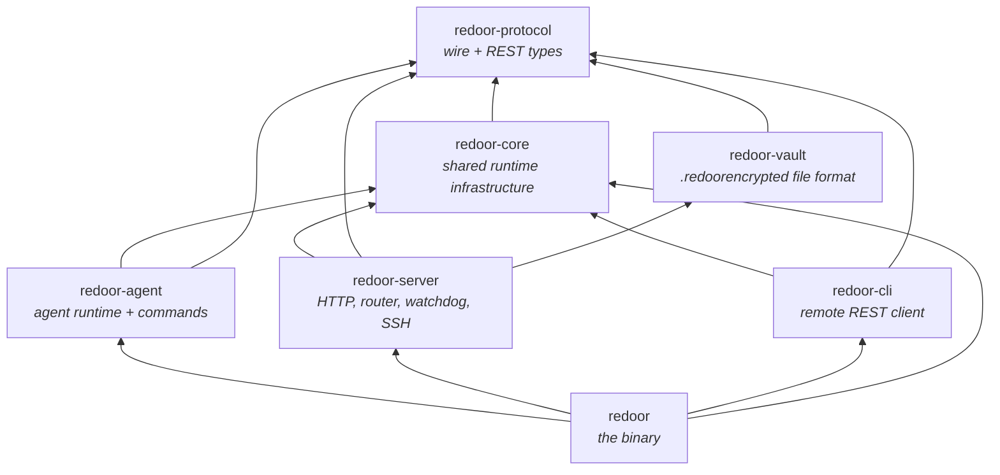

Arrows point from a crate to what it depends on (the binary uses `redoor-protocol` only in its
tests). Dependencies only go downwards, and the three role crates in the middle are siblings
that cannot import each other.

`redoor-agent` also links `libghostty-vt`, Ghostty's terminal emulator library, as the
headless emulator of persistent terminal sessions. Its build script builds Ghostty from source
with Zig (pinned in `mise.toml`, installed in CI by `mise-action`), clones a pinned Ghostty
commit and fetches a few Zig packages at build time, and for Android needs the NDK through
`ANDROID_NDK_HOME`. `.cargo/config.toml` sets `LIBGHOSTTY_VT_SYS_OPTIMIZE=ReleaseSafe`, so Zig's
bounds and overflow checks stay on in release builds (see "Authentication and trust").

Zig's standard library gives the binary native ELF thread-locals, which Rust code on Android
never has because Rust uses emulated TLS there. On arm64 Bionic refuses to start an executable
whose TLS segment is aligned below 64 bytes, and Zig aligns its thread-locals to only 8. So
`redoor-agent`'s build script links `bionic_tls_align.S` into arm64 Android builds: a single
64-byte-aligned thread-local, kept through `--gc-sections` by its retain flag and linked with
`+whole-archive` since nothing references it. The CI Android build fails if the TLS segment
alignment drops below 64 again.

### `redoor-protocol`

The contract between all parties, with no runtime dependencies (no tokio).

- `wire/`: the agent websocket protocol.
  - `handshake` holds the upgrade contract: the `redoor.v6` subprotocol, the agent endpoint
    path, the `426` body and the protocol-mismatch types the UI lists.
  - `agent_auth` holds the mutual proof of the agent token (see "Mutual token proof"): the
    nonces, the HMAC proofs of each step and their headers, shared by the agent and the
    server so both compute them the same way.
  - `ServerToAgent` and `AgentToServer` are the JSON control envelopes, one per direction,
    so each side's `match` is exhaustive. No frame except `hello` carries an agent id: the
    authenticated connection is the identity.
  - `Command` is the request payload. Its variants wrap the per-command structs in
    `request`, and each struct names its response type through the `AgentRequest` trait, so
    a command can only be answered (and decoded) as its own response.
  - `Command::policy()` is the single table that classifies every command: whether it
    streams bytes and in which direction, whether it is an upload, and how it is cancelled.
    Both the server and the agent read it, so they cannot disagree.
  - `stream` defines the binary frame (stream id, `FIN` flag, up to 64 KiB of payload)
    and the credit windows. `exec`, `log` and `terminal` hold the feature-specific wire types.
  - `registration` holds `AgentIdentity` and `AgentCapabilities`, which are flattened into
    the `hello` frame. The capabilities include `SystemdSupport` (available, or unavailable
    with a reason), which the REST agent projection exposes as `systemd`.
- `ids`: the strongly typed identifiers. `AgentId` is the stable device id (see "Device
  identity"); `validate_device_name` holds the device name rules.
- `api/`: REST request and response types grouped by domain (agents, auth, files,
  transfers, git, tokens, ...). `search` also holds the streamed search events and
  `FileSearchRanking`, the top-100 path ranking the agent, the server and the browser share,
  so the streamed matches reduce to the same list everywhere. `systemd` holds the systemd
  unit management bodies and the journal's NDJSON `SystemdJournalEvent`. Git is a directory with one module per feature area
  (`worktree`, `worktree_list`, `revision`, `commit`, `history`, `refs`), plus the vocabulary they share
  (including `GitPage`, the bounded offset and size every paged Git list uses), so later
  Git features (such as search) are added beside them rather than into one file.
- Types marked `#[ts(export)]` generate the TypeScript interfaces in `bindings/`, which the UI
  and the integration tests use, so REST JSON (and the wire types the browser shares, such as
  exec, log and terminal events) is checked from both sides. Agent-only wire types are
  covered by round-trip tests in the protocol crate and by the TypeScript fake agent.

### `redoor-core`

Infrastructure that more than one role needs:

- Configuration: serde parsing with a `validate()` pass, plus format-preserving edits through
  `toml_edit`.
- `RuntimeContext`: app name, `AppPaths` and websocket timeouts. It is built once in `main`
  and passed down instead of being read from process globals.
- Logging, behind a replaceable logger. A `tokio::task_local!` holds the signed-in user a
  task works for, and every record written inside it carries a `user` field (see "Logging
  the signed-in user" under "Authentication and trust").
- `rotating_log`: every log file a process owns goes through `RotatingLogFile`, which keeps
  it under its `log_max_size` (10 MB by default) so long-running processes on small
  devices cannot fill the disk. The size is checked when the file is opened and after
  every 100 messages, counted in memory so writes between checks cost nothing. An
  oversized file keeps the newer half of its lines. The file is compacted in place
  instead of renamed, so every open append handle keeps writing to the live log, and it
  is streamed in fixed chunks so rotation never loads the log into memory. A process-wide
  lock orders truncation against appends, because a relay writes one file from several
  writers.
- Filesystem safety: `safe_fs` (including `safe_rm_all`), `atomic_rename`, `destination`
  (symlink-safe placement and merges) and `staging` (self-deleting hidden staging paths with
  atomic name reservation).
- `stream_credit`: the per-stream flow-control primitives that both the agent and server
  transfer paths use.
- `directory_measurement`: one directory walk that yields content bytes and the predicted
  tar size. The agent uses it for download totals and directory sizes, and the CLI uses it
  for the percentage of local directory uploads.
- Process helpers (`process`, `subprocess::run_checked`), `bounded_tail`, `paths::home()`,
  binary identity and build information.
- `upgrade`: installing releases and restarting the processes of a replaced binary, shared by
  `redoor upgrade` and the server. `upgrade::install` embeds the repository's `install.sh`
  (`include_str!`) and runs it with bash; it is the only code that downloads releases.

### `redoor-vault`

The `.redoorencrypted` file format (see "Encrypted files"): preamble parsing and building,
the header MAC, and the STREAM payload as `EncryptingReader` and `DecryptingReader` adapters
over 64 KiB chunks, plus the size arithmetic in both directions. It is the only
implementation of the format and the only Rust code that handles file keys.

It is a crate of its own, not a core module, so only the roles that may hold file keys link
it: the server, and later a CLI command that opens files with a backup `vault.json` and no
server. `redoor-agent` cannot depend on it, so "agents only ever see ciphertext" is enforced
by the compiler, and the crypto crates stay out of the infrastructure every role builds.

### `redoor-agent`

The agent runtime and the implementation of every command.

- `runtime/`: the agent's single event loop.
  - `links`: the one connection and its three outbound lanes (control, interactive, bulk),
    with a generation number so events from a replaced socket are ignored.
  - `dispatch`: applies `Command::policy()` once per command. It handles admission,
    cancellation registration, spawning, logging and the response in one place.
  - `cancel`: a `CancellationToken` registry whose entries unregister themselves when dropped.
  - `responder`: typed outbound frames, including actions that must run after a frame was
    written (for example, re-exec after a restart response), and the `ResultLedger` that
    lets each request send exactly one result.
- `commands/`: filesystem, git, file search, content grep, metadata, host and systemd commands.
  - `git/`: one module per Git feature area on top of shared plumbing in `git/mod.rs` (the
    failure type, the blocking runner that interrupts gix when the request is dropped, path
    validation and repository discovery). `status` and `diff` read the worktree; `revision`
    resolves a user-supplied revision to a commit once per request; `tree` and
    `commit_diff` read committed history; `history` lists the commits that changed a path
    and `refs` lists branches and tags (see "Git history, branch and tag lists");
    `worktree_list` lists the main and linked checkouts of a repository and
    `worktree_status` counts the uncommitted changes of the visible rows' checkouts within a
    time budget; `file_bases` reads one file's staged and committed text for the editor's
    Git gutter (see "Editor buffers and open files"); `export`
    streams committed files and directory archives for downloads and copies (see "Git
    history downloads and copies"). All Git work runs in `spawn_blocking` and every
    response is bounded (entries, files, bytes per blob and per batch), because gix inflates
    whole objects and the reply is a single control frame. Object kinds and sizes are read
    from headers before inflating, commit diffs visit changes one at a time and stop at the
    file limit, and patch budgets count JSON-encoded bytes, since escaping can grow control
    characters sixfold inside the frame. Text patches carry their whole file
    (`full_context: true`) when the patch is at most 256 KiB, so the UI can expand context
    without another request. Each batch charges the default-context (3-line) patch to the
    8 MiB patch budget and only the extra unchanged lines to a separate 4 MiB context
    budget. Sending files whole therefore never turns a later file into `too_large`; a
    file whose whole patch does not fit falls back to default context.
  - `systemd/`: systemd unit management (see "Systemd units"): `scope` resolves and
    authorizes the requested manager and validates unit and user names, `process` builds and
    runs the systemd tools with a fixed environment, `parse` reads their text output and
    `journal` streams a unit's journal.
- `transfers/`: shared upload and download drivers.
  - `UploadSink` covers raw files, tar directories and file edits. `ByteSource` covers file
    ranges and tar archives.
  - Cancel and failure always run in the same order: stop, clean up, unregister, respond.
  - `stream` is the writer of every outgoing stream (request output, terminal and log
    streams), and the only place payload frames leave the agent. It waits for credit before
    each data frame; `FIN` spends none.
- `trash/`: a `TrashProvider` with freedesktop (Linux and Android/Termux), macOS and
  unsupported implementations.
- `platform/`: mounts, accounts and identity, which keeps OS-specific code out of the
  commands.
- `terminal/`: terminal sessions, which belong to the process rather than a connection (see
  "Terminals and live logs").
  - `registry`: `TerminalSessions` in `AgentServices`, every session of the process. It
    starts shells for `CreateTerminal`, closes them for `CloseTerminal` and signals every
    change, which the current connection reports as `terminal_sessions`.
  - `session`: the session task, which owns the PTY, mirrors its output and serves at most
    one attachment.
  - `emulator`: `ScreenMirror`, the `libghostty-vt` emulator on its own thread, and
    `pending_tail`, which keeps the bytes of an unfinished escape sequence for snapshots.
  - The module itself bridges one attach stream of the connection to a session.
- `logs`: live log streaming on one stream of the connection.
- `device_id`: the `<data_dir>/agent-id` file a standalone agent keeps its id in. Relayed
  agents (`--agent-id`) and managed daemons (id in their payload) never read or write it.
- `runtime::AgentRole` tells the three owners apart: a standalone agent never gives up, a
  relayed agent leaves recovery to its relay, and a managed daemon reconnects on its own
  and keeps an orphan clock (see "Managed agent lifecycle").
- `ManagedDaemon` prepares a managed agent's daemon from its launch payload; the `redoor`
  binary's `managed` module runs `redoor agent managed` around it (ensure step, report,
  session holder, `--stop`, `--remove`).

### `redoor-server`

- `http/`: Axum routes, auth (sessions, OIDC), access tokens (`http/tokens`), access control
  (`http/access`), the UI assets and MCP.
  - `agent_client`: `AgentClient::call` for any protocol request that is also an
    `AgentCall`, which adds its deadline; all deadlines are defined in one place.
  - `error.rs`: `ApiError`, which owns all HTTP status mapping.
  - `user_state` and `editor_buffers`: per-user files in `<data_dir>/users/<name>/` (the
    preference document and one file per open file's editor buffer), keyed by the
    session's login name.
  - `auth`: login verification (`[[server.users]]` passwords), sessions per login method and the password change; `auth_me` answers
    `GET /api/v1/auth/me`. `auth/password_logins` owns the password logins: the config file
    is their only source of truth, stat'ed on every login and session check and parsed again
    when its metadata changes, so hand edits apply without a restart and the password change
    only writes the file. A file that does not parse keeps the last good logins, and unchanged
    plaintext passwords keep their in-memory hash. The rest of the config is read at startup.
  - `vault` and `vault_files`: the vault REST API and the encrypted file routes (see
    "Encrypted files"). `vault_ssh_keys` lists and rewraps the SSH keys encrypted
    with the vault.
  - `ssh_keys`: the SSH key and host key routes, and unlocking an encrypted SSH key for a
    device Start (see "SSH device keys").
  - `git/`: Git REST handlers split by the same feature areas as the protocol, sharing
    path and revision validation in `git/mod.rs`.
  - `systemd`: the session-only systemd routes, thin adapters over the agent's systemd
    commands and, for the journal, an NDJSON `OutputStream` (see "Systemd units").
  - `services/`: `TransferService` (copy and move), `OutputStream` (downloads, diffs, exec
    and NDJSON event streams such as searches and journals), `AgentSearch` (path and content
    search) and `AgentUpload`. REST and MCP handlers are
    thin adapters over these.
- `actors/`:
  - `agent_ws` (in `http/`): the agent endpoint. It checks the bearer token and the
    subprotocol before accepting the upgrade, and remembers protocol-mismatched attempts
    for `GET /api/v1/protocol-mismatches`.
  - `session`: one actor per agent connection. It requires `hello` as the first frame,
    asks the router to accept it and bridges the socket to the router through bounded lanes.
  - `lanes`: the typed outbound lanes to one agent (priority, command, interactive and bulk)
    and the write tickets that let a cancel withdraw a command that is still queued.
  - `router/`: the single owner of agent registrations and in-flight work.
    - `flows`: one table where every request belongs to exactly one flow (command, output
      stream, upload or copy). Every flow except a one-shot command has an explicit phase
      enum.
    - `streams`: the data path. Payload frames go from the connection reader to consumers
      (HTTP bodies, copy forwarders, terminal and log bridges) without passing through the
      router.
    - Every router handler is synchronous (enforced by `clippy::unused_async`), so the
      router mailbox never waits on a peer.
- `terminals/`: the server's in-memory index of terminal sessions (see "Terminals and live
  logs").
  - `registry`: `TerminalRegistry` in `ServerState`, every session as its agent last
    reported it, plus which browser views each one and the closes still owed to agents
    that are away. Nothing is saved; a restarted server learns the sessions again from each
    agent's report.
  - `http/terminal_sessions` (list, create, delete) is a thin handler over the registry.
    `http/terminals` is the attach websocket: it takes the session's viewer slot and
    relays between the browser and an attach stream on the agent.
- `watchdog`: one supervisor per managed agent, which owns the session to its daemon, with
  restart backoff, a reconnect deadline, generation counters, the ensure report a `hello`
  must match and the pending stop of the daemon. `managed_session` reads a session's ensure
  report.
- `ssh/`: preparing remote hosts (OS and architecture probe, binary install), launching
  agents through SSH reverse forwards, and the standalone `relay`.
  - `transport`: `SshHost` with a `HostKeyPolicy` and an `AuthPolicy`. `build_ssh_command`
    is the only place that creates an `ssh` command, so no connection (probe, upload or
    agent session) can bypass the policies.
  - `shell`: every remote command reaches the user's login shell as a single-line
    `sh -c '<script>' sh '<arg>'...` of single-quoted words. The login shell may be fish or
    tcsh, so it only ever starts POSIX `sh`, and arguments such as agent names with spaces
    are never split or interpreted. Remote paths are literal except for a known home or data
    directory prefix (`~/`, `$HOME/`, `${XDG_DATA_HOME:-$HOME/.local/share}/`), which is
    expanded on the device.
  - `provision`: the probe, launch and upload scripts and the `Installer` that picks,
    uploads and verifies the binary. A binary upload is one session: a script creates the
    directory, writes a temp file, marks it executable and renames it into place.
  - `keys` (`SshKeyStore`), `encrypted_keys`, `held_keys` and `managed_keys`: per-device
    SSH keys (plaintext or encrypted with the vault), the decrypted keys the
    server holds for running devices, and pinned host keys, see "SSH device keys" below.
  - `ssh_agent`: the in-process ssh-agent (OpenSSH key agent protocol, not the redoor
    agent) through which `ssh` gets signatures from a managed key without ever reading it.
- `vault`: `VaultStore`, the shared `vault.json` with its proof checks and validation.
- `startup`: `ServerConfig::resolve`, then `ServerRuntime::build`, then
  `serve_until_restart`.
- `tls`: built-in HTTPS, see "Built-in HTTPS". `ServerCertificate` loads the operator's PEM
  files or creates the self-signed certificate, and `ServerListener` is the one listener type
  `axum::serve` runs on, plain or with TLS.

### `redoor-cli`

The `redoor remote ...` client. It uses `reqwest` against the REST API and authenticates
with an access token, and covers device inventory, copy (including tar archives), file
operations, exec and agent lifecycle (`login`, `logout`, `status`, `create-token`, `devices`,
`start`, `stop`, `exec`, `cp`, `mv`, `ls`, `stat`, `mkdir`, `rm`, `find`, `grep`). It only
depends on protocol and core, so it never links server or agent code.

The CLI and MCP offer roughly the same device operations. The difference is local files:
only the CLI streams files and tar archives between the local machine and a device; MCP
keeps file content inline and capped at 64 KiB.

- `credentials`: the token saved by `login` in `<data_dir>/remote-credentials.json` (0600,
  in a 0700 directory, never followed through symlinks). `REDOOR_REMOTE_SERVER` plus
  `REDOOR_REMOTE_TOKEN` override it, so CI jobs and AI agents need no saved login.
  `login --insecure-tls` skips certificate verification for a self-signed server and is
  saved with the token; `REDOOR_REMOTE_INSECURE_TLS` does the same for any credential source.
- `login`: `LoginFlow` behind a `Prompter` trait (dialoguer on a terminal, scripted answers
  in tests). Every prompt also has a flag, so the same command works in scripts.
- `progress`: the single redrawn stderr line of `cp`, shown only when stderr is a terminal so
  logs and pipes get no carriage-return noise. Directory transfers count file content bytes
  rather than tar or gzip bytes, because that is what the directory sizes (a local
  `directory_measurement` walk, or the agent's `directory-size` endpoint) report. The size
  walk runs beside the transfer, so a large tree starts moving at once and the percentage
  appears when the walk finishes.

### `redoor`

The binary crate. `main.rs` parses the CLI with clap and dispatches to a role. Every role
returns `anyhow::Result<ExitCode>`, and errors are printed once.

- `service/`: a `ServiceBackend` trait with systemd and launchd backends and one shared
  status formatter. The action set (`install`, `start`, `stop`, `restart`, ...) is one enum
  generic over its target, so the agent and server (no target) and relays (a relay ID) cannot
  drift apart. A relay service is `<app-name>-relay-<id>` and runs
  `redoor agent relay start <id>` in the foreground; its systemd unit is `Type=exec` because
  a relay retries SSH forever and never sends a readiness notification. `launchctl bootout`
  can return before launchd has removed the job, and a bootstrap in that window fails with
  status 5 or is silently discarded, so the launchd backend waits for the job and its process
  to disappear after every bootout, retries that conflict, and verifies the job is loaded.
- `process_control` and `process_logs`: PID files, stopping processes and reading logs.
  Every PID file is a JSON record with a top-level `pid`, a start time and the
  `BinaryIdentity` of the image that wrote it (relays add their launch metadata). The
  advisory lock, not the file, decides liveness. The process records its own build because
  after `redoor upgrade` the executable on disk no longer describes the one in memory;
  re-exec drops the close-on-exec lock, so the new image claims the file again and rewrites
  it. `status` prints that build and notes when it differs from the CLI's own. Bare-number
  files from older builds are still read so their processes can be stopped.
- `upgrade`: the `redoor upgrade` command on top of `redoor_core::upgrade`, plus the detached
  restart helper. See "Upgrading in place".
- The binary re-executes itself as the SSH askpass helper, so no second executable is
  shipped.

## Processes and connections

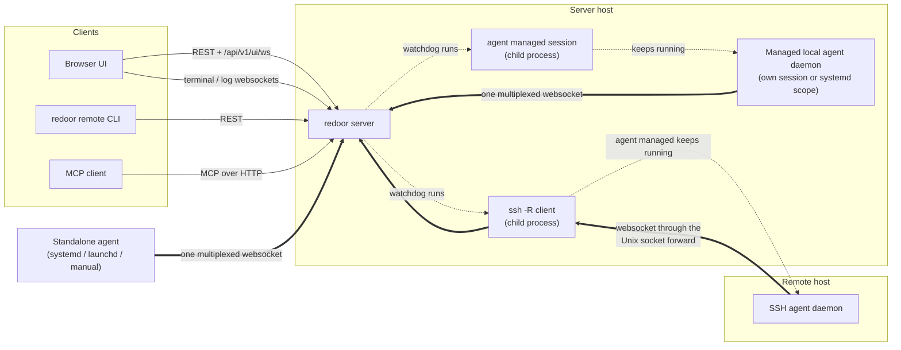

Agents always open the connections. The server never dials an agent, so an agent can run
behind NAT, on a phone (Termux) or on a host that is only reachable over SSH.

- **Standalone agents** are started by the user or a service manager, and connect to the
  server's `/api/v1/agent/ws` endpoint with the agent token.
- **Managed local agents** are `[[agents]]` entries in the server config. Each runs as a
  daemon that outlives the server; the watchdog runs a session (`redoor agent managed`) that
  keeps the daemon running and connects to the listener directly (see "Managed agent
  lifecycle").
- **SSH-backed agents** are also watchdog-managed daemons. The server's session is `ssh -R
  <socket>:localhost:<server-port>` running `redoor agent managed` on the device, and the
  daemon connects through that Unix socket. What looks like a local connection on the
  device reaches the server through the tunnel; the URL keeps `localhost:<server-port>` as
  its authority, `wss://` with built-in HTTPS (see "Built-in HTTPS"). The token travels in
  the launch payload on stdin and the password through askpass, so neither appears on a
  command line. A device can instead use a redoor-managed SSH key and a pinned host key
  (see "SSH device keys"). `redoor agent relay` starts a plain agent the older way, with a
  random TCP port forward, for agents of a remote server.
- **Browsers, the CLI and MCP clients** only use the REST API, the `/mcp` endpoint and browser
  websockets. They never talk to agents directly; the server translates each request into
  agent commands.

## Built-in HTTPS

`[server.tls]` makes the server terminate TLS itself, for private deployments without a
reverse proxy or a domain name. Without the table it serves plain HTTP, the default, since a
fresh install only listens on loopback.

- **Certificate.** `cert` and `key` are the operator's PEM files (read on every start, so a
  renewed certificate only needs a restart). `self_signed = true` instead makes the server
  create a key and certificate in `<data_dir>/tls/` on the first start (key mode 0600,
  written to temp files and renamed into place). The certificate names `localhost`, the
  loopback addresses, the hostname, a specific bind address and the primary LAN address. It
  is valid for 825 days and has the server-auth usage, because Apple platforms refuse server
  certificates without them even after a user accepted the warning. Later starts reuse it, so
  browsers keep the exception a user accepted; it is only replaced when a file is missing or
  it expires within 30 days (checked by verifying it against itself with rustls, so no X.509
  parser is needed). Startup logs the certificate's SHA-256 fingerprint so users can compare
  it with the one the browser shows. The restart route loads operator files before shutting
  down, so a wrong path cannot take the server down.
- **Listener.** `ServerListener` owns the TCP socket and runs each handshake in a task of its
  own (10 s timeout), so a client that connects and stays silent cannot stop the accept loop.
  Dropping the listener on restart closes the port and aborts pending handshakes. TLS offers
  only HTTP/1.1 through ALPN, like browsers use over plain HTTP: over HTTP/2 browsers would
  open WebSockets with extended CONNECT, which the `get` WebSocket routes do not accept.
- **Cookies** are always `Secure` with built-in TLS; `cookie_secure` is for proxies.
- **Remote CLI.** `redoor remote` verifies the certificate unless `login --insecure-tls`
  (saved with the token) or `REDOOR_REMOTE_INSECURE_TLS` turns it off.
- **Agents.** A standalone agent verifies the server certificate unless `--insecure-tls`
  (`REDOOR_AGENT_INSECURE_TLS`, `[agent] insecure_tls`) turns verification off, for
  self-signed servers. The UI's agent config snippet adds `insecure_tls = true` when the
  server uses its self-signed certificate. Managed agents (local and SSH) always connect to
  `localhost`, so no certificate can match the name they use; the server starts them with
  `--insecure-tls` (`LocalServerEndpoint`). That loses nothing over the plain
  `ws://localhost` they use without TLS, because their traffic is on loopback or inside the
  SSH tunnel until it reaches the server. Insecure mode still verifies the handshake
  signature, only the certificate's trust, name and dates are skipped. A server reached in
  insecure mode still has to prove the agent token before the agent says `hello`, and never
  learns the token itself (see "Mutual token proof").

## One connection per agent

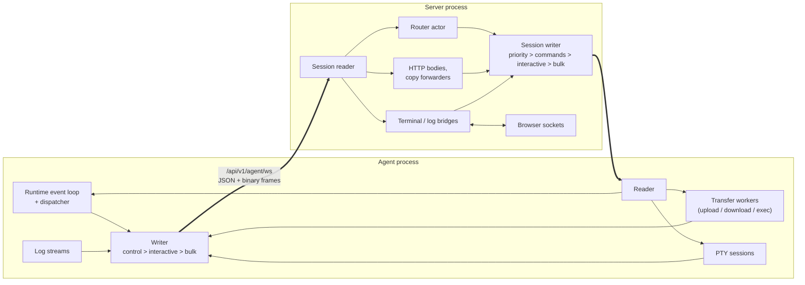

Each agent keeps exactly one websocket to the server, at `/api/v1/agent/ws`. It carries:

- **Text frames**: JSON control messages (`ServerToAgent` / `AgentToServer`).
- **Binary frames**: stream data. Each frame is an 8-byte stream id, a flags byte (only
  `FIN`, which marks a successful end; failures are reported by the result) and up to 64 KiB
  of payload. Unknown flags are rejected.

Every stream has a `u64` id allocated by the server from the same router-wide counter as
request ids, and each id is interpreted per connection:

| Stream | Opened by | Data direction |
|---|---|---|
| Request output (download, exec output, copy source) | `command` | agent → server |
| Request input (upload, edit, archive upload, copy destination) | `command` | server → agent |
| Terminal attachment | `terminal_attach` | both |
| Log stream | `log_stream_open` | agent → server (NDJSON events) |

**Scheduling.** Each side has one writer that drains its lanes in strict order:

1. control frames (on the server: the priority lane first, then the command lane);
2. interactive frames: terminal input and output;
3. bulk frames: every other stream. The bulk lane holds a single frame, so producers wait in
   the lane's fair queue and streams that have data and credit take turns frame by frame.

Because no data frame exceeds 64 KiB, a control frame never waits behind more than one data
frame. Terminal frames go ahead of downloads, so typing stays responsive during transfers.
One TCP connection does mean one congestion window: a slow network is shared by all of an
agent's streams. `tests/raw-upload-toxiproxy.test.ts` and `tests/stream-isolation.test.ts`
keep that trade-off visible.

**Readers never wait on consumers.** The reader on each side hands binary frames straight to
the stream's bounded queue with `try_send`. Every stream is credited, so an honest peer can
never overfill it; an overflow fails only that stream.

**Memory bound.** A stream's receiver holds at most its credit window plus the final frame:

| Stream | Window | Per connection |
|---|---|---|
| Output streams (downloads, exec) | 4 frames | at most 32 concurrent ordinary commands, enforced by the agent |
| Upload streams (uploads, edits, copy destinations) | 4 frames | at most 32, enforced by the server's router |
| Terminal attachments | 16 frames each way | at most 8 |
| Log streams | 4 frames | at most 8 |

So the worst case per connection is roughly (streams × (window + 1) × 64 KiB), for example
8 attachments × 2 directions × 17 frames × 64 KiB ≈ 17 MiB for a terminal-heavy agent, and
64 × 5 × 64 KiB ≈ 20 MiB for transfers. On top of that the server reads one websocket
message at a time, capped at 32 MiB (a control result such as a git diff batch can be a few
MiB; data frames are at most 64 KiB).

## Stream credit

Credit is the per-stream flow control that lets many streams share one websocket without a
slow consumer holding up the others.

**Why it exists.** All of an agent's streams share one socket, and each side reads it with a
single reader. Without credit, a reader holding a frame for a consumer that is not ready (a
browser downloading slowly, a copy destination on a slow disk) has two bad choices. It can
buffer without limit, which breaks the memory bound. Or it can stop reading the socket, which
freezes every other stream and the control frames behind them. TCP flow control does not help,
because it applies to the whole connection, not to one stream.

**The rule.** A sender may put a data frame on a stream only when it holds credit for that
stream. One credit is one frame (up to 64 KiB). The receiver hands credit back with a
`credit {stream, frames}` control message once its consumer has drained frames.

- **Window**: the most credit a stream can hold. It is 4 frames for transfers and 16 for
  terminals. Grants beyond the window are clamped, so a misbehaving peer cannot make the other
  side buffer more.
- **Batching**: receivers return credit 2 frames at a time, so grants stay rare. The batch is
  smaller than the smallest window, so a drained receiver never holds back all of the sender's
  credit.
- **Grants travel as control frames** (on the server's priority lane and the agent's control
  lane), so they never wait behind data.
- **`FIN` is free.** The receive queue keeps one extra slot for it, so a stream can always end,
  and its result can always follow, even when the consumer has stalled.
- **Initial credit**: output streams get their full window in the command frame, so they start
  without a round trip. Uploads start at zero, and the agent's first grant also says that its
  worker is ready.

**What it buys.**

- The receiver knows the sender can have at most a window of frames outstanding, so the
  reader drops each frame into that stream's bounded queue with `try_send` and never waits.
  The socket keeps being read, so control stays responsive.
- Backpressure goes all the way through. A stalled HTTP client stalls only the agent producer
  for its own download. A copy returns credit to the source only after the destination has
  accepted the frame.
- Memory is bounded per stream at window + 1 frames (see the table above).
- Sending without credit is a protocol violation for that stream only. The stream fails and
  the connection keeps going.

**Where it lives.** `redoor-protocol::wire::stream` defines the window and batch constants and
which frames spend credit. `redoor-core::stream_credit` holds the two primitives. On the sender
side, `CreditGate` is a semaphore of frames: producers wait on it before each data frame, and
incoming grants refill it. On the receiver side, `CreditLedger` counts drained frames and
produces the batched grants. Each side has one place that spends credit: the agent's
`transfers/stream` writer, and the server's `OutboundStream`, which upload producers, copy
forwarders and terminal input all send through.

## Connection setup

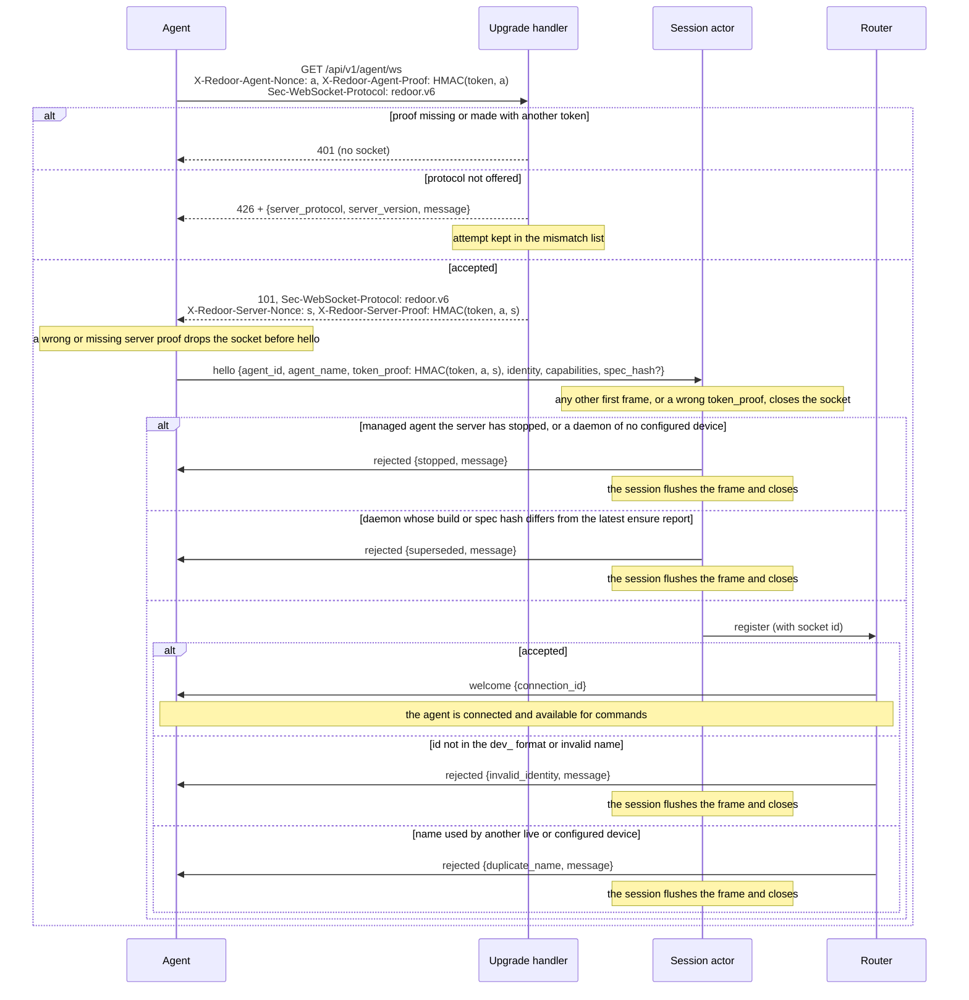

- **Authentication and negotiation happen during the HTTP upgrade.** A client without the
  token or with an incompatible protocol never gets a socket, so no session state exists for
  it. The `hello` only finishes the mutual token proof (see "Mutual token proof"). The agent
  treats `401` (wrong token), a server that cannot prove the token and `426` (other protocol
  version) as needing an operator: a standalone agent logs a clear error and keeps retrying
  at the slowest backoff step, so it connects once the token or the server is fixed, and a
  managed daemon does the same while its orphan clock runs; a relayed agent exits and leaves
  the retry to its relay (see "Connection recovery").
- A refused protocol mismatch is remembered, so a standalone agent of another release shows
  up in the Devices view instead of only in its own logs. Managed daemons are replaced with
  the server's own binary before they talk to it, so they only mismatch in the moment
  between a server upgrade and the ensure step (see "Upgrading in place").
- **A daemon is never an external device.** A `hello` with a spec hash is a managed daemon's;
  without a supervisor for its id (a deleted device whose cleanup missed it, another server
  sharing the token) it is rejected as `stopped`, which ends it, instead of being listed as
  a standalone agent. There is no
  compatibility with earlier protocols: an agent and a server must speak the same
  `redoor.vN`.
- **Identity is the connection.** `hello` is the only frame that names the agent; every later
  frame is attributed to the session that received it. A second `hello` closes the socket.
- **Request ids are interpreted per connection.** The server allocates them from one
  router-wide atomic sequence shared by the router and its `RouterHandle` (so a client can
  pick an id before sending), and the router indexes flows by agent and request id, so a frame can
  only resolve work that was sent to its own connection.
- A reconnect of the same agent id replaces the old connection, which receives `evicted`.
  A *different* agent id that claims the name of a live or configured device is `rejected`
  with `duplicate_name`. See "Device identity" for the id format and cloned agents.
- Every connection gets a **socket id**. The router only accepts frames and unregistrations
  from an agent's *current* session, so a slow-dying old connection cannot remove the agent
  that replaced it after a reconnect.
- **Credit is mandatory.** Every stream in both directions is credited; there is no
  capability flag and no uncredited fallback.
- On the agent side, each link has a **generation** number. Timers and tasks from a replaced
  connection carry the old generation and are ignored.

### Mutual token proof

The agent token never crosses the network. Each side proves it knows the token with an
HMAC-SHA256 keyed with it, over a domain-separation label per step and fresh random nonces
(`redoor-protocol::wire::agent_auth`):

1. The upgrade request carries the agent's nonce `a` and `HMAC(token, "redoor agent upgrade", a)`.
   The server answers `401` without it.
2. The `101` answer carries the server's nonce `s` and `HMAC(token, "redoor server", a, s)`.
   The agent checks it before it sends anything, and drops the socket otherwise.
3. The `hello` carries `token_proof = HMAC(token, "redoor agent hello", a, s)`. The session
   closes the socket before registering anything otherwise.

Why it works this way:

- **Agents refuse servers that do not know the token.** Before, the agent sent the token
  as a bearer header, so any server it was pointed at (a typo, stale DNS, a spoofed address,
  or anyone on a plain-HTTP or `insecure_tls` path) learned the token and could command the
  agent. Now such a server gets neither the token nor a `hello`, and its commands are never
  read. This works the same over plain HTTP, built-in HTTPS and behind a TLS reverse proxy,
  because it does not depend on TLS reaching the redoor server.
- **The agent proves itself first, in the upgrade.** That keeps the `401` before any socket
  exists and keeps unauthenticated clients out of the mismatch list, and it means the server
  never hands its proof to someone who does not hold the token. The first proof covers only
  the agent's nonce, so a captured request can be replayed to get a socket; the `hello` proof
  over the server's fresh nonce is what makes the replay useless, and the hello timeout bounds
  how long such a socket lives.
- **Each step has its own label,** so no proof can be reflected back as another step's.
- **Limits.** The frames after the handshake are not bound to it, so without TLS an active
  man in the middle can relay the proofs to the real server and then read and inject frames;
  only end-to-end TLS with certificate checks stops that. The token is shared by every agent,
  so whoever holds an agent's token can also pass as the server to other agents. A weak,
  hand-picked token can be guessed offline from captured proofs; generated tokens are 256
  random bits.
- **Older agents** send the token as a bearer header and no proof, so this server answers
  them `401`: a standalone one logs that the token was rejected and retries at the slowest
  pace, and a supervised one exits to its owner. They do not show up in the mismatch list,
  because authentication comes before protocol negotiation. Managed agents are provisioned
  with the server's binary and are unaffected. A new agent pointed at an older server also
  gets `401`, since that server still expects the bearer token.

## Device identity

Every device has two identifiers with different jobs:

- **The id** (`AgentId`, `dev_` followed by 20 random lowercase base32 characters, 100 bits)
  never changes for the device's lifetime. Everything stored or used internally refers to
  it: router keys, watchdog supervisors, token scopes, resume manifests, MCP operations and
  `config.toml`. The `dev_` prefix only makes ids recognisable in logs and URLs, like
  `redoor_at_` on access tokens.
- **The name** is for people. It is shown in the UI and used to address a device in URLs,
  the REST API, MCP and the CLI, but it is never stored as a reference. Renaming a device
  changes only the name, so nothing else has to be rewritten.

The name used to be the identity, which meant a token scoped to `pi` silently lost access
when `pi` was renamed, and gained access to whichever device was later called `pi`. Keeping
stored references on ids removes that escalation.

**Who owns the id** depends on whether the server has a config entry for the device:

- **Managed agents (`[[agents]]`): the server.** The id is `id = "dev_..."` in the entry,
  generated when the device is added through the UI or API and passed to the spawned agent
  with `--agent-id`. Hand-written entries without an id get one at startup, written back
  with the same formatting-preserving rewrite agent edits use. If the file cannot be
  written (read-only mount, other owner), startup fails and prints a ready-to-paste
  `id = "dev_..."` line per entry; an id kept only in memory would change on every start.
  The server owns these ids because several entries can target the same `user@host` (and
  share its data dir), because it needs the id before the first connection, and because
  wiped remote state must not change the id. The edit handlers copy the id from the stored
  entry: a request never carries it, and dropping it would assign a new id on the next
  start.
- **Relays (`[[relays]]`): the relay.** The entry's `agent_id` is assigned like a managed
  id when `redoor agent relay start` runs and passed to the remote agent with `--agent-id`.
- **Standalone agents: the agent.** On first start it creates `<data_dir>/agent-id` (0600,
  written to a temporary file and published with a no-replace rename) and reuses it later.
  Deleting the file makes the agent appear as a new device, which is how a cloned machine
  gets its own identity.

Every programmatic rewrite of `config.toml` (id write-back at server or relay startup, and
the add, edit and delete routes) holds an exclusive `flock` on `.config.toml.lock` next to it
from read to replace. Each writer replaces the whole file, so a writer working from an older
read would otherwise drop another's change, such as an id already in use. The id write-back
first checks without the lock, so a read-only deployment whose entries all have ids never
creates the lock file.

Duplicate ids in `config.toml` (a copied block) fail parsing for every role and name both
entries. `hello` carries the id and the name in separate fields; the router rejects a
`hello` whose id is not in the id format or whose name breaks the name rules
(`invalid_identity`).

**Names** must not be empty, must not contain `:` (the CLI's `device:path` separator) or
`/` (URL paths), and must not be in the id format, because requests accept either and an
id-shaped name would be ambiguous. Names are unique: `[[agents]]` names are checked at
startup and before restarts, creating or renaming a device to a taken name is refused, and
a different id claiming the name of a live or configured device is rejected. A create or
rename reserves the new name in the router before it stops the agent and rewrites the
config, and `hello` treats a reserved name as taken, so a standalone agent cannot claim the
name in that window; the reservation is dropped when the edit finishes. A new
standalone agent may take the name of a disconnected standalone agent; the stale inventory
row is dropped so the name still points at one device. Uniqueness is not a security
property, since access control works on ids.

**Name-or-id resolution.** Every request value that addresses a device accepts a name or an
id: an exact id wins, otherwise the name is matched (`RouterMsg::ResolveDevice`). It happens
once, before access control:

- The access middleware resolves the `{agent}` path parameter and stores the id as the
  `ResolvedDevice` extension; handlers take the device from there and never read the raw
  parameter. It runs after authentication, so anonymous callers cannot probe names.
- Handlers with devices in the body (copy, move, diff, partials) and MCP tools resolve their
  device fields before calling `Principal::require`.
- Token scopes are resolved when a token is created or edited and stored as ids, so a scope
  stays tied to its devices and does not follow a name.

Addressing by name is intentional: a script that uses `pi` follows whichever device is
called `pi` now, so a device can be swapped by renaming. Scripts that must stay on one
device use its id. An unknown value is `404 Device not found`; the CLI then lists the
available devices with their names and ids.

**Cloned standalone agents.** Copying a home directory or an image with a baked-in data dir
copies the id file, so several machines report the same id, and since a reconnect replaces
the old connection, the clones would evict each other forever. Hostnames cannot tell clones
from reconnects (clones usually keep them), so the router detects the eviction loop itself
(`router/duplicate_ids.rs`):

- Each session owns a `ConnectionActivity` clock (`actors/activity.rs`) that it updates on
  every inbound frame; the stale check reads the same clock, and the router reads it
  directly when a `hello` arrives, so heartbeats never pass through the router mailbox. A
  connection is healthy while its last frame is no older than `min(2 × keepalive,
  stale_timeout)`: both ends ping every keepalive period, so a live link always delivers a
  frame within two periods.
- Only a `hello` that would replace a *healthy* connection of the same id counts. A real
  reconnect replaces a dead or dying connection, once, and is never counted.
- The third counted replacement within 60 seconds still goes through and starts the
  conflict: while the current connection stays healthy, every newcomer for that id is
  rejected with `duplicate_id`, and the device carries a `duplicate_id` warning with the
  hostnames of the competing `hello` frames. If the current connection goes silent, the next
  newcomer gets through.
- The warning clears after 60 seconds without any competing `hello`, rejected ones included;
  counting only replacements would clear it while a clone is still retrying and restart the
  loop once a minute. The router's periodic tick does the clearing.
- A rejected agent logs how to fix it (delete `<data_dir>/agent-id` on one machine, or check
  for duplicate config ids when it was started with `--agent-id`) and retries with its normal
  backoff, so a fixed clone, or a real reconnect after the current connection died, gets
  through. Other rejections make a relayed agent exit, so its relay shows the problem and
  restarts it; a managed daemon exits only on `stopped` and `superseded`; a standalone agent
  retries them at the slowest backoff step.
- On `evicted`, managed daemons and relayed agents exit as before, so a process the server
  replaced or stopped does not linger. A standalone agent holds the single-instance lock on
  its data dir, so being replaced means another machine has its id; it reconnects with
  backoff instead, otherwise the loop would end before the router could detect it.
- The agent still handles a `rejected` or `evicted` frame that arrived just before the
  server closed the socket, even if it notices the connection loss first.

Managed agents get their id from their own config entry, and duplicate config ids fail
startup, so in practice this only affects standalone agents. Like every agent check, it
trusts self-reported behavior.

## Connection recovery

redoor tries hard to keep every agent connected and never gives up on one that should run.
Each connection has exactly one owner of its recovery, and all owners retry on the same
schedule, `redoor_core::backoff::Backoff`: 1 s doubling to a 30 s cap, each wait drawn from
the upper half of its step so agents that lost the same server spread out without ever
waiting past the cap. The schedule starts over only after a connection stayed up for 30 s,
so a peer that accepts and drops at once is not retried at the shortest delay forever.

- **Standalone agents own their connection.** The agent pings the server every keepalive
  period and drops the socket after `stale_timeout` without any inbound frame; the server
  pings too, so a live link is never silent that long. The reader, writer and liveness monitor
  share a shutdown signal; only the task that first sets it reports connection loss, so
  reader cleanup cannot replace a stale-connection diagnosis with a generic end-of-stream.
  The agent then reconnects on the backoff.
  It never exits on its own: refusals that only an operator can fix (`401`, `426`, a
  `rejected` hello) are logged and retried at the cap, because a standalone agent has
  nobody to restart it.
- **Relayed agents leave recovery to their relay.** An agent started with `--agent-id` by a
  relay reconnects through its tunnel only for `stale_timeout`, then exits; it also exits on
  a refusal, an eviction or the end of its stdin (`--exit-on-stdin-eof`). The tunnel may be
  dead in a way only a new SSH session fixes, and the exit ends that session, which the
  relay notices at once.
- **Managed daemons reconnect on their own** like standalone agents, because they outlive
  SSH sessions and server restarts: the next session's forward appears at the same socket
  path, and a local daemon reaches the listener directly. `SIGUSR1` from the ensure step
  makes a daemon drop whatever connection it still believes in and connect at once with
  the backoff reset; the ensure step sends it only when the server has no socket from the
  daemon, so a healthy connection is never disturbed. A daemon exits on `stopped`,
  `superseded`, an eviction, or after its orphan limit (24 h, `orphan_timeout` in its
  payload) without an accepted connection. The orphan clock runs only while the daemon has
  no accepted connection and uses wall-clock time, because the monotonic clock stops while a
  phone or laptop sleeps.
- **The watchdog owns the session to a managed daemon.** Server-side, the session actor
  pings the daemon and asks the watchdog to drop the tunnel after `stale_timeout` of
  silence; the daemon is kept. A session whose daemon stays without a connection 60 s after
  the session started or after its socket closed is dropped, and the next cycle replaces
  the daemon (`replace` in the payload), because a running process (a wedged daemon, an
  `ssh` whose remote side hangs) is no proof the daemon comes back. Every new cycle waits on
  the backoff.
- **Relays own their SSH session** and relaunch it on the backoff whenever it exits. They
  cannot see the agent's socket, so liveness comes from both ends of the session: ssh runs
  with `ServerAliveInterval=10` unless the user's config sets one, which ends a session over
  a dead network in about 30 s, and the remote agent exits when the tunnel stops reaching
  the server.
- The only wait without a timer is a locked SSH key: no retry can unlock it, so the agent
  stays `Starting` with the issue shown until a Start or Retry brings the key (see "SSH
  device keys").
- `REDOOR_RECONNECT_DELAY` replaces the agent's backoff with a fixed delay so tests do not
  wait for it; the watchdog and relays always use the real schedule.

## Managed agent lifecycle

Managed agents are the `[[agents]]` entries in the server config: local agents and
SSH-backed agents. Each runs as a daemon on its device, which outlives SSH sessions and
server restarts (in-place re-exec, `systemctl restart`, a crash), so its shells do too. The
server's watchdog only runs the *session* to it. Standalone agents manage themselves.

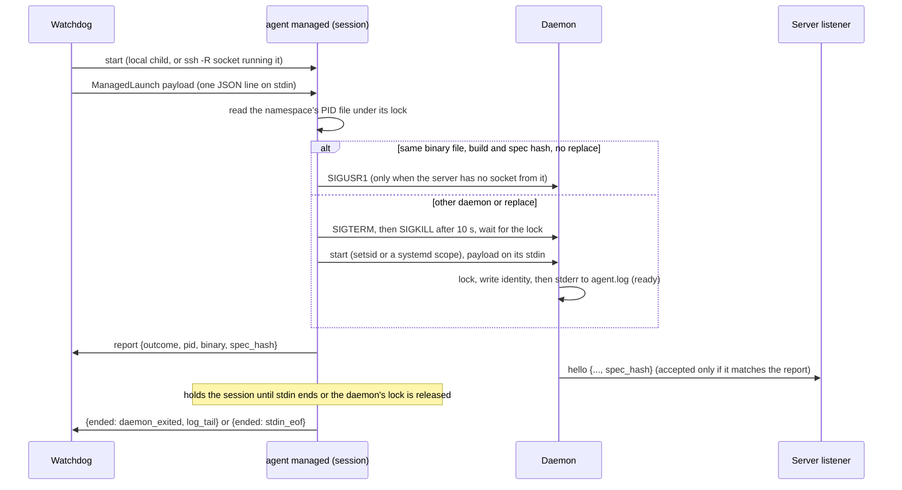

- **One namespace per device.** A daemon runs with `--app-name <server app name>-<agent id>`
  (for example `redoor-dev_k3j…`). Keying by id instead of by server keeps several entries on
  one `user@host` apart, and gives every daemon its own PID lock, identity, `agent.log`,
  config dir (no accidental pickup of a standalone `config.toml`) and partial uploads, plus
  a stop command for free (`redoor --app-name <ns> agent stop`). Binaries stay shared under
  the server's own app name.
- **`redoor agent managed`** reads the payload (`ManagedLaunch`: token, id, name, server URL,
  TLS setting, home, connect address, orphan limit, `replace`, `server_connected`; at most
  16 KiB), runs the ensure step, prints one report line and holds the session. It keeps a
  daemon only when the daemon's recorded `BinaryIdentity`, install path, executable file
  identity (device, inode, size, modification time of the file it started from) and spec
  hash equal its own: it was just executed from the expected binary, so its own identity is
  the expected one. The build identity alone misses debug rebuilds, which keep the identity
  and date at the same path; every cargo build and every `install.sh` rename produces a new
  file. The spec hash covers every daemon setting, with the token only as a SHA-256
  fingerprint, so a changed name, home or token restarts the daemon; the token is never
  written to disk.
- **The PID lock is the only liveness proof.** A PID is trusted only while its lock is held,
  because the kernel releases an `flock` when its holder dies; the lock descriptor is
  `O_CLOEXEC`, so a shell can never inherit it and make a dead daemon look alive. Waiting
  for a stopped daemon is a blocking `flock` on a dedicated thread: it cannot be cancelled,
  but it always returns, since `SIGKILL` makes the kernel release the lock, and the thread
  closes its descriptor before the next daemon starts. The holder ends with
  `std::process::exit`, so that thread never keeps it alive.
- **Starting a daemon.** The daemon is the same binary with `--serve`. It gets the payload on
  its stdin pipe (closed after writing), and its stderr stays piped to the session until it
  holds the lock and wrote its identity; it then points stderr at its `agent.log`, so end of
  file means ready, and an early exit leaves its error for the report. It keeps nothing of
  the SSH channel: its stdin, stdout and stderr are `/dev/null`, `/dev/null` and the log. It
  starts in a new session (`setsid`). A local daemon of a server running as a systemd
  service starts in its own transient scope instead (`systemd-run --scope [--user]
  --unit=<ns>-<random> --collect -p KillMode=process`), because a scope leaves the server's
  cgroup, so `systemctl restart` of the server does not kill it. A scope runs the command as
  a child of `systemd-run` itself, so it keeps the pipes and the environment. `KillMode=process`
  and stopping daemons by PID (never `systemctl stop`) keep processes a user started from a
  shell (`tmux`, `nohup`, the `redoor upgrade --restart-pids` helper) alive when a daemon is
  replaced, and the unique unit name keeps such leftovers from blocking the next start. The
  manager is read from the server's cgroup, not `INVOCATION_ID`, which every descendant of a
  service inherits; without a service, or when the scope cannot be created, `setsid` is used.
  A system service running as `redoor` may not create system scopes, so the server units
  `redoor server systemd install` writes use `KillMode=process`: a restart stops only the
  server, and its session processes end with it because their stdin closes. The server
  cannot rewrite an older system unit, so with managed agents configured it warns at startup
  when its unit still uses `KillMode=control-group`.
- **Logs live on the device**, in the namespace's `agent.log`; live logs still come over
  `log_stream_open`. The PTY shells and exec commands never inherit `REDOOR_AGENT_TOKEN`.
- **States** are `AgentConnectionStatus`. A managed agent moves between `Stopped`, `Starting`,
  `Connected` and `Stopping`. `Disconnected` is only used for standalone agents. A managed
  agent whose socket drops goes back to `Starting`, because the watchdog is already bringing
  it back. A local daemon may stay connected while its session is replaced, and the device
  then stays `Connected`.
- **The server starts no device on its own.** Desired-running lives in memory only, and
  every supervisor starts `Stopped`. Starting a device is the user's decision: an SSH
  device with a vault-encrypted key cannot even be started before a browser unlocks the
  vault, and a server that reconnected devices by itself would hold their keys in a state
  nobody chose. A local daemon that outlived the previous server process needs no tunnel,
  though, and reconnects by itself; its device is **adopted**: the `hello` starts it as if
  the user had pressed Start, and the cycle's ensure step keeps or replaces the daemon like
  any start. The adopting `hello` publishes its socket and queues `Start` and `Connected`
  under one lock, so the cycle sends `server_connected = true`; otherwise the ensure step
  would `SIGUSR1` the kept daemon into a reconnect that drops the terminals clients reattach
  after the restart. Refusing it as `stopped` would end the daemon and its shells. Only a device
  nobody started or stopped in this server process (its first attempt generation is still
  current) is adopted, so a Stop is never undone. An SSH daemon cannot connect without the
  session's tunnel, so an SSH device stays `Stopped`, its daemon and shells waiting on the
  device (until its orphan limit), until the user's Start keeps that daemon. The trade-off:
  a stop that never reached a local daemon (the server died right after Stop) is undone by
  the adoption after the restart.
- **Actions**:

  | Action | Endpoint | Effect |
  |---|---|---|
  | Start | `POST /api/v1/agents/{agent}/start` | Marks the agent desired-running; the supervisor runs its session. A vault-encrypted SSH key's file key may come with it (see "SSH device keys") |
  | Disconnect | `POST /api/v1/agents/{agent}/shutdown` | Drops the session and acknowledges at once, then stops the daemon on the device (`Stopping`, retried on the backoff with the issue shown) |
  | Retry start | `POST /api/v1/agents/{agent}/retry-start` | Abandons the current attempt and starts a fresh one with the backoff reset. Takes the same optional SSH key file key as Start |
  | Restart | `POST /api/v1/agents/{agent}/restart` | For a managed device, a new cycle with `replace`; a daemon started from a payload cannot re-exec itself, since its stdin is closed and exec would release its lock. A standalone agent re-executes itself |

- **Session events.**

  | Event | Result |
  |---|---|
  | Session ends | Tunnel lost. The issue comes from the end line (daemon died: its log tail), else from SSH's stderr. New cycle on the backoff. |
  | No connection 60 s into a session or after a disconnect | The session is dropped and the next cycle replaces the daemon. |
  | `Stale(socket)` | Drops the session only. A repeat failure reaches the deadline above. |
  | Stop | Drops the session, acknowledges, then stops the daemon (`agent managed --stop`). The pending stop lives in memory only; after a server restart a local daemon it missed reconnects and is adopted, and an SSH one ends at its orphan limit. A device whose daemon this process neither adopted nor sent a payload to stops at once. |
  | Delete | Stops the session; a background task then runs `agent managed --remove` once (stop, then `safe_rm_all` of the namespace's data, cache, config and root log dirs), so an unreachable device cannot block the delete. |
  | `hello` that differs from the latest report | `rejected { superseded }`; the daemon exits, its session sees the lock released, and the next cycle starts the expected one. |
  | Server restart or shutdown | Drops the sessions only (`detach_all`). The server never stops daemons on its own shutdown. |

- **Registration before the report.** A daemon can connect before the current cycle has a
  report: a local daemon reconnects on its own, and an SSH forward exists before the remote
  command prints anything. Such a `hello` is accepted provisionally. When the report
  arrives, the supervisor compares it with the connected daemon's build and spec hash and
  ends a mismatching connection with `superseded`. A `hello` after the report is checked at
  once. The check compares with the latest report, not with the server's own identity:
  otherwise `redoor upgrade --no-restart`, which leaves the old server running while the
  path holds the new binary, would reject every daemon started from that path and start it
  again forever.
- **Credentials for the stop.** Stop, configuration changes and delete release the device's
  held SSH key. The stop (and the delete task) is prepared first and captures the
  connection, key included, which it drops when it finishes or gives up. A configuration
  change keeps the id and with it the namespace, so the new entry's first ensure step
  replaces the daemon through the spec hash; only a change of target, user or SSH port, which
  may reach another device or account, stops the old daemon with the old settings, in the
  background once the old supervisor is gone (removing the supervisor would cancel a stop
  it ran itself).
- **SSH sessions.** One session per cycle: the launch script probes and installs as below,
  then `exec`s `<bin> --app-name <ns> agent managed --session-socket <socket>` with
  `-R <socket>:localhost:<server port> -o StreamLocalBindUnlink=yes -o ExitOnForwardFailure=yes`.
  sshd keeps a forward's socket file after the session ends (its own `StreamLocalBindUnlink`
  is off by default), so the next session could not bind the same path: every SSH session
  listens on a path of its own, `<dir>/<ns>-<random>.sock`, and its `agent managed` points
  the stable `<dir>/<ns>.sock` symlink at it (with a rename) and removes the sockets earlier
  sessions left. The daemon only knows the stable path, so its spec hash never changes
  between sessions. OpenSSH sends the `-R` path to sshd literally, before the remote command
  runs, so remote variables cannot be used in it: the directory (`$XDG_RUNTIME_DIR`, else
  `$TMPDIR`, else `/tmp`) is resolved once with a short session and kept in memory, and
  `/tmp` is used when a path would exceed the ~104-byte socket limit. A failed forward
  forgets the cached directory and shows an issue naming sshd's `AllowStreamLocalForwarding`
  and `DisableForwarding`. There is no TCP fallback.
- **Caveats.** `KillUserProcesses=yes` in the device's `logind.conf` ends daemons at logout,
  and sshd configurations that forbid stream-local forwarding are not supported.
- **SSH provisioning runs on every attempt**, so the UI always shows current results. The
  session is started by a launch script that first reports the OS, architecture and version
  of the binary at the managed install path, and `exec`s it only when the version matches
  this server. A device with a current binary therefore starts in one SSH session.
  Otherwise the script exits without starting anything, the server uploads the matching
  release from the local cache and starts again, and that second report verifies the
  upload. Server-managed devices always use the managed install: an operator-installed
  `remote_bin` (and a configured `home`) exists only for relays.
- **Install directory and `noexec` mounts.** Installs live in
  `<root>/<app-name>/binaries`, where the root is `${XDG_DATA_HOME:-$HOME/.local/share}`
  unless the device sets `install_dir`. That setting exists because some systems, TrueNAS
  for one, mount the home directory `noexec`: the upload succeeds and the mode bits say
  executable, but the kernel refuses to run the file with a bare "Permission denied". So
  whenever the probe gets no version, it also looks up the mount of the binary's directory
  (or its nearest existing parent) in `/proc/self/mounts` and reports the mount point when
  it is `noexec`. The installer then fails before uploading, naming the mount and the
  install directory setting, because every install path of the device shares that
  directory and no retry or release fallback could run either. The lookup is Linux-only
  and skipped when a version came out, so a normal start pays nothing for it.
- **Install paths identify the bytes, so devices never hash binaries.** Hashing a debug
  build of hundreds of megabytes on the device (Perl `shasum` on macOS, phones and boards
  without hashing instructions) made every start slow, and the hash only has to tell
  builds apart. Release installs live at versioned paths. A debug server uses its local
  debug build instead when the platform matches, at
  `binaries/debug-<hash>/redoor`, where `<hash>` is the first 16 hex characters of the
  build's BLAKE3 hash; a binary there that reports the expected version is that build. The
  expected version is the one the build itself reports, not the server's, because the
  build on disk can be newer than the running server after a version bump without a
  restart. The server hashes and runs the build lazily on the first provision after it
  starts or the file changes and caches the result keyed by path, size and modification
  time, so later starts only stat the file; it is not computed at startup because most
  servers never provision an SSH device. Every upload streams into a temp file whose byte
  count must equal the local file's size before it is renamed into place, because a
  stream that ended early would otherwise be trusted forever at a content-addressed path.
  The size check plus the post-upload `--version` probe replace the former SHA-1
  comparison for release, debug and forced uploads. The probe also reports whether a file
  exists at the path and, when `--version` prints nothing, the first line of its stderr.
  A file at a `debug-<hash>` path that exists but does not run is therefore the build's
  fault, not a missing or stale install: the platform check compares only OS and CPU, so a
  dynamically linked glibc debug build still reaches musl or older-glibc hosts. The
  installer then uses the release build (static musl) for that start, and keeps the
  unrunnable debug install so later starts skip straight to the release without uploading
  hundreds of megabytes again; the loader's error is shown in the status lines. After a
  debug upload verifies or is rejected this way, a
  background task removes the other `debug-*` directories and the legacy `debug/`
  directory; an agent still running an old build keeps its deleted file open. Each step is
  published as `provisioning_status`, which the UI lists while the agent starts. Killing
  ssh only ends the session; the daemon keeps running. Relays probe and install once before
  their first start instead,
  because they restart the agent many times from the prepared state; they prepare again
  only when the remote shell reports the binary missing (exit 127), which happens after
  another provision's cleanup removed their `debug-<hash>` directory.
- **A stop wins every race.** Every start, shutdown and retry bumps an attempt generation, and
  the router commits a registration only if its generation is still current. An agent that
  connects while its entry is not desired-running gets `rejected` with `stopped` and exits,
  unless nobody touched the device in this server process, which adopts it (see "The
  server starts no device on its own").
  Without this, a `hello` that was already in flight, or a daemon whose stop has not reached
  it yet, would reconnect and silently undo the user's stop. Socket ids likewise filter
  out late disconnect and stale events from replaced sockets.
- **Config edits apply at runtime.** Adding an agent generates its id and creates a new
  stopped supervisor. Editing or deleting one stops the agent, rewrites the config file
  (preserving its formatting, finding the entry by its id) and replaces the supervisor, so an
  edited agent comes back as `Stopped` with the same id. Supervisors are keyed by id, so the
  session finds its supervisor through the id in `hello` even after a rename. Changes made to
  `config.toml` by hand take effect on the next server restart.
- **Server restart** (`POST /api/v1/server/restart`, or the `redoor upgrade` signal) validates
  the config first. It then drops every managed session before re-executing, because `exec`
  would otherwise leave them orphaned. The daemons keep running; local ones reconnect and
  are adopted, SSH ones wait for the user's Start.
- **A restart waits at most a few seconds for open requests.** Graceful shutdown stops
  accepting at once and then waits for every open request, so a long download or a slow
  agent command would keep the server unreachable for its whole duration. After
  `SHUTDOWN_GRACE` (5 s) the server re-executes anyway, which ends what is left.
- **Every server process has a boot id.** `GET /api/v1/server` reports a random `boot_id`
  made at startup. A re-exec keeps the PID and is back within milliseconds, too fast for a
  client to see the server down, so the UI's restart and update dialogs wait for the boot id
  to change instead.
- **A failed exec falls back to the running image.** When the path to re-execute cannot run
  (another CPU, a corrupt download, a `noexec` mount), Linux and Android exec
  `/proc/self/exe`, which still names the old image after its file was replaced. An
  unsupervised agent or server therefore stays up on its old version instead of exiting.

## Upgrading in place

`redoor upgrade [TAG]` replaces the binary it was run from and restarts every local redoor
process still running the old file. `install.sh` writes the new binary beside the old one and
renames it over the path, so running processes keep their old image and never see a
half-written file.

- **`install.sh` is the one downloader.** `redoor_core::upgrade::install` runs the embedded
  script for `redoor upgrade`, the server's update endpoint and the server's release cache
  (`BinaryCache`), which fetches binaries for agent upgrades and SSH provisioning. The cache
  picks another platform with `REDOOR_TARGET_OS`/`REDOOR_TARGET_ARCH` and installs into its
  versioned cache directory; `REDOOR_RELEASE_BASE_URL` points every caller at a mirror. A
  captured run gets its own process group, killed when the run is dropped, so a cancelled
  download also stops `curl` and `tar`. Hosts that download releases therefore need bash,
  curl and tar, which the container image installs.

- **Everything executes the binary's path** (`redoor_core::executable`). After the rename,
  Linux reports a running image as `<path> (deleted)` through `/proc/self/exe`, so
  `current_exe()` names nothing. Re-exec, managed local agents, SSH askpass, daemon spawning
  and agent upgrades from the running server strip that marker and use the path, which then
  holds the upgraded binary. Until the server restarts, a protocol change can therefore make
  its new local agents and running-server agent upgrades fail to connect; a default
  `redoor upgrade` restarts the server within seconds, so only `--no-restart` leaves that
  window open.
- **Roles restart themselves on `SIGUSR2`.** The server, standalone agents and relays catch
  it and re-exec in place, which keeps their PID, arguments, environment, working directory,
  terminal and supervisor, so the upgrade never has to rebuild a command line. The server
  goes through the same validated restart as the REST route. A relay drops its SSH session
  first (`kill_on_drop`). Agents launched by a server or relay do not catch it; their owner
  restarts them. Managed daemons and their sessions carry `REDOOR_MANAGED_AGENT`, so the
  process scan skips them instead of listing them for a manual restart. SIGHUP was not used because a foreground process gets it when its terminal
  closes.
- **Processes are found by executable path, before the install.** The process table is
  scanned for the canonical path being replaced; macOS can no longer name a replaced file
  afterwards, and a failed install restarts nothing. The signal's default action terminates,
  so a process gets it only if its caught-signal mask (`/proc/<pid>/status`, `ps -o caught`)
  shows the handler. Older builds without it are listed for a manual restart rather than
  restarted through systemd or launchd: re-exec keeps a service's PID, so supervised and
  unsupervised processes need the same single restart path once every build has it.
- **All current builds are signalled before any is awaited.** A restarting server stops
  accepting at once, so restarted agents reconnect to the new server and not to the old one,
  which would reject a newer protocol with `426` and leave the agent retrying at the
  slowest backoff step until it is upgraded. On Linux the
  upgrade then waits until `/proc/<pid>/exe` names the new file and the handler is back.
- **The server is not dumpable** (see "Encrypted files"), which hides its `exe` link
  and environment even from its own user. Process discovery falls back to an absolute
  `argv[0]` for processes of the same user, and the wait treats a hidden `exe` like macOS:
  the signal delivery is the last thing it can check.
- **Upgrading from inside a restarted process uses a detached helper.** When an agent's web
  terminal or exec runs the upgrade, restarting the server drops that agent's connection,
  which stops its execs, and restarting the agent itself ends its shells. So the upgrade
  re-runs itself with the hidden
  `--restart-pids` option in a new session (`setsid`), outside the process groups that teardown
  signals, and that helper finishes the restarts.
- **The server updates itself in-process.** `POST /api/v1/server/upgrade` (session only,
  like restart) validates the config, finds the processes of its binary and runs the
  installer. It refuses a binary not named `redoor` (or a `REDOOR_INSTALL_DIR` elsewhere),
  because the release would land beside it and the restart would re-execute the old file. A
  failed install is answered with the script's output while the old server keeps serving.
  After a successful one the server starts its own validated restart, which stops accepting
  at once, then signals the other processes without waiting for them, since it cannot
  outlive the wait, and answers with each process's outcome; graceful shutdown delivers that
  answer before the re-exec. If its own restart is refused, the request fails and the other
  processes are left alone: they would move to a binary this server may not speak to. The
  home page's Update button then waits for the replacement server like the restart dialog
  does, and the new build reloads the page (see "Browser server state").
- **Downloads give up on a stalled connection.** `install.sh` passes curl a connect timeout
  and aborts a download that stays below 1 KiB/s for a minute. Without that a stalled
  download would hang the update request and the release cache, which agent upgrades and SSH
  provisioning wait on, forever; a speed floor instead of a total time limit still lets a
  large binary finish over a slow link.
- **The first start after a server start upgrades a managed daemon.** Every start of a
  device, and the adoption of a local daemon that reconnects, runs the ensure step, which
  replaces every daemon whose binary differs from the expected one (local: the file at the
  server's path; SSH: the release or debug build, installed first), whatever brought the
  server up: the UI's Update or `redoor upgrade`, `systemctl restart` after a package
  install, a crash or a downgrade. Local daemons are therefore upgraded as soon as they
  reconnect, SSH devices on the user's next Start, and an unreachable SSH device on its
  first successful tunnel. An old local daemon is adopted provisionally with the same
  protocol and gets `426` after a protocol change, until the ensure step replaces it; the
  lock rules out two daemons at once. The update dialog counts, from the server's terminal
  index, the terminal sessions on managed devices this will end, and says that shells on
  devices that are not connected end when those devices reconnect.

### Agent upgrades from the server

`POST /api/v1/agents/{agent}/upgrade` installs a published release, or force-installs the
server's own executable, on a connected standalone agent. Managed agents are refused, and
the device page hides the controls: the next ensure step would undo such an upgrade, and
its `SelfExec` releases the daemon's lock during the exec, which the session would read as
a dead daemon. Streaming a 50 MB binary to a phone takes
minutes, so the work runs in a background task (`AgentUpgrades` in `ServerState`), not in the
request.

- **The request validates, the task does the work.** The handler checks the inventory row,
  the agent's executable path, the release version and platform or the CPU of the running
  binary, answers those failures itself, then starts the task and answers at once. A page
  reload, a phone suspending the tab or a proxy timeout therefore no longer cancels an upload.
- **One upgrade per agent.** A second one is refused with `409` while the first still
  prepares or uploads, since both would write the same executable.
- **Phases.** `preparing` (release download into `BinaryCache`), `uploading` with bytes sent,
  `restarting` once the agent accepted `SelfExec`, then `completed` or `failed`.
  `GET /api/v1/agents/{agent}/upgrade` reports the agent's running or last upgrade.
- **The server notices the agent's return when the status is read.** A `restarting` job
  completes when the inventory lists the agent on a connection other than the one that ran the
  old binary, reporting the target version (or, for a force install, the server's exact
  build). Another build means the new binary could not start and the agent fell back to its
  old one, so the job fails with both versions.
- **Finished jobs stay until dismissed** (`DELETE`), so an outcome is not missed. They live in
  memory only; a server restart ends every upgrade task anyway.
- **The binary replaces the executable with one rename.** The upload publishes with the merge
  mode, a single rename over the old file, so the path never goes missing; the agent keeps
  its mode bits.
- **The UI follows the server's record.** `AgentUpgradeStatus` polls the status while the job
  runs or restarts and is shown on the device page both above the details and on the
  lifecycle view, which replaces the details while the agent is disconnected, so progress
  stays visible across the restart and a reload.

## Server-side lanes to an agent

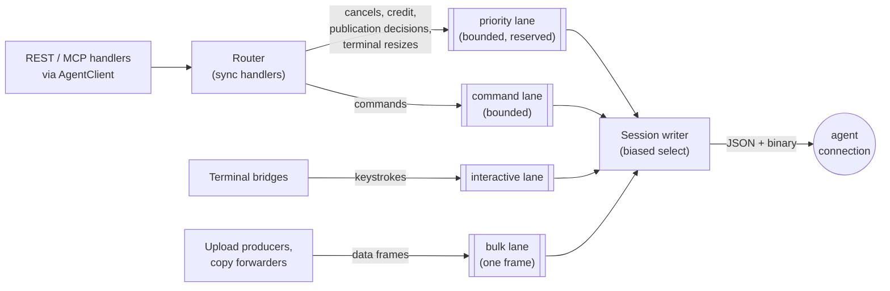

- Frames stay typed (`ServerToAgent`, `StreamChunk`) until the session writer encodes them.
  JSON is produced in exactly one place.
- The **command lane** is bounded. When it is full, new work is rejected instead of buffered,
  which is the server's admission control.
- Every frame that starts work (a command, `terminal_attach`, `log_stream_open`) carries a
  **write ticket**. The writer claims the ticket just before writing the frame, and a cancel
  first tries to withdraw it. Whichever wins decides: a withdrawn frame is skipped and never
  reaches the agent, otherwise the cancel is sent after it. So a `cancel` can never overtake
  its command, and the agent needs no memory of early cancels.
- The **priority lane** is drained first. Cancels, credit grants and publication decisions
  never wait behind a backlog of commands or data. A cancel or publication decision that
  finds the lane momentarily full waits for capacity in a small task instead of being
  dropped.
- The router never awaits. `RouterHandle::send` reports `Full` and `Stopped` separately, and
  async callers use `send_async`, so router messages are never silently dropped.

## Flows

The router tracks all in-flight agent work as **flows**. Every request the router sends to an
agent belongs to exactly one flow, and all flows live in one `FlowTable`.

| Flow | What it is | Phases |
|---|---|---|
| `Command` | A one-shot request whose caller waits for the result | none |
| `Output` | A download or exec output streaming to a consumer | `Streaming`, `Canceling` |
| `Upload` | An upload, archive upload or file edit into one agent | `AwaitingReady`, `Streaming`, `Committing` (edits only), `Publishing`, `Canceling` |
| `Copy` | A copy or move, on one agent or across two | `Verifying`, `SettlingPartial`, `Local`, `Remote`, `DeletingSource` |

- **Why one table.** A frame's request id resolves through a single index instead of probing
  several registries. Explicit phase enums replace combinations of booleans, so impossible
  states such as "canceling and publishing" cannot be represented. Phases also decide what
  can still be canceled. An upload in `Committing` or `Publishing` and a move in
  `DeletingSource` have passed the point of no return.
- **Keys.** Flows are indexed by agent and request id, so a frame can only resolve work that
  was sent to its own agent. One flow can answer several request ids at once (a cross-agent
  copy has one per agent), and it gets fresh ids when it changes phase.
- Terminal attachments and log streams are not flows. They are per-connection streams with
  no result.
- **A flow settles exactly once**, and it is removed from the table when it does. A flow
  settles when:
  - the agent's result arrives. This is the normal case, and the result always comes after
    the stream data.
  - the caller gives up. A dropped `AgentClient` call sends `AbandonCommand`, which removes
    the command flow at once; a dropped HTTP body sends `CancelTransfer`, and stream flows
    move to `Canceling` until the agent acknowledges the cancel. The router tick also prunes
    command flows whose reply port is closed, as a safety net.
  - the user cancels or pauses it by transfer id.
  - the agent's connection is lost. `fail_agent_flows` takes out every flow that depends on
    that agent and fails each one. Which agents a copy depends on changes with its phase.
    Once the source has sent everything, losing it no longer fails the copy. Once a move is
    deleting its source, losing the destination no longer matters.
  - its stream violates credit.
- Callers learn the outcome through oneshot channels (command results, upload readiness and
  completion, pause confirmation) or a watch channel (exec exit status).
- **Leases.** A streaming flow holds a `StreamLease`: a cancellation token, byte counters and
  a fault slot, shared with the data path. This is what lets payload bypass the router. The
  router cancels or fails a stream through its lease and reads progress from its counters,
  and no frame passes through its mailbox.
- **Progress rows are separate from flows.** Downloads, uploads and copies also get a row in
  the transfer progress store, keyed by a public `TransferId`. Rows outlive their flows as
  history (see browser live updates below).
- **Admission.** The router allows at most 32 uploads per connection, counting copies into
  that agent. It refuses a second copy to a destination path that already has one running,
  and it rejects new work when the command lane is full.

## One-shot command

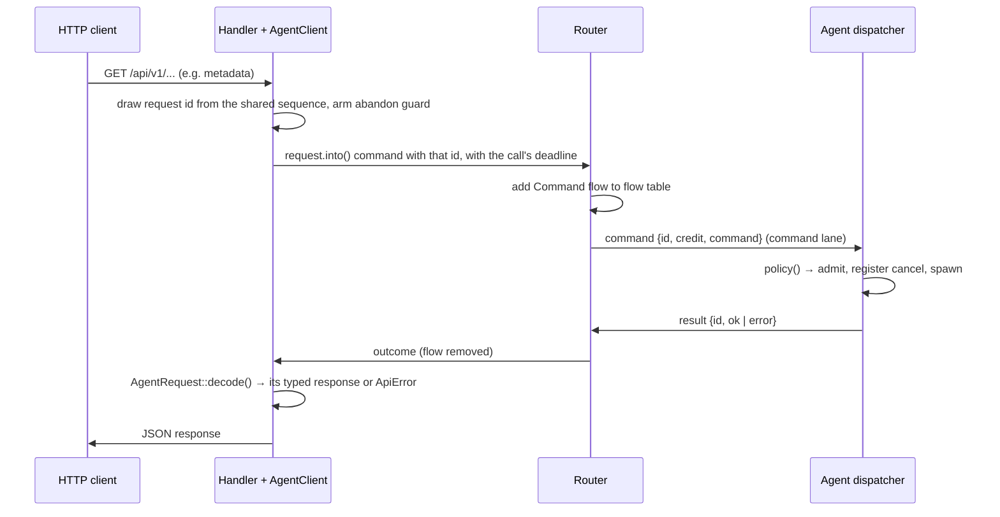

- `AgentClient::call` is the only way handlers talk to agents. The request type decides
  the response type: the agent encodes its answer with `Reply::of::<R>` (or
  `Reply::stream::<R>` for streaming commands), and the server decodes it with
  `R::decode`, so there are no "unexpected result type" branches. An agent
  error becomes an `ApiError` with the status of its `CommandErrorKind`; a payload that is
  not the request's response type is a protocol fault (500).
- The client draws the request id before sending, so a guard that knows the id can always
  abandon the command. When the caller gives up (the deadline passes or the HTTP client
  disconnects) the guard sends `AbandonCommand`; the router drops the flow and, if the
  command is cancelable on the agent, also cancels it (see the request lifecycle below). The
  mailbox is FIFO and the execute message is enqueued first, so the abandon never overtakes
  it, and an abandon for a settled or unknown id is a no-op. The guard tries a non-blocking
  send and only spawns a task when the mailbox is full. A few commands, such as trash
  restore, run to completion on purpose: their execute request clears `cancel_on_abandon`,
  so an abandoned call is forgotten without a cancel frame.
- Git status (the Git view's change list), Git directory entries, Git file bases and Git
  worktree status are cancellable on the agent (`CancelScope::Request`) even though they
  carry no stream, because they can run for many seconds after their caller stopped caring.
  The browser aborts a query when the view closes, and the agent then stops the walk and
  frees its status-walk slot at once. File search and content grep are cancelled the same
  way, but they are output streams (see "Streaming search"). This is per caller, not per
  user: parallel MCP or CLI searches do not cancel each other. The agent logs each one at
  debug level (`File search canceled`, `Content grep canceled`, `Git status canceled`,
  `Git worktree status canceled`).
- Git status of a subdirectory hands gix a `:(top,literal)<dir>/` pathspec, so the walk
  covers only that directory instead of the whole checkout followed by a prefix filter. The
  trailing slash keeps a sibling such as `src-old` out of a walk of `src`, and `literal`
  keeps glob characters in names from widening it.

## Request lifecycle

Every request follows one ordered lifecycle on the connection:

```
server: command {id, credit, command}
agent:  binary frames of stream id ... binary frame with FIN     (streaming commands only)
agent:  result {id, ok: <response>} or result {id, error: {kind, message}}   (exactly one, last)
```

- **Exactly one result per request, always after its data.** An output stream's result
  (download, exec, search) is queued on the same agent lane as its data, behind `FIN`, so when the
  server sees the result the consumer already has every byte. An upload answers after its
  publication step, on the control lane. Flows therefore settle on the result alone; there is
  no separate "stream ended" event to reconcile with it. The agent's `ResultLedger` enforces
  the single result (a second one is a bug: a debug assertion, and dropped in release).
- **`FIN` means the data is complete.** A download or upload that fails or is cancelled ends
  without `FIN`, and its error result carries the reason. The server then fails the consumer
  after the frames it already queued, so an HTTP body aborts visibly instead of looking like a
  short file. Exec output always ends with `FIN`, because the output of a stopped process is
  still all the output there is; its result says how the process ended. Terminals and log
  streams have no result, so `FIN` is how they end: a terminal attachment always sends it
  (after the shell's exit or error event, or when it is detached), and a log stream sends it unless the server canceled it, because
  then nobody listens any more.
- **Initial credit is in the command.** Output streams (downloads, exec, searches) get their first
  window (`credit: 4`) in the command frame, so output starts without a round trip. Uploads
  start with `credit: 0`; the agent grants the first window when its worker is ready, and
  that first grant is the readiness signal.
- **Cancel.** The server sends `cancel {id}` on the priority lane only for a command that has
  been written (see write tickets above). A command still in the queue is withdrawn, never
  written, and answered by the router itself with a `canceled` error result. A written
  command's cancel is acknowledged by its normal result: kind `canceled` if the cancel
  stopped it, or the real result if it had already finished. The agent ignores cancels for
  requests it already answered and keeps no state for them.
- **Credit violations** are the only data-path event the router hears directly: the
  connection reader stops routing the stream, and the router fails the flow and cancels the
  agent's worker. The connection continues.

## Download, exec output and stream credit

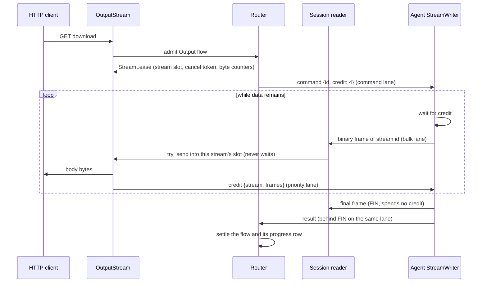

- **Payload bypasses the router.** The router admits the stream and hands out a
  `StreamLease`. Frames then go from the session reader straight into that stream's
  bounded slot; the router only sees the result that follows them. Progress is read from the
  lease's byte counters.
- **Credit isolates streams.** The agent may have at most the granted number of frames in
  flight per stream (4 × 64 KiB). The server returns credit as the HTTP client drains the
  body. A stalled client therefore stalls only its own stream, while other downloads, exec
  output and copies from the same agent keep flowing. `tests/stream-isolation.test.ts`
  covers this.
- An agent that sends beyond its credit fails only that stream, not the connection
  (`tests/stream-credit.test.ts`).
- **Cancellation.** Dropping the `OutputStream` (the HTTP client went away) cancels the agent
  side. `FIN` and results never need credit, so a cancel acknowledgement can never get stuck
  behind unread data.
- Exec output uses the same path. The exit status is exec's result, ordered after the output
  `FIN`; the router publishes it on a separate watch channel, so the HTTP body emits it after
  the last output line. A timeout or cancel stops the process even while output waits for
  credit, and the result follows at once.

## Streaming search

Path search and content grep stream their matches while the agent still walks, so the
browser shows results long before a large tree is done.

```
browser:  POST /api/v1/agents/{agent}/find-stream/{*path}   (or grep-stream)
server:   command {id, credit: 4, FileSearch}  → Output flow of kind Events
agent:    validate, open the root → error result with no data, or an empty ready frame
agent:    NDJSON batches {"type":"match",...}\n ...  last frame (FIN): ... {"type":"done",...}\n
agent:    result {id, ok: null}   (or an error, after the data already sent)
server:   passes the lines through as application/x-ndjson
```

- **Search is an output stream.** `FileSearch` and `ContentGrep` use the `OUTPUT` policy,
  like exec and downloads, and travel on the agent's existing connection. The summary is the
  `done` line, part of the data, so the result carries nothing; the router's `Events` flow
  kind (shared with unit journals) has no transfer history and only reads the result when it
  is an error, which fails the consumer after the matches it already has.
- **Validate before streaming.** The agent checks the query, the regex, the context limits
  and opens the root before it sends anything, so those failures are the result alone and
  the server (which waits for the first frame) answers them with a proper HTTP status. After
  validation it sends one empty ready frame. A content grep sends it before it waits for one
  of its four grep slots; the wait still counts against its timeout.
- **Batched lines.** The walk hands its events through a bounded channel to a writer
  beside it (`commands/search_stream.rs`), which sends a batch at 32 KiB or 100 ms after its
  first line. A stream has only four frames of credit in flight, so a frame per match would
  wait for a credit round trip every few matches on a slow link.
- **Path search streams only rank changes.** The agent keeps its top 100 and sends a match
  only when it enters that list. Re-ranking every received match (score, then path) and
  keeping 100 gives exactly the agent's final list, while the event count stays small (about
  `100·ln(N/100)` for `N` matching paths). Content grep sends every match as its file proved
  to be text, up to its 100-match cap.
- **Content grep walks shallow first, in name order.** Grep has no relevance score and stops
  at its cap, so the walk order decides which matches the user sees. It walks breadth-first
  and sorts each directory's listing by name, so files beside the search root come before a
  deep subtree such as vendored code, and the same tree gives the same matches on every
  filesystem. Ranking like path search would mean reading every file to the end of the tree.
  Queued directories hold a path and a shared chain of their ancestors' `.gitignore` rules,
  not an open handle. Each real directory is walked once (a visited set of device and inode),
  because a symlink maze would otherwise fill the queue with exponentially many paths; path
  search walks depth-first and only skips directories already on its current path.
- **Ending.** A deadline stops the walk, flushes, and ends with `done {timed_out: true}`;
  the `done` line rides on the `FIN` frame, which needs no credit. A cancel stops the walk
  wherever it waits and ends the stream without `FIN`, so it never looks finished. Dropping
  the HTTP body cancels the search like any output stream.
- **One implementation for JSON callers.** `POST .../find` and `.../grep`, MCP and the vault
  scan get one JSON response, built by `AgentSearch::collect` from the same stream: it
  reassembles lines across frames (at most 1 MiB per line), keeps the top 100 for path
  search, requires the `done` line and gives up at the search timeout plus slack.
- The streaming routes are named `find-stream` and `grep-stream` rather than
  `find/stream`, which would also be the JSON search of a folder called `/stream`.
- The browser reads the body with a stream reader (`streamNdjson`) and feeds the batches to
  TanStack Query's `streamedQuery`, which reduces them into the same `FileSearchResponse` /
  `ContentGrepResponse` shape the JSON routes return. Refetches use `refetchMode: "replace"`,
  so an invalidation does not clear the list, and `keepPreviousData` keeps the previous
  query's results until the first new event.

## Upload
## Upload

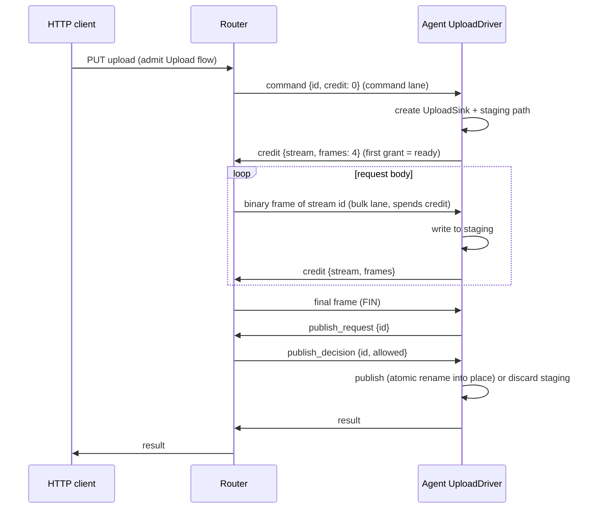

- The agent's first credit grant confirms its worker exists before any body bytes are sent;
  the session reports it to the router as the upload's readiness.
- A producer that gives up (body longer than its `Content-Length`, client gone) never sends
  an error frame. The router cancels the agent's worker, which discards its staging and
  answers with its result.
- Content is written to a hidden **staging** path next to the destination. The path is
  reserved atomically and deletes itself if the upload is cancelled, fails or disconnects.
- **Publication is a separate step decided by the router.** This orders "publish" against a
  cancel that may be racing it. The router's answer is final, so a cancelled upload never
  replaces the destination, and an upload the router has accepted is never reported as
  cancelled.
- Raw file uploads, tar directory uploads and in-place file edits all use the same
  `UploadDriver`. They differ only in their `UploadSink`.
- Raw file and tar directory uploads both default to `on_existing=error`. Replacing or merging
  into an existing entry must be requested explicitly, so no client overwrites by accident.
- A raw upload can carry a **precondition**: `must_not_exist`, or `matches` with the
  `MoveSourceIdentity` (device, inode, size, mtime) the server read. The agent checks it
  before staging and again right before the rename, and a mismatch discards the staging and
  fails with `already_exists` or `source_changed` (409). Encrypted vault writes depend on it
  (see "Encrypted files"). Older agents would silently ignore the field, so agents
  announce `supports_upload_preconditions` in `hello` and the server refuses vault writes to
  agents without it.

## Copy and move between agents

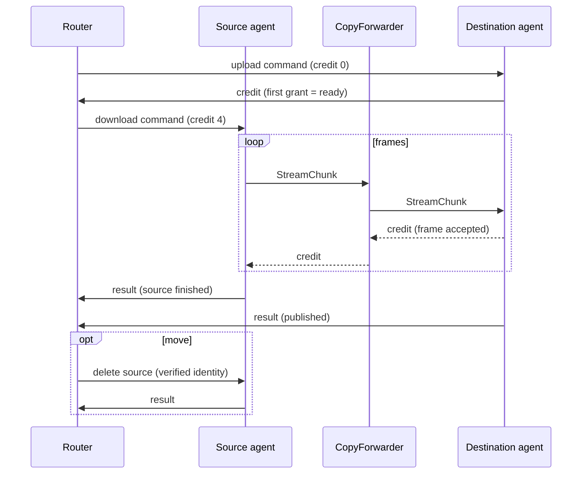

- A cross-agent copy is a source download and a destination upload joined by a
  `CopyForwarder` task. Credit is returned to the source only after the destination has
  accepted the frame. A slow destination therefore slows down only this copy, never either
  agent's other streams.
- The forwarder only relays data and `FIN`. A source that fails sends no `FIN`, and its
  error result makes the router fail the copy and cancel the destination worker. A partial
  copy is never published. The destination either discards its staging, or, for a
  resumable file copy, keeps it as a partial (see the next section).
- A **move** is a copy followed by deleting the source (`CopyFlow` then
  `CopyPhase::DeletingSource`). The source is deleted only if its identity still matches what
  was copied. Once the source is being deleted, a destination disconnect no longer affects
  the result.
- A copy or move on a single agent runs entirely on that agent as a local worker. The server
  only follows its progress and can cancel it. Copies from Git history are the exception:
  they always stream through the server (see "Git history downloads and copies").

## Resuming copies and moves

An interrupted file copy or move keeps what it has already written, so the next attempt
continues from there instead of from byte zero. This covers regular files: copies and moves
between agents, copies on one agent, and the copy-and-delete fallback of a move on one agent.
Directory archives start over.

- **The partial is the only resume state.** The destination writes into a hidden partial file
  next to the destination path (`.<name>.redoor-partial-<hash>`). It keeps a manifest for that
  file under `partials/` in the agent's data dir. Both are made durable before any payload
  arrives. The server keeps no transfer database, so resuming works across server, agent and
  machine restarts, including a crash of the destination agent.
- **The server signs the manifest.** The manifest records:
  - the source agent, path and file identity
  - the destination
  - the operation and the conflict policy

  The server signs these fields with a BLAKE3 keyed hash, using a key only it holds
  (`partials-signing-key` in the server data dir). The agent stores the signature but can
  neither check nor produce one. Without the signature, a compromised destination agent could
  write a manifest naming any file on any other agent. A single Resume click would then copy
  that file to the attacker, or, for a move, delete it. The server also checks that the
  manifest names the agent that returned it as its destination. The shared agent token is not
  used as the key, because every agent knows it.
- **Only a verified prefix is reused.** The server rounds the partial's length down to whole
  64 MiB segments.
  - **Across agents**, the router has both agents hash each segment (`HashSegments`) and
    compares the digests itself. Copying resumes after the last matching segment, and
    everything after a mismatch is sent again. The hashing rounds are ordinary commands owned
    by the copy's flow (`CopyPhase::Verifying`), so cancel, pause and agent loss behave as in
    any other phase.
  - **On one agent**, the copy runs the same check inside its own command.
- **A changed source starts over.** The manifest and each resumed download carry the source's
  identity (device, inode, size and mtime). If the live source no longer matches, the partial
  is discarded.
- **Why the copy stopped decides what happens to the partial.** Cancels carry a reason:

  | Stop | Partial |
  |---|---|
  | User cancel | Discarded |
  | Pause | Flushed and kept. The pause request returns only once the partial is durable, and the transfer's progress row is then dropped |
  | Connection lost, agent crash, read or write error | Kept. The transfer ends as errored with "partial kept" |

  An agent that loses its connection fires its cancel tokens with the default reason,
  `Disconnected`. So it keeps its partials without needing to hear from the server.
- **Resuming is explicit.** Nothing resumes by itself when an agent reconnects.
  - `GET /api/v1/partials` lists the verified partials on connected agents.
  - `POST /api/v1/partials/resume` starts a new transfer from one of them. It re-reads the
    manifest from the agent instead of trusting the client.
  - Starting the same copy again also resumes, because the default is `resume: "auto"`.
    `"restart"` starts from scratch.
  - `POST /api/v1/copy/preflight` lets the UI offer "Resume" or "Start over" before a copy
    starts.
- **The agent owns cleanup.** It sweeps its partials at startup and once a day. The sweep
  removes partials older than `partial_max_age_days` (7 days by default), and manifests whose
  file is gone. Partials are also removed when they are published, canceled or discarded.
- `tests/resumable-transfers.test.ts` covers these cases, including tampered manifests and
  manifests moved to another agent.

## Terminals and live logs

A terminal is a session of the agent process, not of a browser socket or of a connection.
The agent owns the shell's PTY and a mirror of its screen, so the shell survives a page
reload, a sleeping laptop, a phone switching networks, a dropped agent connection and a
server restart, and any browser can pick it up again. The server keeps an in-memory index
of the sessions and relays one browser per session to the agent.

```mermaid
sequenceDiagram
    participant B1 as Browser 1
    participant B2 as Browser 2
    participant S as Server
    participant A as Agent

    B1->>S: POST /api/v1/agents/{agent}/terminals
    S->>A: command CreateTerminal {id, cwd, title, number, size}
    A->>A: start shell, mirror and session task (max 8 running)
    A->>S: result: the session's record
    A->>S: terminal_sessions [records]
    B1->>S: attach GET /api/v1/terminals/{id}/ws
    S->>A: terminal_attach {stream, session, size}
    A->>S: ready, snapshot of the mirror, then live output
    S->>B1: relayed
    B1-->>S: socket closes (reload, network change)
    S->>A: cancel {id: stream}: detach only
    B2->>S: attach
    S->>B1: taken_over, close
    S->>A: terminal_attach on a new stream
    Note over S,A: server restarts; the agent reconnects
    A->>S: terminal_sessions [records]
    B2->>S: DELETE /api/v1/terminals/{id}
    S->>B2: closed
    S->>A: command CloseTerminal {id}
```

- **The agent owns the session.** `TerminalSessions` lives in the agent's process-wide
  services. `CreateTerminal` starts the shell before it answers, so a full agent or a missing
  directory is an error for the creating window instead of a dead tab. Each session is a
  task whose loop serves commands (attach, detach, resize, close) first, then the shell's
  exit, then output, and no command waits for an attachment or for credit, so a takeover or
  close is never stuck behind a slow server.
- **Attachments.** `terminal_attach` binds a session to one stream of the current
  connection: the agent sends `ready` (for a running shell), the snapshot, then live
  output, and writes the stream's input to the PTY. Canceling the stream or losing the
  connection only detaches. A newer attach of the same session takes it over and ends the
  older stream. The agent opens the input route before it sends `ready`, and the server
  reads nothing from the browser before `ready`, so early keystrokes wait in the browser
  socket instead of reaching an agent that would drop them.
- **The agent reports its sessions.** After `hello`, and again whenever a session is created,
  exits or is closed, the agent sends `terminal_sessions` with every record (id, directory,
  title, number, creation time, status). The whole list replaces what the server knew about
  that agent, which is how a restarted server learns which shells still run.
- **The server's index.** `TerminalRegistry` keeps the records as each agent last reported
  them, in memory only. The agents are the only authority on which shells run, and a
  restarted server does not reconnect managed SSH devices on its own (see "The server
  starts no device on its own"), so a restarted server starts empty and each agent's first
  report after it connects brings its sessions back; browsers drop the tabs meanwhile and restore them, in their saved order,
  from the next list. Records stay while their agent is disconnected, because the shells
  keep running there. A session the agent no longer reports (it was restarted) stays listed
  as exited ("Shell ended when its device restarted") until its tab is closed, like a shell
  that exited, so the tab explains what happened and offers a new shell; the server answers
  its attach itself. A server restart forgets such records, so their tabs just disappear.
- **Closing.** `DELETE` removes the record, tells the attached browser `closed` and sends
  `CloseTerminal`. The close is remembered until the agent no longer reports the session,
  so a close made while the agent is away reaches it when it reconnects, and its next
  report does not bring the tab back. At most 256 closes are remembered, in memory only: a
  server restart before the agent is back lets that shell run on and its tab return.
- **The mirror.** Every output chunk is fed into a headless `libghostty-vt` emulator, the
  engine the browser renders with, so the agent parses output exactly as the client does.
  On attach the session asks it for a snapshot: a reset (`ESC c`, so a browser emulator
  reused after a takeover starts clean), the screen, scrollback (up to 1000 lines), cursor
  and input modes as VT sequences, then the bytes of an escape sequence or UTF-8 character
  that output had started but not finished, which `libghostty-vt` keeps in its parser state
  but does not expose. The snapshot request goes on the same ordered channel as the feeds
  and no output is read until it arrives, so it reflects exactly the output before it and
  live output continues after it, with nothing lost or repeated. Tab stops are left out
  because the formatter writes them after the cursor, which would move it. The emulator's
  types are `!Send`, so each session's emulator runs on its own thread; a 200x60 mirror with
  full scrollback takes about 2 MiB. An exited session compacts it once, a running one when
  idle. Keeping the mirror on the agent spreads that memory and parsing over the devices.
- **Backpressure.** PTY output is read only once the attachment's queue and the emulator's
  queue both have room, so stream credit holds a slow browser's shell back and memory stays
  bounded. Without an attachment, output is drained into the mirror at once, so a detached
  shell never blocks on output. Keystrokes go to a small forwarder task and then to a PTY
  writer task, because writing waits while the shell does not read; the forwarder drops
  input of a replaced attachment right before writing it.
- **One viewer.** The server decides which browser views a session: attaching takes the
  session over, and the previous viewer gets `taken_over` and its socket closes. The reason
  travels on a separate oneshot, not the data path, so it reaches a viewer whose socket is
  stalled and interrupts a send stuck on a slow browser; a takeover therefore never looks
  like a dropped connection, which the browser would answer by attaching again. When the
  agent is away, the attach socket closes without an event, so the browser does attach
  again, and succeeds once the agent is back.
- **Lifecycle.**

  | Event | Result |
  | --- | --- |
  | Browser socket closes | Detach. The shell keeps running. |
  | Another browser attaches | The old viewer gets `taken_over`, the new one the snapshot. |
  | `DELETE /api/v1/terminals/{id}` | Record removed, PTY killed (when the agent is back, if it is away). An attached viewer gets `closed`. |
  | Shell exits | `exited { message }`. The mirror stays, so a reload shows the last screen and why it ended. |
  | Agent disconnects | The shell keeps running and stays listed; viewers' sockets close and they attach again. |
  | Server restart | The shells keep running; the restarted server lists them, and browsers show their tabs again, once each agent has reconnected and reported them: local and standalone agents on their own, managed SSH devices after the user's Start. |
  | Agent restart or upgrade | Its shells are gone; after its first report they are listed as exited, and their viewers get `closed`. A managed daemon is restarted when its device is restarted and when a server with another binary first starts the device or adopts its daemon. |

  An exited session keeps only its mirror. Sessions live until their tab is closed, without
  a timeout: every window restores every session as a tab, so a forgotten shell is always
  visible there. An agent runs at most 8 shells and keeps at most 64 sessions.
- **Managed agents keep their shells across server restarts.** Managed agents are daemons
  that outlive the server and their SSH sessions, so a server restart or a dropped SSH
  connection only interrupts the viewers, which attach again once the daemon is back: a
  local daemon reconnects on its own, an SSH device's daemon once the user starts the
  device, within its orphan limit. A server with another binary replaces the daemons when
  they come back, and their shells end. Standalone
  agents and agents behind a relay keep their shells across a server restart too.
- The session routes are session-only, so API tokens and MCP cannot list, open or take over
  interactive shells. Creating, deleting and a shell exiting publish `terminals_changed` on
  the UI socket, so other windows update their tabs.
- Terminal frames use the interactive lane in both directions, so keystrokes and echoes do
  not queue behind bulk transfers. Lifecycle events travel on the same lane as the output,
  so an exit always follows the output that preceded it.
- On macOS, printable Option combinations and dead keys use the browser's native input
  and composition events so keyboard layouts can produce characters such as Finnish `|`.
  The wterm adapter bypasses Escape-prefix encoding for these keys; non-text Alt keys
  continue through the terminal's normal key encoder.
- WTerm's OSC 52 callback writes application-provided text to the browser clipboard;
  clipboard reads are never exposed to the PTY. If browser permissions reject a write,
  the session retains it and offers a user-triggered Copy action. Selection copying uses
  WTerm's selection API, including virtualized history. Ctrl+Shift+C also works when
  mouse selection leaves focus on the terminal host. Shift-drag seeds a document caret before
  the browser selects, avoiding the hidden input's selection; Shift+right-click keeps the native menu.
- Live logs (`log_stream_open`) send NDJSON `LogEvent` lines that may span frames; the bridge
  reassembles each line (bounded by the largest valid event) and validates it before
  relaying it to the browser.
- Each connection allows at most 8 terminal attachments and 8 log streams, enforced on both
  sides.
- Playwright agents inherit a fixture-owned `SHELL` wrapper that starts interactive POSIX
  `sh` without login profiles or `ENV` startup files. A fixed prompt lets command tests wait
  for shell readiness after PTY attachment, and keeps user prompt plugins from scrolling
  rows while browser selection gestures are in progress.

## Systemd units

The UI manages the systemd units of a device: unit lists and status, start, stop, restart,
reload, enable and disable, the unit's journal, daemon-reload and user linger. The REST
routes under `/api/v1/agents/{agent}/systemd` are session-only; access tokens and MCP manage
units through exec, whose permission already covers running `systemctl`.

```
browser:  GET  .../systemd/{system | user/{user}}/units[/{unit}]       → one-shot commands
browser:  POST .../units/{unit}/actions, .../daemon-reload; PUT .../user/{user}/linger
browser:  GET  .../units/{unit}/journal?lines=N                       → NDJSON stream
agent:    systemctl / journalctl / loginctl / systemd-analyze, never through a shell
```

- **Command line tools, not D-Bus.** The agent runs `systemctl`, `journalctl`, `loginctl`
  and `systemd-analyze` (`commands/systemd/`). They are on every systemd host, add no
  dependency, and reaching another user's manager as root needs only that user's UID and
  runtime directory instead of the bus policy of the user's session. Every run gets a cleared
  environment with `LC_ALL=C`, `TZ=UTC` and `SYSTEMD_COLORS=0` (so the parsers read stable
  text and a root agent leaks nothing into another user's tools), `--no-pager`,
  `--no-ask-password` (polkit never waits for a password nobody can type) and `--` before
  unit names. Output is the `--plain --no-legend --full` tables and `show -p` key=value
  lines, because `-o json` needs systemd 246 and Ubuntu 20.04 ships 245. Unit names are
  validated (systemd's characters and a known type suffix, so no glob reaches
  `journalctl -u`) and user names must resolve through NSS, all before a process starts.
- **Scopes and trust.** Every request names its manager, `SystemdScope::System` or
  `SystemdScope::User { name }`. A root agent manages the system manager and every user's
  manager and linger; it reaches another user's manager by running the tool with that
  user's UID and GID, `XDG_RUNTIME_DIR=/run/user/<uid>` and
  `DBUS_SESSION_BUS_ADDRESS=unix:path=/run/user/<uid>/bus` plus `--user`, not
  `systemctl -M user@`, whose requirements differ between versions. A non-root agent reads
  the system manager (lists, status and journal need no privileges) but the agent refuses
  system actions itself, before any tool runs, instead of hitting a polkit prompt; it
  manages its own user's manager fully and refuses other users. Linger follows the same
  rule, with polkit deciding a non-root agent's own linger. Responses carry `can_manage`,
  so the UI shows read-only views without knowing the rules.
- **A user manager that does not run** (no `/run/user/<uid>/systemd/private` or bus socket)
  is the typed `SystemdUserManagerNotRunning` failure (`409`, code
  `systemd_user_manager_not_running`), so the UI can offer to enable linger instead of
  showing a bus error. The root agent's user list judges `manager_running` by the same
  sockets, not by `/run/user/<uid>` (which logind creates before the manager is up), so a
  user the list shows as running never answers the next request with this failure.
- **Hosts without systemd.** The agent decides once at startup with the `sd_booted()` check
  (`/run/systemd/system` exists; macOS and Android are unsupported outright) and reports
  `SystemdSupport` in its `hello`; the UI only offers the systemd view where it is
  available. Systemd commands on such an agent fail with the typed `SystemdUnsupported`
  (`501`, code `systemd_unsupported`), not a tool error.
- **Actions wait for their job.** `systemctl start` and friends block until the systemd job
  finishes, so "Job for x failed" reaches the UI (as a `409` with systemd's message). The
  commands are request-cancelable on the command lane with a 120 second `AgentCall`
  deadline; an abandoned call kills `systemctl`, while the job itself keeps running in
  systemd. The action answers with the unit's status afterwards.
- **Bounded lists.** Unit lists merge `list-units --all` with `list-unit-files`, so disabled
  units that are not loaded appear too. The response is one control frame, so it is cut at
  10,000 units with a `truncated` flag, and tool output past 16 MiB is drained and dropped.
- **Unit files in the list.** Each listed unit carries `fragment_path`, the file the UI
  opens to show the unit. Loaded units get systemd's `FragmentPath` from the same batched
  `systemctl show` that reads timer schedules (devices, scopes, `not-found` and masked units
  are left out of it, since they have no file). Unit files systemd has not loaded are not
  asked about, because `show` would make systemd load each of them: the agent reads each
  directory of `systemd-analyze [--user] unit-paths` once and takes the first file of the
  unit's name, as systemd would. Transient files (`.../systemd/transient/`) and masked
  units report none, an instance reports its template's file.
- **Timers.** Unit details of a `.timer` carry `SystemdTimerInfo` (its rules from
  `TimersCalendar`/`TimersMonotonic` as unit file lines, `Triggers`, the next and last
  elapse, `Persistent`), and every unit's details carry `TriggeredBy`, so a service names
  the timers, sockets or paths that start it. The unit list adds a `SystemdTimerSummary`
  (next and last elapse, `Triggers`) to each loaded timer from the one extra
  `systemctl show -p ...` that also reads the loaded units' files (in batches of 1,000
  names, so the argument list stays bounded), so a `list-timers` view needs no request per
  timer; a failure of that extra run lists the units without files and schedules instead of
  failing the list. All of it comes
  from `show` key=value lines, so it works on 245. systemd reports a monotonic next elapse
  (`OnActiveSec=`, `OnUnitActiveSec=`, `OnBootSec=`) relative to `CLOCK_MONOTONIC` and
  prints it as a time span since boot (`5month 2w 4d 10h 59min 4.344391s`), which only the
  device can interpret. The agent therefore parses the span back to microseconds, moves it
  onto the wall clock with its own `CLOCK_REALTIME - CLOCK_MONOTONIC` offset read at the
  same moment (as `systemctl list-timers` does), and reports the earlier of that and
  `NextElapseUSecRealtime` as Unix milliseconds. `CLOCK_MONOTONIC` and not `/proc/uptime`,
  because containers virtualize the latter.
- **Journal.** One `journalctl -o json --output-fields=... --all -n N -f` run delivers the
  last lines and then follows, so history and live entries share one stream and nothing is
  lost or repeated between them. System units use `--unit`, the agent's own user units
  `--user --unit`, and a root agent reading another user's units uses explicit
  `_SYSTEMD_USER_UNIT=<unit> _UID=<uid> + USER_UNIT=<unit> _UID=<uid>` matches, because
  `--user-unit` would match root's own UID. The agent runs it as an `OUTPUT` command
  through the search stream driver: validation errors are the result with no data (the
  server waits for the first frame, so they become HTTP statuses), then an empty ready
  frame, then batched NDJSON `SystemdJournalEvent` lines under stream credit, so a slow
  browser stalls `journalctl` instead of growing memory. Lines are capped at 64 KiB (longer
  entries become a note) and `MESSAGE` byte arrays are decoded lossily. The server relays
  the lines as `application/x-ndjson` through an `Events` output flow; dropping the body
  cancels the request, and `journalctl` is `kill_on_drop`. A non-root agent that cannot
  open the system journal file (not in `systemd-journal` or `adm`) sends an
  `access_limited` event first, because `journalctl` only prints its hint in text formats
  and the log would otherwise just be empty. An `end` event appears only when `journalctl`
  itself exits.
- **The agent's own unit** comes from `/proc/self/cgroup` (the service or scope it runs in,
  below `user@<uid>.service` for a user manager). The overview reports it and unit details
  set `is_agent_unit`, so the UI warns harder before stopping, restarting or disabling the
  unit that runs Redoor.
- **UI.** The unit lists live under `/agents/{device}/systemd` (`system`, `user`,
  `user/{user}`), shown only when the agent reports `SystemdSupport` available; a direct URL
  on any other device explains why instead of sending requests. A unit has no page of its
  own: its status, actions, timer schedule, drop-ins and journal are the Systemd tab of the
  file view of its unit file (`/agents/{device}/browser/{fragment_path}?view=systemd`), so
  a unit and the file that defines it are one tab apart. The tab appears only for unit files
  and drop-ins (by name) that path status says a manager loads; a drop-in shows the unit it
  changes, a template file lists its loaded instances (`&unit=` picks one, since a template
  has no status), and a file several managers load gets a manager picker (`&systemdScope=`).
  The route's loader asks path status before rendering `?view=systemd` and falls back to
  the file's default view when no manager loads the file, like the Git view outside a
  repository. Unit list rows link to `fragment_path`; units without a file (devices, scopes,
  `-.slice`, transient units) are listed without a link. Unit names known only by name
  (`Triggers`, `TriggeredBy`) resolve to their files through the manager's cached unit
  list. Unit lists and unit status poll every few seconds while visible, because systemd
  pushes nothing to the UI. The journal is a fetch subscription owned by the tab: it is
  aborted on unmount (which stops `journalctl`) and keeps only the newest 5,000 entries in
  memory.
- **Path status** tells the editor and the file view's Systemd tab which managers load a
  file: the system manager and one user manager, by matching the file's directory against `systemd-analyze [--user] unit-paths` (unit files) or its parent
  `<unit>.d` directory (drop-ins), then `NeedDaemonReload` and `LoadState` say whether a
  daemon-reload is due or systemd cannot load the unit yet (a new file on systemd versions
  that do not load new files on demand). A drop-in missing from the loaded unit's
  `DropInPaths` also needs a reload, because systemd (255) keeps `NeedDaemonReload=no`
  when a drop-in is added to a running unit that had none.
  The user manager is the one the request names (`&user=`), resolved with the same trust
  rules as the unit lists (a non-root agent may only name its own account). Links from a
  user's unit list, its timer links and its drop-in links carry that user as
  `&systemdScope=user/<name>`, and the view, the tab and the loader's redirect pass it on,
  because shared root-owned files such as `/usr/lib/systemd/user/*` belong to every user's
  manager and the file alone cannot say whose. Without a user (the editor's reload offer)
  the agent picks its own account's manager, or for a root agent the file owner's (the
  parent directory's owner for a new file), since that is whose manager loads files below a
  home directory.

## Browser live updates and transfer progress

`/api/v1/ui/ws` carries only invalidation hints. The data itself is always fetched over REST.

- `UiEvent` has four variants with no payload: `agents_changed`, `routes_changed`,
  `transfers_changed` and `terminals_changed`. The UI's `RefreshListener` turns them into
  TanStack Query invalidations and nothing else. REST stays the single source of truth, so
  there are no deltas to keep consistent, and a missed event only means a view refreshes
  later. When the socket reconnects, the listener also invalidates the server info, the agent
  inventory, transfers, partials, terminal sessions and agent data, because events may have
  been missed meanwhile.
  - `agents_changed` refetches the inventory, then refreshes the cached data of every agent
    whose status or connection id changed, or that was not listed before. A restarted server
    lists a standalone agent only once it reconnects, and views refetched while it was
    missing would otherwise keep their errors. Lifecycle chatter, such as provisioning steps,
    does not refetch open file views.
  - `routes_changed` (an upload, edit or copy finished) refreshes the cached data of every
    agent: listings, metadata, git state and trash.
  - `transfers_changed` refreshes the transfer list.
  - `terminals_changed` (a session was created, closed or exited) refreshes the terminal
    session list, which the terminal tabs of every window follow. It is not throttled.
- Agent events go out immediately on connect, disconnect and lifecycle changes. Transfer
  events are throttled to one every 5 s while progress is ticking. They go out immediately
  when a transfer starts, starts canceling or ends.
- **Transfer progress** lives in the router's `TransferProgressStore`. There is one row per
  download, upload and copy, keyed by its public `TransferId`.
  - Payload bypasses the router, so a 250 ms tick (and every progress listing) copies byte
    counts from the flows' leases into the active rows.
  - Copies on one agent run on that agent and report progress frames instead.
  - The UI estimates speed and ETA between refreshes.
- Rows end as `Completed`, `Errored` or `Canceled` and stay as history (at most 1000 rows, for
  an hour). A paused copy's row is dropped, because its partial is now its record. The store
  lives in memory only.
- Things that produce no event are polled: protocol mismatches every 10 s, partials every
  5 s and the agent inventory every second while a managed agent is starting.
- `DELETE /api/v1/transfers/{id}` cancels and `POST /api/v1/transfers/{id}/pause` pauses.
  - Cancel is idempotent and returns at once. The row becomes `Canceled` when the agent
    acknowledges.
  - Pause returns only after the destination has made the partial durable.

### Browser server state

The TanStack Query cache is the single place the UI keeps server state. Route loaders only
prime it (`fetchQueryUncancelled`) so a navigation renders with data, and components read the
same queries (`useQuery`, `useSuspenseQuery`). Events and mutations refresh the UI by
invalidating query keys, so a view never needs a separate reload signal.

- **Plain data in the cache.** The agent inventory is stored as plain `AgentInfoResponse`
  JSON. TanStack Query structurally shares plain data, so a refetch that changes one agent
  keeps every other agent's object identical. The request client for an agent (`Agent`) is
  built by `ApiClient.agentFor(info)`, which memoizes per snapshot object, so a client keeps
  its identity until its data changes. The `useAgents` / `useAgent` hooks and the
  `loadAgent` loader helper both go through it, which makes memos and effects keyed on an
  agent stable.
- **One key hierarchy.** Everything about one agent lives under `queryKeys.agent(id)`
  (details, configuration, accounts, trash, listings, metadata, git, searches, editor
  buffers). The inventory list is a sibling key, so refreshing it does not touch any agent's
  files. `invalidateAgentData` is the single entry point mutations and events use after
  changing an agent.
- **Commit history is immutable.** History queries keyed by a resolved commit ID carry
  `meta: { immutableHistory: true }` and are skipped by agent-wide invalidations. A file
  mutation cannot change those ancestors, and refreshing them could cancel an in-flight
  next page. A moved HEAD selects a new query key instead; unborn HEAD history remains
  refreshable.
- **The editor's device text is refetched by the editor only.** The file content query is
  tagged with `meta: { editorBuffer: true }`, and `invalidateAgentData` and
  `invalidateAllAgentData` skip it, so unrelated mutations do not download open files again.
  The editor refetches it on focus, window focus and Reload, also while the buffer is dirty:
  the query only ever holds device text, and the editor workspace decides what that text may
  do to the buffer (see "Editor buffers and open files").
- **Stale times follow the events.** The inventory is trusted for 30 s because
  `agents_changed` invalidates it, and it polls every second only while a managed agent is
  starting, which pushes no event. Listings, git state and metadata never go stale on their
  own; the loaders force a refetch on navigation, events and mutations invalidate them, and
  the window-focus refresh reloads the route and invalidates git state. A directory's Git
  view also refetches the worktree diffs it already has cached, in batches and without
  waiting, so coming back to a list shows the cached patches at once and then the edits
  made while away.
- **A new server build reloads the page.** The shell watches the cached server info and
  reloads once it reports another build than the page started with, after an update from the
  UI or `redoor upgrade` on the command line. The old page's lazily loaded chunks no longer
  exist on the new server and its requests may not match the new API. The update dialog
  keeps its result in session storage, so the reloaded page still shows it. A failed chunk
  load (`vite:preloadError`) also reloads, at most once a minute, and the terminal renderer
  forgets a failed module load so the next terminal tries again.
- **Restart waits are bounded per attempt.** `waitForRestart` polls for 30 s, and each probe
  request is cancelled after 5 s, because TanStack Query hands every later fetch of a key
  the promise still in flight, so one hung request would otherwise answer every attempt.
  Refreshing the agents' data after a restart is not awaited, so a slow refetch cannot keep a
  dialog spinning.
- **What still reloads the route.** A loader also decides which kind of entry lives at a URL
  and applies redirects, which the cache cannot express. The route is therefore reloaded
  (`router.invalidate`) only when that can have changed: the window-focus refresh, creating
  the entry at a missing path, a browser URL that was opened while its agent was offline and
  whose agent has since connected, and the route error retry. Disconnecting needs no reload:
  views choose the lifecycle screen from the live inventory.
- **Optimistic edits** go through the cache. Chmod and chown update the cached listing in
  `onMutate`, restore only the changed fields on error, and invalidate the agent afterwards.
  One-time download tokens live in the cached file metadata.

### Browser application shell

The route tree separates the authenticated application from the public login form.

- **`__root`** only supplies the router context (`api`, `queryClient`) and the developer
  tools. It never branches on the page.
- **`_app`** is a pathless layout route that holds the whole authenticated application.
  Its loader primes the inventory, transfers, server info and user state, and its component
  is `AppShell`: the menus, the top bar, the shared bottom drawer and the global handlers.
  `/login` is a sibling of `_app`, so it loads nothing and renders no chrome. Outside a
  deliberate logout, a 401 reloads into `/login?redirect=...` (`main.tsx`). Once logout starts,
  the API client suppresses background expiry redirects so the logout caller owns the reload
  into `/login`. A failed logout or a new login restores normal expiry handling; logout itself
  still reports an already expired session. The shell never mounts without a valid session.
- **Session-scoped work lives in the shell's lifecycle.** `AppShell` starts the
  `RefreshListener` (the UI event socket) in an effect and stops it on unmount, and also
  hosts the clipboard and drag-and-drop import handler and the Escape-to-blur shortcut.
  Because they only exist below `_app`, they cannot run while signed out. The clipboard
  import wraps the shell as a context provider, so the toolbar's Paste button calls it
  directly instead of signalling it through a window event.
- **Device URLs carry names, everything else uses ids.** Device pages live under
  `/agents/$deviceName`, because people read and type those URLs. The `agents.$deviceName`
  loader resolves the name once (an exact id also matches first, like the server) from the
  cached device list, refetching once on a miss, and returns `{ deviceId }`; an unknown name
  shows the "device not found" page. The route never reloads that resolution
  (`staleTime: Infinity`, and `invalidateDeviceViews` reloads only its children), so an open
  page keeps acting on the device it was opened for even if its old name later belongs to
  another device. Child loaders use `loadDeviceRouteAgent` and components `useRouteAgent`,
  both by id; API calls, terminals, websockets and stored UI state (remembered browse paths,
  provisioning history) use the id. Links built from a device (`deviceRoute`,
  `browserRoute`) also store its id in the history state, and the device route resolves that
  id instead of keeping its own (`shouldReload`): otherwise choosing the device that took an
  open page's old name in the sidebar would keep acting on the previous device. Links that
  only know a name carry no id and stay on the device the page was opened for. Renaming a
  device on its own page replaces the history entry with the new name's URL. Links are built with `Link`/`navigate` params from the
  device's current name, never by string concatenation, since names may contain `#`, `?`
  or `%`.
- **Context comes from the router, not from pathnames.** `useDisplayedAgentId` reads the
  device id the committed device route resolved, `useAgentViewContext` picks the top bar's
  views from the leaf route id, and `useBrowserLocation` is the one selector over the browser
  route's loader data (requested path, whether it is a file or directory, canonical path).
  The top bar, search scope, file import and remembered tab location all use the committed
  matches, so they describe one consistent page. Controls that must follow a click at once,
  the sidebar highlight and the terminal shortcut, use `useTargetAgentId`, which also sees
  the pending matches of a navigation whose loaders are still running, so a slow agent does
  not leave them pointed at the previous device.
- **Back and forward restore the view.** The router restores the scroll position of the
  shell's scroll area (`data-scroll-restoration-id="app-main"`) per history entry. That
  position only lands where the reader left if the page has the same height, so view state
  that changes it, such as which diffs of a list are expanded, their layout choices, the
  folded lines revealed in them, the diff list's file filter and the directory listing's name
  filter, is kept per history entry too (`useHistoryEntryState`). It lives in
  module-level stores instead of component state, because opening a file unmounts the view.
  Its key mirrors the router's scroll key (`__TSR_key`), read once when the view mounts or
  changes scope: the live location already points at the next entry while the old view is
  still on screen. A new visit to the same URL is a new entry and starts from the defaults.
  The search dialog keeps its results, scroll position and opened result per entry the same
  way, so back from a result shows the search as it was without asking the agent again.
  Only a finished search is kept, because results stream in and a partial list restored on
  Back would look complete. It
  scrolls inside its own `<dialog>`, which the router cannot restore, and it mounts only
  while open, so its entry is the one it opened on and never the result's that follows.
- **A view's toolbar shares the browser header's tab row.** `BrowserRouteShell` renders the
  header and the view as siblings, so it holds a `ViewToolbarSlotProvider` above both. The
  header registers an element in its tab row, and the file editor portals its toolbar there
  (`ViewToolbar`) instead of stacking a toolbar row of its own; the portal keeps the toolbar
  in the editor's React tree, so its state and shortcuts stay with the editor. A wide content
  column lays the tabs and the toolbar out on one row, a narrow one puts the toolbar on a row
  under the tabs. In full window the editor covers the header, so it renders the toolbar in
  place.
- **Menus own their open state.** `SideMenu` reads and closes the `openSideMenuAtom` itself
  and returns focus to whatever opened it, so the shell passes no props, refs or callbacks
  to the menus or the top bar.
- **The bottom drawer isolates fast-changing leaves.** The drawer's tabs take nodes as badges
  and each pane reads its own queries. The transfer badge runs an animation-frame clock
  (`useTransferClock`, shared with the per-row progress cell), so it is a leaf component;
  otherwise every frame would rerender the terminals.
- **The drawer is three atoms and one write.** `bottomDrawerActiveTabAtom`,
  `bottomDrawerCollapsedAtom` and `bottomDrawerHeightAtom` are the whole state, kept in
  session storage like the sidebar widths, so a reload restores the drawer of that browser tab
  without opening it in other windows. `TabbedBottomDrawer` takes the height as a prop, so the
  layout does not know where it is remembered. `activateBottomDrawerTabAtom` is a write-only
  atom that sets the tab and expands the drawer, so revealing a pane is the state change
  itself; there is no request counter for an effect to drain.
- **Search state is typed URL state.** `agentSearchSchema` validates the search keys on
  `/agents/$deviceName`, and `useAgentSearchNavigation` changes them with the router's typed
  `search` updater, so the path, hash and the child view's own keys survive.

### Browser long-lived resources and shortcuts

Anything that must outlive a route or a component is a class created once in `main.tsx`.
Components do not run such work from effects; they call a method on the owner, or subscribe
to its snapshot. The owners that carry data for views extend `ExternalStore`, which publishes
immutable snapshots for `useSyncExternalStore`, and reach components through the router
context (`useTerminals`, `useUploads`).

- **`TerminalSessions` owns the tabs.** Features call it instead of queueing requests:
  `create` opens a shell, optionally with a one-shot startup command whose listing refresh
  it schedules, and `openOrFocus` is shared by the `t` and Alt+t shortcuts. It
  reads the drawer atoms through the shared jotai store, which `main.tsx` creates, to know
  whether a tab is on screen and to reveal the drawer. Active tab, device picker, focus
  requests and tab order live in its snapshot.
  - The tabs follow the server's session list (`queryKeys.terminalSessions()`, primed by the
    `_app` loader) through a `QueryObserver` that the shell starts. The first result
    restores one detached tab per session in the saved order; later results add sessions
    opened in other windows and drop tabs whose session is gone, without a message. Titles
    and per-device numbers are session metadata, so every window names a tab alike, and new
    tabs are numbered after the restored ones.
  - Creating and deleting go through `MutationObserver`s. While one of this window's creates
    is pending, the list adds no sessions: the server publishes `terminals_changed` before
    the create response arrives, so the list can already hold a session whose tab here does
    not know its id yet. When a create resolves, an in-flight list fetch is cancelled, the
    new session is merged into the cached list, and only then is the list invalidated, so a
    fetch from before the create can never remove the new tab. Sessions being deleted are
    kept out of the tabs until the delete settles.
  - Tab order and the active tab are kept in the user state (`terminalTabs`, by session id).
    Whenever no tab is active, a list result picks the saved one again, or the first tab when
    the saved shell was destroyed meanwhile. This runs on every result, not only the first,
    because tabs of devices missing from the inventory are restored later, and a drawer
    restored open must show a shell rather than an empty pane.
- **`TerminalSession` owns one tab.** It holds the attach WebSocket, the wterm emulator, the
  ready flag and two generation counters: the emulator generation (bumped by restarting,
  failing or disposing) and the socket generation (bumped by every new socket), so a late
  event from an earlier attempt drops itself. The session builds its own host element,
  which keeps its emulator while React remounts, so the panel only attaches and detaches that
  element. A tab starts lazily the first time it is displayed and attached: a new tab
  creates its server session with the emulator's real size, a restored one only attaches.
  The server's snapshot is just the first binary frame. The PTY is only resized while
  displayed, because a hidden layout measures as 1x1. The panel retries focusing in an
  effect after each render, because a tab that was just revealed is inert until React has
  committed it.
  - An unexpected close re-attaches after 0.5, 1, 2 and 4 seconds, then offers "Reconnect".
    Before each attempt it checks that the session is still listed, because once it was
    closed elsewhere or its agent restarted it never will be ("Terminal session no longer
    exists"). After a server restart the session is not listed until its agent has
    reconnected; the list result drops the tab meanwhile and a later one restores it.
  - `taken_over` keeps the last screen visible and dimmed, takes the input's focus away,
    and attaches again only on a focus, click or "Take over", so two open windows never
    take a session back and forth by themselves.
  - Closing a tab deletes its session; disposing on page unload only detaches. The one-shot
    startup command stays client side: only the window that created the session types it,
    on its first `ready`.
- **`UploadQueue` owns uploads.** It keeps the rows, runs at most five uploads at once, shares
  one directory request between files with the same parent and sends requests through a
  `MutationObserver`, so they are still query mutations. Files stay `File` handles that
  `Agent.upload` streams, so a large file is never read into memory, and the concurrency limit
  leaves room on the connection for control requests. When the last pending piece finishes it
  invalidates agent data, and while work is pending it warns before the page unloads.
  Every batch carries one conflict policy (`onExisting`). `GlobalFileImportHandler` is the only
  place that enqueues. Before enqueueing, it lists the destination and, if any top-level item
  already exists, shows the same Rename / Replace / Merge prompt as Copy, Move and Sync
  (`destination-conflict.tsx`). Merge is offered only when a directory meets an existing
  directory. Rename rewrites the top-level path component, and Merge sends `merge` with every
  file. Because uploads go file by file, Replace first trashes (or deletes) a conflicting
  directory and then uploads with `override`.
- **`EditorWorkspace` owns the editor.** It holds the page's only CodeMirror `EditorView` and
  the buffers of open files; see "Editor buffers and open files".
- **`ShortcutRegistry` owns every window shortcut.** There is one capture and one bubble
  `keydown` listener, attached while something is registered. A binding declares its phase,
  a priority tier, a key matcher, whether it skips text controls, the terminal and the editor,
  and what claiming the key does: `prevent` (cancel the default), `swallow` (also hide the key
  from CodeMirror, Vim and the terminal) or `shield` (only hide it). The tiers, highest first,
  are observer (watchers that never claim), modal (open menus and drawers), interaction (a
  drag in progress), editor (save and find, which also work with focus outside the editor),
  app (opening the terminal or the search) and view (page keys such as filter or create).
  Within a tier the first registered wins. A binding that returns `false` only observed the
  key; the first binding that handles it claims the press for both phases, so a keyboard sort
  that claims Escape in capture also keeps the drawer from closing in bubble. Components
  register with `useShortcut`, which reads `match` and `run` through a ref, so it
  subscribes once and never on every render.
- **No module-level singletons for per-instance state.** The editor's `:w` finds its save
  handler in a CodeMirror facet of the state that ran it, which resolves to the mounted
  editor component through the workspace. The open editor's path, which refresh triggers
  read, is an atom in the application's store.

### Editor buffers and open files

A file becomes *open* when it is first edited or double-clicked in the editor (a double click
selects a word but changes nothing, so it opens a file without editing it); any other file
shown in the editor is a *preview*. Diff file headers, diff rows and search results also
have a small button that opens a file without going to it (`OpenInBackgroundButton`). The
open files list (`openFiles` in the user state) is shown in the application menu; the
full-window editor covers that menu, so its header carries a button that opens the menu as a
drawer over the editor. Full-window mode is the `fullWindow` search key, retained by the
browser route like `rev`, so switching files keeps it, Back leaves it and a link or reload
opens straight into it.

- **One view, one buffer per open file.** `EditorWorkspace` (`ui/src/editor`), created in
  `main.tsx` and reached through the router context, owns the single `EditorView` and a
  buffer per open file plus the current preview. A buffer is the file's `EditorState` (text,
  selection, undo history), its scroll snapshot, the device text it is based on and the
  server revision it was last written as. Switching files stashes the outgoing `view.state`
  and `view.scrollSnapshot()` in its buffer, `setState`s the incoming one and dispatches its
  scroll snapshot, so each open file keeps its caret, selection, scroll and undo history
  (Vim's `u` and `Ctrl-r` use the same CodeMirror history). The view's DOM moves into
  whichever `CodeEditor` is mounted. Showing another file drops the previous preview's buffer.
- **Preferences are compartments.** Vim mode, line wrapping, theme and editability are
  compartments of every buffer's state, so a restored state built under older preferences is
  reconfigured on activation without losing its history. Callbacks (update, focus, `:w`)
  reach the mounted component through a handlers ref, never a captured file.
- **The buffer is the draft.** Dirty tracking and Save read the buffer's document; there is
  no second copy of the text in React state. The first edit of a clean buffer opens the file.
- **Device text never replaces unsaved edits.** When the file content query brings new device
  text (focus, window focus, Reload, after a reload), a clean buffer takes it as a minimal
  change outside the undo history (`Transaction.addToHistory` false), so the caret and history
  stay. A dirty buffer keeps its text; if the device moved away from the text the edits are
  based on, the editor shows a "changed on device" banner with Keep my changes (which rebases
  the edits on the new device text, so the banner returns only if the device changes again) and
  Discard my changes (which loads the device text and starts the history over). Saving
  overwrites the device.
- **Buffers are stored on the server per user.** The goal is to edit a file on one computer,
  walk to another and continue exactly where you left off. `GET`, `PUT` and `DELETE
  /api/v1/user/editor-buffers/{key}` (`http/editor_buffers.rs`, session only) keep one file per
  buffer in the signed-in user's private `users/<name>/editor-buffers/` directory, named by
  the SHA-256 of the key
  (`<agentId>:<path>`, sent base64url-encoded), so no key can escape the directory, and written
  atomically. The payload is opaque to the server: CodeMirror's state JSON with history, the
  hash of the device text it is based on, a scroll anchor, the `?line=` history entry and the
  open files line request already applied, and a dirty flag. Buffers live outside the user state document because that is
  replaced whole on every preference change, so buffers there would be rewritten on each
  keystroke.
- **Last writer wins, with versions.** Buffers belong to the user whose open files list
  holds them, because replacing a user's state deletes the buffers that list no longer
  names; shared buffers would let one person's closed file delete another's draft. A user
  works from one computer at a time, so there are no revision checks. Every `PUT` gets a new server-assigned version
  (milliseconds, always above the previous one), which `PUT` and `GET` return.
- **Writes.** The workspace writes an open buffer about a second after the last document or
  selection change, one request at a time per key (a change during a write is written after
  it), through a `MutationObserver`; a failed write is retried. Scrolling never schedules a
  write: the scroll position is read from the view whenever a buffer is serialized, and on
  `pagehide` or when the page becomes hidden every pending buffer is written at once
  (`keepalive` when under 64 KiB), plus the shown one if only its scroll moved. That is what
  carries the scroll position to the next computer. The version a write returns becomes the
  buffer's `lastSeenVersion`.
- **Reads are the only thing that may move the caret.** The stored buffer query goes stale
  immediately, so it is read when a file is first shown in the tab (and on page load), when
  switching back to a loaded file, and when the window is focused or becomes visible. The
  copy is adopted only when its version is newer than `lastSeenVersion` and the buffer has no
  unwritten changes and no write in flight. A user who typed or moved the caret before the
  response arrived keeps their state (their next write wins), a refocus of the same window
  gets back its own write and changes nothing, and a slow read that lands after a newer own
  write is older than it and ignored.
- **Closing deletes the stored copy.** Closing a file deletes its buffer (after a write still
  in flight), and replacing the user state deletes the buffer files of files no longer in
  `openFiles`, under the same lock as buffer writes, so a file closed in another browser does
  not leave its buffer behind either.
- **Closing asks only for unsaved edits.** There is no unsaved-changes prompt on navigation
  or page unload, since edits survive both. Closing an open file (the list's X or Clear) asks for confirmation when the buffer is dirty, reading the stored copy for
  a file not visited since the reload, and confirming discards the edits.
- **Limits.** Undo history keeps at least 100 events per buffer (`HISTORY_DEPTH`). A stored
  buffer may be 8 MiB (`MAX_EDITOR_BUFFER_BYTES`, enforced as the route's body limit); the
  browser drops the undo history from a payload above 7 MiB and skips storing one that is
  still too large. Only open files and one preview are kept in memory. Editable files are at
  most 2 MiB.
- **Git gutter.** A file in a worktree that Git does not ignore gets a thin gutter left of
  the line numbers (`ui/src/editor/git-gutter.ts`) marking added and modified lines and
  deletions, with staged changes drawn dashed (deletion wedges faded) so they differ by shape,
  not only colour.
  - The route's Git context decides whether the gutter exists, so its 4px are reserved before
    any marks load and the text never shifts. It lives in a per-buffer compartment, so files
    outside a repository and revisions have no gutter at all.
  - The marks come from `GET git/file-bases/{path}` (the agent's `GitFileBases` command): the
    index text, plus the HEAD text only when it differs from the index (`same_as_index`
    otherwise, so the common case sends one copy). Each side is bounded by the editor's 2 MiB
    and the pair by 8 MiB JSON-encoded; conflicts, binary or non-UTF-8 blobs, symlinks and
    submodules answer without text and leave the gutter empty. It is a background query
    rather than part of the file loader, so opening a file never waits for Git; it is
    request-scoped (`CancelScope::Request`), so leaving the file aborts the query and the
    agent drops the read (`Git file bases canceled` in its debug log). Like every `git` query
    it is refetched when the window is focused or a terminal is left, which catches a
    `git add` or commit made there.
  - The browser diffs rather than the agent, so the gutter follows unsaved edits. Unstaged
    marks compare the buffer with the index; staged marks compare HEAD with the index once
    per answer and are carried onto the buffer lines that still show those index lines. The
    diff skips the common head and tail and runs Myers' algorithm (jsdiff) only on the
    interned middle, giving up past 1000 edits or 100 ms by marking the whole middle as one
    change. The marks live in a state field of each buffer: edits only map them, and a
    recomputation runs 250 ms after typing pauses. The workspace keeps each buffer's gutter
    source beside its state and re-applies it on every state swapped into the view, so a
    discard or an adopted server copy keeps its gutter.
- **`?line=` applies once per history entry.** The applied entry is stored with the buffer,
  so returning to a file or reloading the page restores the user's place instead of jumping
  back to the linked line.
- **Opening at a line without going there.** A diff row or content search result opens its
  file with a `reveal` (`{ line, id }`) on the open file's entry in the user state, since the
  file may have no buffer anywhere yet and the line must survive a reload or a move to
  another computer. When the file is next shown, the workspace selects and centers the line
  and stores the request's id as the buffer's `revealEntry`, so it is applied once on
  whichever computer shows the file first. The entry is never cleared from the user state:
  clearing it would be a settings write triggered by rendering, and the stored id already
  makes it inert. A `?line=` link not applied yet wins over a pending reveal and consumes
  it, because following a link is the newer, explicit choice.

### Browser component library and theme

Shared controls live in `ui/src/components`, and a feature adds one there instead of styling a
native element, so behaviour and look stay in one place.

- **Controls declare a tooltip the same way.** `Button`, `IconButton`, `ToggleButton` and
  `Tab` take `tooltip` and `tooltipClassName`, and `OptionalTooltip` wraps the control only
  when there is text. `IconButton` is the one that defaults it, to its `label`, because an icon
  alone is ambiguous; `tooltip={false}` opts out. Callers never wrap these controls in a
  `Tooltip` themselves.
- **Variants carry the repeated looks.** `IconButton` has `variant` (`ghost`, `quiet`,
  `outline`) and `size` (`xs` to `xl`); `Button` has a `ghost` variant for borderless menu-style
  actions. `IconLinkButton` and `LinkButton` are router links with the same looks, which is
  how an icon-only destination avoids a raw anchor. Callers add only what is specific to them,
  such as `shrink-0`.
- **`ref` is an ordinary prop.** React 19 passes it through the props spread, so `InputControl`
  and `Select` are plain functions typed with `ComponentPropsWithRef`, like the buttons.
- **One tab strip implementation.** `TabList` owns the `tablist` role and the arrow-key
  navigation; `Tab` owns `role="tab"`, `aria-selected` and the roving tabindex. The drawer and
  the terminal strip use them. The list activates the neighbouring tab by clicking it, so each
  owner's click handler stays the only definition of what selecting a tab means.
- **Modal overlays share one focus trap.** `useFocusTrap` wraps Tab at the first and last
  control as a modal-tier shortcut binding. The side-menu drawer and the anchored dialog
  (which is portaled and so lacks the native `<dialog>` trap) both use it. Escape stays a
  separate binding per overlay because their phases differ on purpose: the drawer lets a
  keyboard sort inside it claim Escape first, while an anchored menu swallows it in capture.
- **Only the topmost native dialog is open.** A flow can open a dialog over another one, such
  as the vault unlock a form dialog asks for. `Dialog` keeps a shared stack: opening a dialog
  closes the one it covers, and closing it reopens that one with its focus, while React keeps
  the covered dialog mounted with its state. Password managers such as 1Password draw their
  passkey prompt into the page, and with two open modal dialogs it lands in the covered, inert
  one and never shows.
- **Theme colors are semantic.** The light theme is a set of `--app-*` variables that switch
  with `light-dark()`, and `@theme inline` in `styles.css` exposes them as the Tailwind colors
  `canvas`, `chrome`, `surface` (and its `active`, `raised`, `code`, `error` variants) plus
  `tint` and `tint-strong` for hover overlays. Components use those classes, so opacity
  modifiers such as `bg-surface/80` follow the theme too; a hex color in a class would stay
  dark in light mode.
- **Imports name their owner.** `api-client.ts` exports only the clients. Binding types come
  from `#bindings/*`, `ApiError` from `api-transport` and the path helpers from `api-paths`.

### File browser

The file browser is one route, `_app/agents/$deviceName/browser/$`, whose splat is the filesystem
path. Everything that distinguishes one screen from another lives in the URL or the query
cache, so Back, reload and shared links all land on the same screen.

- **URL state is a validated schema.** `browser-search.ts` defines the search keys: `view`
  (details, sync or git), `line`, `preview`, `diffMode` (the Git comparison of a file), `rev`
  (a browsed Git revision, see "Git revision browsing"), `gitTab` (the Git view's commits,
  branches, tags or worktrees list), `refSort` and `branchScope` (the order of the branch and
  tag lists, and whether branches are local or remote-tracking) and `sort` / `order` (the
  listing order). Each field falls back to
  undefined, so a stale link shows the defaults. The loader depends on `view`, `diffMode`,
  `rev`, `gitTab`, `refSort` and `branchScope`, so it prefetches the diff or list the page is about to show; sorting and `line` stay out of the loader's dependencies and never
  reload the route.
- **Typed links only.** `browserRoute(device, path)` takes the device object (so a bare id
  cannot be passed by mistake) and returns the typed `to` and `params`, so the router encodes
  the name and the path and checks the search keys. Where a real string href is required,
  such as a copied link, it comes from `router.buildLocation`.
- **The loader identifies, the cache supplies data.** The loader resolves what lives at the
  path (directory, file, missing, unreadable) and applies redirects. The page then reads the
  live listing from the query cache, so a refresh reaches it without reloading the route.
- **Git state per entry is a background request.** The file list's Git column comes from
  `GET git/entries/{path}` (the agent's `GitDirectoryEntries` command), not from `ls`: a
  status walk can take far longer than reading one directory, so listing latency stays the
  same inside a repository and the column fills in afterwards.
  - The agent walks only the browsed directory (`:(top,literal)<dir>/`), with ignored paths
    emitted collapsed to the directory a rule matched, so an ignored `node_modules/` costs
    one entry rather than a walk through it, and wholly untracked directories collapsed the
    same way. Staged renames are paired so a row can name where it came from.
  - Every reported path is folded into the direct child it lies in, so the answer is bounded
    by the listing size, not by how many changes the tree holds. A file gets its index and
    worktree state, conflict flag and rename source. A directory gets its own state when Git
    has one for it as a whole (ignored, untracked, a changed submodule), otherwise its most
    severe descendant change (conflict, then changed, then untracked) with counts for the
    tooltip. Ignored descendants are not counted. Counting stops telling paths apart after
    5000, and the counts are then flagged as lower bounds while the mark stays right.
  - When the browsed directory itself is ignored (a rule on it or a parent) and the index
    tracks nothing below it, the agent answers `ignored` without walking. A wholly untracked
    directory is reported by gix as one entry naming no children, so the agent then reads
    the directory and classifies each entry against the ignore rules instead.
  - Walks share a process-wide semaphore of two slots, separate from the worktree list's,
    and have a 30 second budget covering the wait for a slot; past it gix is interrupted and
    the agent answers `timed_out`. Outside a repository the answer is `outside_worktree`
    rather than an error, since the browser may ask for any directory.
  - The command is request-scoped (`CancelScope::Request`), so leaving the directory aborts
    the query and the agent drops the walk at once (`Git directory entries canceled` in its
    debug log).
  - In the browser the column (`git-status-column.tsx`) sits right after Type, so it stays
    visible when the table scrolls sideways on phones. Whether it is shown depends only on
    `git/context`, which the loader has before the first render: inside a worktree and not
    at a revision, where worktree status would describe other files. It is there while
    loading, on failure, on `timed_out` (the header tooltip says why the rows are empty) and
    when everything is clean, and every cell is a fixed slot the size of the type icon, so
    the data arriving never shifts the table. The data is a `useQuery` in the file list, not
    in the loader, keyed under the agent's `git` prefix so window focus and file mutations
    refresh it with the listing. Symbols fade in by opacity only, keyed by their label, so a
    refetch with the same answer does not fade again.
  - The column sorts like the others (`sort=git`): conflicts, then the entries' own changes,
    directories holding changes, untracked, clean and ignored last, ties by name. Until the
    status is known (loading, failed, `timed_out`) the Git sort keeps the name order, so rows
    only move once there is something to sort by and only when the user chose that order.
    Select, Type and Git are icon-sized columns with icon headers (labels in tooltips and
    accessible names) that shrink-wrap their content, so Name starts close to the icons.
- **One workflow per path operation.** Four dialogs that ask for a name (rename, duplicate,
  new file, new directory) share `PathNameDialog` and `validatePathComponent`, which rejects
  empty names, `.` and `..`, and separators. Directory creation alone opts in to nested names
  (`a/b`), because the agent creates every missing parent. `DeletePathDialog` owns what must
  follow any delete: leave the path's own page for its parent, unselect it, close it (with
  its editor buffer) and refresh the agent's data, so the list, details and editor cannot
  drift apart. Dialogs are mounted only while open, which replaces effects that reset their
  state.
- **Waiting on a transfer uses the transfers query.** Duplicate, batch copy and move, and the
  Sync view all follow transfers they started through `transfers_changed` plus a short poll on
  the same cache entry (`watchedTransfersQueryOptions`). `waitForTransfers` is an observer on
  that entry for flows that await completion, and the Sync view reads it as a query for a live
  progress readout. No feature polls the API on its own.
- **Waiting for an agent to return is shared.** Restarting or upgrading an agent recognizes the
  replacement as the same agent id on a new connection. `useAgentReconnect` does that in one
  place for the device list and the device page.
- **The editor owns its keys at the window.** Mod-S (save) and the find keys are
  editor-tier capture bindings in the shortcut registry that swallow the key, so CodeMirror
  and Vim never see it. That works with focus inside or outside the editor and needs no second
  binding in CodeMirror. Whether the find panel is open belongs to the editor view, which also
  shows it on the toolbar.

### Git revision browsing

A `rev` search key (a branch, tag or commit id, or a range `A..B` of them) turns the file
browser into a read-only view of that revision. The URL path stays the worktree path, because a revision is only another
way of looking at the same repository location, and paths deleted since are still reachable.

- **The revision travels with every link.** The browser route declares
  `retainSearchParams(["rev", "fullWindow"])`, so breadcrumbs, listings, view tabs, diff links and even
  links from the shell keep `rev` without each link passing it. Leaving history sets
  `rev: undefined` explicitly, which the middleware respects.
- **A separate loader branch and page.** With `rev` set the loader asks the agent for the
  committed tree entry (`git/tree`) instead of `ls` and metadata, and renders
  `RevisionFileBrowser`, which reuses the worktree's components in a read-only mode: the
  same `FileList` and toolbar (`readOnly`), the same details card pieces
  (`RevisionDetailView` fills them with what Git records), the editor (`FileEditView` with
  `revision`, fed by `git/blob`) and, for `view=git`, the commit's own changes against its
  first parent (`git/commit-diff`). Every action that would write is shown disabled, since
  it would act on the worktree rather than the revision; selecting and downloading read the
  commit instead (see "Git history downloads and copies"). Git records no owner, group or
  modification time, so those show as absent.
- **Commit diffs follow the browsed path.** On a subdirectory or file the commit diff shows
  only that subtree or file, with a link to the repository root for the whole commit, like
  the worktree Git view. A path the commit deleted has no tree at the commit, so the loader
  (`browser-revision-loader.ts`) falls back to the commit diff and shows the deletion.
- **Ranges show several commits as one change.** The agent's `RevisionPath` splits `A..B`
  at the first `..` (ref names cannot contain one) and resolves both sides in the same
  repository. Every history command reads B, so browsing a range shows its newer end, and
  `git/commit-diff` compares B with A instead of B's first parent, like `git diff A..B`,
  reporting the start in `range` so the view heads the diff with both ends and drops the
  prev/next stepper. An empty side means `HEAD` as in Git.
- **Symmetric ranges compare with the merge base.** `A...B` also names B, but its diff
  starts at the merge base of A and B, like `git diff A...B`, so reviewing a branch shows
  only its own work instead of also reverting what A gained since they split. The response
  marks the range `merge_base`, so the header reads "What B adds to A" and labels the start
  as the merge base. Histories without a common ancestor are invalid input rather than a
  diff from the empty tree. Its base is usually a branch that moves while HEAD stays put
  (pulling or merging into main), so the loader fetches a symmetric diff again on every
  navigation instead of trusting the cache key, which only pins HEAD. Such a header also carries a base and a compare picker and a
  swap link (`git-compare-picker.tsx`), so any two branches can be compared without typing
  a range. They are native selects, which phones open as their own full-screen pickers,
  stacked beside the swap button in a narrow column. They offer the checkout as `HEAD`
  and the first page of branches (the 100 most recent), plus any side already in the URL
  that the page lacks, so a select never shows a different ref than the one compared. Each
  pick is a new history entry, so Back returns to the previous comparison.
  Git cannot resolve the parent of a root commit, so a left side of the form `<root>^` (or
  `~`, `^1`, `~1`) starts the range from the empty tree instead: that keeps
  `<oldest>^..<newest>`, the range a run of commits picked in the history list opens, valid
  when the run reaches the first commit.
- **Moving revisions are resolved once per navigation.** The tree query is refetched on
  every navigation because a branch can move; committed content and commit diffs are then
  fetched and cached by the commit id the tree resolved, so cached text can never belong to
  an older commit than the banner shows. A range's diff is cached by `A..<resolved B>`,
  keeping A as typed; ranges from the history list name A by commit id, so it cannot move. Links keep the revision as typed, so they follow
  the branch.
- **Nested repositories fall back outwards.** The innermost repository containing the path
  resolves the revision first, so a submodule's own history is browsable. A revision it
  does not know is resolved in the enclosing repository, which is how opening a checked-out
  submodule while browsing a superproject commit shows the gitlink that commit recorded.
- **A banner under the breadcrumbs** names the revision and commit and links back to the
  working tree, so committed content is never mistaken for the files on disk.
- **The shell sees no worktree entry.** `useBrowserLocation` reports a revision page with a
  null worktree `entry` and a separate `revision` field, so terminals and search do not treat
  a committed path as existing on disk, while the top bar still shows the device tabs with
  Files active. The top bar's Files tab, which opens the device home, leaves history.
- **Viewed content is bounded, downloaded content is streamed.** The editor reads committed
  text as bounded JSON (its 2 MiB limit), because gix inflates a whole object to read it.
  Downloads and copies use a separate streaming reader instead (see "Git history
  downloads and copies").

### Git history, branch and tag lists

The Git view is one card (`GitView`) in the worktree and at a revision alike. Its header
names the repository as a breadcrumb that starts at the repository root, so a subdirectory
or file always shows which repository it belongs to and is one click from the whole
repository, followed by the root's absolute path and a badge for what is checked out (the
branch and HEAD commit, a detached HEAD, or the browsed revision). Below it a segmented
switch picks the panel: Changes (the worktree status, file diff or commit diff), Commits,
Branches, Tags and Worktrees. The switch is the `gitTab` search key, so a panel survives reload and
Back. It is deliberately not a second row of underlined view tabs, so it reads as part of
the Git view rather than another level of page navigation.

- **HEAD comes with the context.** `git/context` reports the checked-out branch and HEAD
  commit next to the repository root, because every worktree Git page renders the header
  and the context is already loaded on navigation; reading HEAD costs no status walk. The
  same context appears after the browser breadcrumbs (`gitTabHead` in `navigation.tsx`):
  the branch, or in amber the commit of a detached HEAD, so every view of a repository path
  shows where new commits would land. The tab always reads "Git". While browsing a revision,
  the revision banner names the commit instead of showing checkout context beside the path.
- **Panels share one vocabulary.** Changed files carry the `git status --short` letter as a
  colored badge (`git-parts.tsx`), whether they come from worktree status or a commit, and
  every panel opens with the same summary bar instead of a second card header.
- **Diffs render as React rows.** Every patch (worktree, staged, commit and Sync diffs) goes
  through `UnifiedDiff`. `utils/diff-parse.ts` reads the unified diff text the agent and
  server write with the `similar` crate (bare `---`/`+++` headers, no `diff --git`) and pairs
  similar deleted and inserted lines into one modified row with inline word and character
  changes, ported from Fredrika Lindh's MIT-licensed shadcn diff viewer. `diff-view.tsx`
  renders the rows, highlighting each hunk side as one block so multi-line strings and
  comments keep their colours, then cutting the highlighted line at the inline segments.
  Highlighting (`utils/code-highlight.ts`, shared with Markdown fences) parses with the same
  CodeMirror/Lezer grammars as the editor and renders React nodes with `tok-*` classes and a
  `data-token` kind, so no highlighter HTML is injected. Grammars the editor bundles colour
  at once; others come from `@codemirror/language-data`, render plain first and colour when
  their grammar has loaded.
  File names and per-line Open links are router `Link`s, and parsing and highlighting are
  memoized on the patch text so re-renders do not redo them. When the server marks a patch
  `full_context` (Git diffs from the agent, Sync diffs from the server, see the agent's
  `git/` budgets), `diff-parse.ts` folds the whole-file hunk back to 3 lines of context.
  Changed lines are paired within each folded hunk, so revealing context never re-pairs edits.
  Each gap keeps its rows as an expandable `SkipBlock`. `diff-view.tsx` reveals 20 lines
  at a time, or the whole gap, and a per-file toggle shows the whole file. All of this
  happens in the browser without another request. Reveals are keyed on the file's hunk
  layout, so switching the inline layout keeps them. Highlighting covers every row the
  patch carries, so a folded line keeps the colours of a string or comment opened above it.
  A diff renders plain rows until it first comes near the screen (`useHasBeenVisible`,
  observed against the app's scroll area) and then highlights in a deferred render, so
  expanding a long list only highlights the files the reader reaches. Plain rows hold the
  same text at the same height, so find in page, the diff search and restored scroll
  positions work on them and colouring moves nothing.
- **One diff card everywhere.** Every diff (the worktree and commit lists, a file's worktree
  diff and Sync compare) is a card of `GitDiffList` (`git-diff-list.tsx`); a single file's
  diff and Sync are a list of one without the collapse chevron, filter and collapse-all
  controls, and Git-only parts (change badge, link, copy-path menu) are optional. Its sticky
  header holds the layout (inline rows or separate -/+ rows), wrap and whole-file switches,
  which apply to that file only. The choices are kept per file and per history entry
  (`useHistoryEntryState`), so back restores every diff the same way. Every file starts
  inline, unwrapped and folded, and no choice is saved as a preference, so nothing on screen
  changes because of a choice made in another diff. `UnifiedDiff` renders only the rows and
  puts the +/- counts (and the change's kind, where no badge names it) into the card header
  through a portal slot, since the body parses the patch it may have fetched itself. Diff lists
  can be narrowed by file name (`utils/file-name-filter.ts`): every word must appear in the
  repository-relative path, a `-word` must not, and quotes keep a word literal (`"-test"`).
  The filter is client-side over the listed files, so it never refetches status or diffs.
  A large change set with many expanded patches is slow to re-render, so the list follows the
  typed query through `useDeferredValue` and typing never waits for it. Filtered-out cards
  stay mounted with the `hidden` attribute instead of unmounting, so widening the filter
  brings a patch back without parsing, highlighting and building its rows again; a card
  whose patch was never shown does not mount it while hidden, so expanding all under a filter
  fetches nothing it hides. The cards are memoized with stable props (files built in a
  `useMemo`, per-file callbacks from `useCallback`), so a filter change re-renders only the
  cards whose visibility changed.
- **Changed files in the side menu.** A foldable diff list (worktree or commit changes)
  lists its files under "Changed files" below the open files, so a long change set can be
  navigated by name. The application menu and the browser route are separate trees under the
  app shell, so the list publishes its filtered files and a `reveal` callback to a jotai atom
  (`changed-files-outline.tsx`) while it is mounted, and the menu reads it. A list's cleanup
  only clears its own outline, so a list mounting before the old one unmounts is not wiped. Picking a file expands its card and scrolls the card's top into
  view; the top does not move while its own patch expands, so it can scroll before render.
- **Diff search instead of find in page.** Find in page only sees rendered text, while a
  diff list keeps files collapsed, folds unchanged lines and fetches worktree patches on
  demand. Every `GitDiffList` therefore has its own search (`diff-search.tsx`): a floating
  button or bar pinned to the bottom of the list, opened with Ctrl/Cmd+F. A second Ctrl/Cmd+F
  in its input falls through to the browser's find. Each card names where its patch comes
  from (`searchSource`): a commit's results, a Sync patch, or a worktree file's diff query,
  which the search fetches in batches (`prefetchGitDiffs`) when it opens or its input gets
  focus, and then reads from the same cache the cards use. The search parses each patch with
  the card's own options and matches the rows' shown text (`utils/diff-search.ts`), including
  folded rows, literally and case-insensitively, within one row, up to 10,000 matches.
  Stepping to a match expands only that card, and the diff reveals the fold the match is in
  as if the reader had (`diff-fold-reveals.tsx`). Matches are marked with the CSS Custom
  Highlight API (`utils/diff-search-highlighter.ts`), which colours ranges without touching
  the DOM React owns. Every rendered row carries a `data-search-key`, and a mutation
  observer rebuilds a card's ranges when its rows change (expanding, revealing, colouring).
  The current match and per-card match counts live in a small external store, so a step
  re-renders only the cards and diffs it concerns. The query and whether the bar is open
  are kept per history entry; a restored query does not jump, so back keeps its scroll.
  Text selected in the list offers, next to the repository search, a button that opens the
  bar on it. The request goes through the same store as a one-shot event, because the bar
  that owns the history-entry state is a child of the selection popup's wrapper. It carries
  where the selection started (card, row key, character offset), so the selected
  occurrence becomes current without scrolling, as the reader is already looking at it.

- **History follows the browsed path.** `git/log` lists the commits that changed the path,
  newest first by commit time, starting at HEAD in the worktree or at the browsed commit
  under `rev`. A commit counts when the path's tree entry (mode and object) differs from
  every parent, the `--full-history` rule without merge simplification, so ordinary
  commits that touched the path are listed and a merge only when it resolved the path into
  something neither side had. Side branches are not pruned, which keeps every page a plain
  filter of one walk. A shallow clone's boundary commits compare as roots. The walk caches
  path states only for its frontier, not for history, and stops when the request is dropped.
- **Branches and tags are repository-wide.** `git/branches` (local and remote-tracking) and
  `git/tags` list refs most recently committed first, or by name with `sort=name`, peeling
  annotated tags with the same header-checked helper as revisions, so tags naming trees or
  blobs and symbolic refs such as `origin/HEAD` are skipped. Names compare naturally (digit
  runs by value, letters without case) on the full ref name, so `v1.10` follows `v1.9` and
  local branches lead remote-tracking ones. The agent sorts because pages are offsets into
  one order, which the browser could not rebuild from a partial list; the order is the
  `refSort` search key, shared by both lists. `scope=local|remote` narrows branches to one
  namespace on the agent, so the count and the pages match what is shown; without it both
  are listed, which the compare picker relies on. The branch list shows local branches by
  default, because a busy remote's branches would bury them, and the `branchScope` search
  key switches it to the remote-tracking ones. The default branch leads the branches in
  either order, marked `is_default`: the branch the default remote's `HEAD` names (its
  local branch when one exists), else `init.defaultBranch`, `main` or `master`. It is part
  of the heap order rather than a later insert, so offsets stay consistent. Either order visits every ref, but at most
  `skip + limit` candidates are held in a heap, so a huge tag namespace costs reading, not
  memory; the name order skips reading commit times.
- **Worktrees show where work is happening.** `git/worktrees` lists the main checkout and
  every linked one (`git worktree list`) from the main repository, so the list is the same
  whichever checkout the request came from, and marks the one containing the browsed path as
  current. Each row carries its branch (or a detached HEAD), its HEAD commit, the lock and a
  `missing` flag for a registration whose directory is gone. The main checkout always leads,
  then checkouts by their latest activity: the newer of the HEAD commit's committer time and
  the modification time of the checkout's index file, which Git rewrites on add, commit,
  checkout and most status runs, so a checkout someone works in counts as recent even on an
  old branch. Missing checkouts trail. The list reads only HEAD and the index file's time,
  never the checkout's files, so it answers quickly; it is bounded to 200 linked worktrees
  and not paged. Like refs it is listed at the resolved repository root and refetched on
  navigation.
- **Worktree changes load in batches for the visible rows.** Counting uncommitted work walks
  every file of a checkout, so it is a separate request (`POST git/worktree-status` with a
  list of paths) instead of part of the list. It splits tracked changes from untracked
  files, since `git stash` and `git worktree remove` treat the two differently, and stops
  counting at 1000 changes, reported as lower bounds past that. A request per row used to
  take every browser connection to the server (plain HTTP/1.1 allows six per origin) and
  stall all other views behind the walks, so the browser batches instead:
  - Each row keeps its own TanStack Query entry, but only asks once it has scrolled near
    the viewport (an `IntersectionObserver`), so long lists do not walk checkouts nobody
    looks at.
  - `WorktreeStatusBatcher` (`ui/src/worktree-status-batcher.ts`) gathers the rows that ask
    together into one request per agent and keeps at most one in flight. Rows asking
    meanwhile wait for the next request. A row's query signal drops it from the batch, and
    the request is aborted once no row waits for it, so leaving the list frees the
    connection and stops the agent's walks.
  - The agent walks the paths behind a process-wide semaphore (two at a time, since each
    gix walk already uses every core and more only make the disk seek between checkouts)
    and answers after a 5 second budget with the checkouts it finished. Unfinished walks are
    dropped, which interrupts gix and frees their slots. If nothing finished by the
    deadline it waits for the first walk anyway, so a checkout slower than the budget is
    still counted and every request makes progress. The browser sends the unanswered paths
    again, first, so the rows fill in every few seconds.
  - A checkout that cannot be counted is a `failed` entry rather than a failed request, so
    it does not hide the other rows' counts. The server gives the call a longer deadline
    than other Git calls to cover the first walk and the queue.
- **Pages are offsets, not cursors.** Each list returns up to 100 rows (`GitPage`, at most
  500 per request and an offset of at most a million) plus `has_more`, and the UI's
  `useInfiniteQuery` asks for the next offset from a "Load more" button. A time-ordered
  walk over a DAG has no single-commit resume point, so every page walks again from the
  start like `git log --skip`; the agent stays stateless between requests and each reply
  is a small control frame.
- **A commit steps to its neighbours.** The commit view links to the previous and next
  commit in the same path-filtered history (`git/commit-neighbors`), so changes can be paged
  through without returning to the list. Previous is the newest ancestor that changed the
  path. Git records parents and never children, so "next" only means something relative to
  a tip: the agent walks from HEAD down to the commit, remembers the matching commits it
  passed (ids only), and returns the oldest one that contains the commit. That check skips
  side-branch commits that are newer but not descendants. The walk gives up once it is older
  than the commit, so a commit HEAD does not contain has no next commit, and the walk never
  covers the whole history. Neighbours are a separate request from the diff because they
  move with HEAD, while a commit's diff is cached for good, and because the walk from HEAD
  grows with the commit's age, so it must not hold up the patches.
- **Links open revisions.** A commit links to the same path at `view=git&rev=<id>`, showing
  that commit's changes scoped to the path. Commits also have checkboxes: the first picks one
  end of a run and later ones move the other end, and the selection bar opens the run as
  `rev=<oldest>^..<newest>`, so the oldest commit's own changes are included. The picked
  ends are history-entry state, so Back from the combined diff returns to the same run. A branch or tag links to the path at
  `rev=<full ref name>`, because a short name can be ambiguous between a tag and a branch;
  the banner drops the `refs/heads/`, `refs/remotes/` and `refs/tags/` prefix for display.
  Every ref except the checked-out branch also has a compare link to
  `view=git&rev=<full ref name>...HEAD`, the usual "what does my branch add to main"
  review. HEAD stays symbolic in the link, so the comparison follows new commits.
- **Caching matches revision browsing.** History is always keyed by a commit id: the
  browsed commit at a revision, and in the worktree the HEAD commit from the Git context the
  loader refetches on navigation. Every page of one history then walks the same commits even
  if HEAD moves between pages, and a moved HEAD is simply a new query. Refs move, so the
  loader refetches them on navigation and the refresh triggers invalidate them with the rest
  of the agent's Git queries. Refs are listed at the repository root the page resolved, not at
  the browsed path, so a submodule browsed at a superproject commit lists the superproject's
  refs that its header names.

### Git history downloads and copies

A file or directory seen while browsing history can be downloaded, and selected and copied
like a working file: back onto its own working path to restore it, elsewhere on the same
device, or to another device.

- **Two agent commands.** `GitRevisionStat` resolves a path at a revision to the commit id
  and the entry kind (file with its header size and executable bit, directory, symlink,
  submodule), without inflating anything. Given a same-agent `replace_target`, it also
  reports whether replacing that path would remove the repository's worktree. `GitDownload` is an output stream like
  `RawDownload`: a file's bytes, or a plain tar of a directory. The server stats first and
  then streams the commit id it got, so a branch that moves between the two cannot mix
  versions, and it refuses symlinks and submodules, which have no content to write.
- **Blobs stream from the object store.** gix only reads whole objects, which would put a
  large committed file into memory at once. `commands/git/export.rs` therefore inflates
  loose objects and undeltified pack entries itself, incrementally with `flate2`, after
  locating them in the object directory, its alternates and the pack indexes (opened once
  per export). Git stores files above `core.bigFileThreshold` undeltified, so large files
  take this path. A deltified blob needs its base in memory to apply the delta anyway, so it
  is read through gix, and refused above 64 MiB with an explanation. Its bases and
  intermediates can be far larger than the blob itself, so the repository is reopened for
  these reads with gix's `gitoxide.objects.allocLimit`, which caps every allocation of the
  rebuild instead of only the result. The reopened handle preserves trust settings and
  disables object environment overrides, so an inherited `GIT_ALLOC_LIMIT` cannot raise the
  export's ceiling. Every blob reader
  checks that it yields exactly the header's size, so a truncated object fails the stream
  instead of misaligning the tar members after it.
- **Directory archives are deterministic and copy-safe.** The tree is walked depth first in
  Git's stored order, one blob at a time, with the commit time on every member (Git records
  no others). Symlinks are left out because copy destinations only extract files and
  directories, a submodule becomes an empty directory as in a fresh clone, and names that
  could escape the archive (`..`, separators) are skipped. The export runs on a blocking
  thread behind the same channel writer as worktree tar downloads, buffered to one stream
  chunk per frame, and stops at the next entry when the download is canceled.
- **Downloads.** `GET /api/v1/agents/{agent}/git/download/{*path}?rev=` streams a file as
  an attachment named after it (with an RFC 6266 `filename*`, shared with worktree
  downloads, since names may hold quotes, newlines or non-ASCII), or a directory as `<name>.tar.gz` rooted at the directory,
  gzipped at the REST edge exactly like worktree directory downloads. Both are always
  attachments, so committed content is never shown inline as if it were the working file,
  and offer no ranges, since there is no source identity to resume against.
  Download producers, router stream leases and HTTP consumers preserve `CommandError`
  kinds through the shared stream path. Before a body starts, `ApiError` maps them to HTTP
  statuses; afterward a failure aborts the body. Allocation-limit refusals are invalid input,
  while corrupt or missing Git objects remain internal failures.
- **Copies.** `POST /api/v1/copy` takes `source_rev`. `TransferService::start_revision_copy`
  stats the source and starts a copy whose source command is `GitDownload` (without the
  root, so the destination is the directory itself). It always takes the streamed copy
  path, even when source and destination are the same agent, because the agent-local copy
  commands read the filesystem; the agent is then both ends of one forwarder. History has
  no inode, so these copies have no partials, resume or pause, and they are never moves.
  Copying a revision onto its own working path is allowed, since that is how a file is
  restored, and `on_existing` still decides whether it may replace the working file.
  Replacing a directory that contains the repository root is refused: a committed tree has
  no `.git`, so it would delete the repository. Merge is the way to restore a whole tree.
  The agent decides this in `GitRevisionStat`, resolving the destination through its
  filesystem, because a symlinked parent or `..` names the same directory under a path a
  lexical check on the server would not recognize. A final symlink can be replaced safely:
  publication renames the link entry itself and leaves its target intact. Missing components
  are not normalized away, since uploads require existing parents. A file Git records as
  `100755` is uploaded with `RawUpload::executable`. New files request execute permissions
  when staging is created, letting the OS apply umask and inherited ACLs; a replaced file
  keeps its own permissions as with any upload.
- **Selections remember the commit.** A selected history item stores the resolved commit id
  (never the typed branch or tag) next to its path, and its key
  (`<agent>@<commit>:<path>`) keeps it apart from the working file and other versions of
  it. While the selection holds one, Move and Delete are hidden and Create archive is
  disabled, the copy preflight is skipped for it (there is no partial to find), and it
  never counts as landing on itself. Links in the selected items pane set `rev` explicitly,
  so a history item opens at its commit and a working item leaves history.
  Because one file can be selected at several commits, the transfer dialog also renames
  every selected item whose name repeats an earlier one, so two versions never land on one
  destination path.

## Encrypted files

Files ending in `.redoorencrypted` are stored encrypted on devices. The user opens, edits,
uploads and downloads them through redoor, and the server encrypts and decrypts them as a
stream. A per-user **vault** holds the key, unlocked in the browser by any of its slots:
passkeys (WebAuthn PRF) and an optional passphrase.

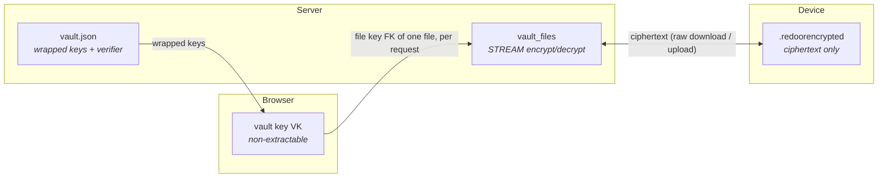

**Trust boundary.** Agents and their devices only ever see ciphertext and never a key. The
vault key never leaves the browser. The server only gets the file key of the one file a
request handles, and only for the duration of that request; `vault.json` holds only wrapped
keys. This protects against devices (other OS users, stolen disks, backups), a stolen copy of
the server data directory (the passphrase slot is only as strong as the passphrase) and
access tokens or MCP clients. It does not protect against a compromised server, which serves
the UI's JavaScript and can already run commands on every agent.

The one exception to "one request" are managed SSH keys encrypted with the vault (see "SSH
device keys"): the watchdog reconnects devices on its own, long after the browser's Start
request, so the server holds such a key decrypted in memory from a browser Start until the
device is stopped or the server process exits.

**Object kinds.** A header's `kind` says what the payload is: `file` for user files on
devices, `ssh-key` for managed SSH private keys stored on the server. The browser binds the
kind into the file key wrap's associated data, so a user file's key can never be presented
as an SSH key's and vice versa. `file` headers have no context; `ssh-key` headers carry
exactly `device_id` and `public_key`, covered by the header MAC.

### Keys

```
passphrase ──Argon2id──► KEK_pw ─┐
passkey A ──PRF──HKDF──► KEK_a ──┼─ AES-256-GCM wrap ─► vault key VK (browser only)
                                                          │ HKDF subkeys
                                                          ├─► file wrap key ─► wraps FK (per file version)
                                                          ├─► chain key ─► wraps the next older VK
                                                          ├─► auth proof
                                                          └─► key id (public fingerprint)
FK ──HKDF──► header MAC key, payload key (ChaCha20-Poly1305 STREAM)
```

- The browser keeps VK as a non-extractable HKDF `CryptoKey` and derives every other key
  from it (`ui/src/vault/vault-crypto.ts`), so one key never serves two algorithms. Every
  wrap binds its context (vault, slot, generation, file kind) in the GCM associated data.
- **FK** is random and new for every encryption. The header stores it wrapped with the
  current generation; the browser unwraps it and sends it with the request in the
  `Redoor-Vault-Key` header (or a JSON or form field), never in a URL.
- **Proof of possession.** `vault.json` stores `auth_verifier = SHA-256(HKDF(VK, "auth"))`.
  Every change of the vault (slots, label, rotation, destroying a generation, restoring a
  backup) sends the proof, which the server hashes and compares in constant time, so a
  stolen session cookie cannot add a passkey or swap the vault. Restoring a backup over an
  installed vault needs proofs for both.
- **Generations.** A rotation creates a new VK for all new writes and wraps the previous VK
  under it, so `keys` in `vault.json` is a chain from the current generation through every
  older one. Slots wrap only the current generation. Destroying a generation relinks the
  next older one under the next newer one and keeps only its fingerprint and dates in
  `retired_keys`, so files on it get a precise error. Every write must use the current
  generation (`stale_vault_key` otherwise), which catches tabs that missed a rotation.

### Storage

`crate::vault::VaultStore` owns `<data_dir>/vault.json` (0600, written atomically), shared
by everyone who signs in. The file is small and changes rarely, so the store
re-reads it under one lock on every request instead of caching it. The document is also the
backup format: it holds only wrapped keys, so "Download vault backup" is safe anywhere.
The server validates the shape of everything the browser submits (id formats, wrap and
salt lengths, Argon2id parameters of at least 64 MiB and 3 passes, at least one slot, an
unbroken chain) but never sees a key, so it cannot check that a wrap really wraps the right
one. Every slot wraps the same key, so no slot type is required: creation, slot removal,
rotation and restore only refuse to leave the vault without any slot (`vault_last_slot`),
because nothing could unlock it again.

### File format

`redoor-vault` is the one implementation: a 19-byte prefix (magic `REDOORENCRYPTED\0`, version, header
length), a JSON header (`VaultFileHeader`: vault id and label, key id, kind, context, FK
wrap, payload parameters), an HMAC-SHA256 over those bytes, then STREAM chunks of 64 KiB
plaintext each followed by a Poly1305 tag. The nonce is a chunk counter plus a final-chunk
flag, which detects truncation, reordering and appended data. The header has no dates, and
the sizes are computable in both directions, so `Content-Length` and progress keep working.

### Requests

`http/vault` serves the vault itself and `http/vault_files` the files, both thin over the
store and the existing `OutputStream` and `AgentUpload` services.

- **Reads** (`header`, `read`, the form-`POST` `download`): `MoveMetadata` gives the file's
  identity, a `RawDownload` pinned to that identity streams it, and `VaultPreamble::read`
  checks magic, version and header before the response starts, then the vault id and
  generation, then the MAC with FK. Each failure is a JSON error with its own
  `ApiErrorCode`. After that, `DecryptingReader` releases only authenticated chunks; a chunk
  that fails later aborts the body. The revision a read reports is a hash of the identity.
- **Writes** (`edit`, `raw`, `rewrap`, `reencrypt`) go through the raw upload flow (staging
  and an atomic rename), never the in-place edit flow, with a precondition the agent checks
  right before the rename: `matches` the identity of the version the browser read, or
  `must_not_exist` for new files. A failed write leaves the previous file intact, and a
  stale one is `vault_file_changed` (409). A rewrap checks the old MAC with FK (proving the
  key belongs to the file), writes a new header and copies the payload bytes unchanged; a
  re-encryption chains `DecryptingReader` into `EncryptingReader`.
- **Decrypted downloads** are a form `POST` navigation, so the browser saves the response as
  a stream; the route checks `Origin` and `Sec-Fetch-Site` itself because form posts are
  not protected by CORS. One-time links never decrypt.
- Plaintext never touches a temporary file on the server; it passes one 64 KiB chunk at a
  time. Keys live in zeroizing types with redacted `Debug`, and travel in headers and bodies,
  which nothing logs; an integration test checks the logs for them.
- **The server makes itself non-dumpable** (`PR_SET_DUMPABLE 0`) at startup on Linux and
  Termux, so processes of its own OS user (local managed agents run as that user) cannot
  read keys from `/proc/<pid>/mem` or attach a debugger. macOS has no equivalent that keeps
  crash reporting, so there a same-user process remains a risk while a request decrypts.

### Browser vault

`ui/src/vault/` holds the browser side; nothing in it is React except the components that use
it.

- `vault-crypto` (WebCrypto, HKDF, Argon2id through `hash-wasm`) and `vault-keys` (creating,
  unlocking, the chain walk, rotation and destroy requests) are pure functions, so the
  integration tests run the same key handling as the UI.
- **`VaultSession`** (router context `vault`) is the page's lock state. It holds the
  non-extractable keys of every reachable generation, shares them with the other tabs over a
  `BroadcastChannel`, locks after 15 idle minutes, and with "Keep unlocked on this device"
  keeps them in IndexedDB instead (no idle lock). On load, kept keys of another generation
  than the server's current one are deleted, because the vault was rotated elsewhere; a
  rotation in this tab locks every other tab and deletes kept keys. "Lock now" deletes the
  kept copy before it locks, so a reload cannot undo it. Logging out locks the same way
  before it ends the session, so the next user of a shared browser finds the vault locked.
- Code that needs the vault calls `requestUnlock(reason)`, which resolves at once while
  unlocked and otherwise opens the one `VaultDialog` in the app shell (create with a passkey,
  a passphrase or both; unlock with one prompt for every passkey of this hostname or the
  passphrase). The editor, uploads, downloads, file creation and the settings page share it.
- **Passwordless vaults.** The passphrase is optional and is the user's recovery path; there
  is no separate recovery code. Wherever a vault ends up without one (creation, removing
  the passphrase, a rotation that drops it) the UI warns that passkeys only work on their
  hostname and that losing them loses every file, which a `vault.json` backup cannot fix.
  New passphrases can be generated (`vault-passphrase`: 25 symbols from a 32-symbol
  alphabet without look-alikes, drawn with rejection sampling, 125 bits) and copied.
- **Passkeys** use the WebAuthn PRF extension (`vault-passkeys`): one `get` with
  `evalByCredential` for every registered credential unlocks; registration refuses
  authenticators without PRF.
- **Fresh unlock.** Flows that wrap the vault key again (adding a passkey or passphrase,
  rotation, slot removal, restoring a backup) need the raw key, which the session never
  holds, so they unwrap a slot again: one prompt for every passkey of this hostname or the
  passphrase (`FreshUnlockFields`, `openFreshSlots`). Only the passkeys' non-extractable
  KEKs wait in React state; the raw key exists only while the flow runs. A restore opens
  the backup's own slots. Rotation keeps only slots opened in the dialog: every kept
  passkey is confirmed with its own prompt (the first confirmation is also the fresh
  unlock, so a single-passkey vault rotates with one prompt), a kept passphrase is typed,
  and anything unconfirmed is removed after a consent that names it.
- **Editor.** A `.redoorencrypted` path opens in the editor even though the agent cannot call
  ciphertext editable. Its content query (`vault-files`) reads the header, unwraps the file
  key and reads the plaintext; it is keyed by the unlocked generation and has `gcTime: 0`,
  so locking drops the plaintext from the cache. Saves send a new file key and the revision
  the editor read; a conflict offers overwrite or discard. The editor workspace never writes
  an encrypted file's buffer to the server (the server also refuses such keys), a `beforeunload`
  warning protects unsaved drafts, and highlighting uses the inner extension. Files on an
  older generation show a banner that rewraps them.
- **Uploads and downloads.** Every pick, drop and paste opens one upload dialog
  (`upload-dialog.tsx`, planning in `upload-plan.ts`) before anything is queued. Each top-level
  item gets a row with its destination name, a Rename / Replace / Merge choice when that name
  exists, and an Encrypt box, which is disabled while the vault is locked. The rows, the
  "for every existing item" select and the naming rules (`destination-plan.ts`,
  `DestinationRow`) are shared with the Copy / Move and Sync conflict dialogs, so every
  transfer asks about existing items the same way and sends the chosen policy per item. Drops and pastes
  while it is open add rows, and made-up names (pasted text, clipboard images) start from a
  free name instead of a conflict prompt. Encrypted items are queued under
  `name.redoorencrypted` (each file of a directory on its own), so the conflict check sees the
  encrypted names; the queue keeps the policy and encryption per file and encrypts each with a
  new file key through the vault upload route. "Download decrypted"
  posts a hidden form into a hidden frame, so the browser streams the plaintext to disk.
- **Settings** (`/settings/vault`) show the slots, generations and backup, run rotations
  (manual, on slot removal and on passphrase change, each with a "Rotate vault key" choice
  where it is optional) and scan the connected devices' default directories for encrypted files
  with the file search, grouping them by generation and offering rewrap and re-encryption.

## SSH device keys

An SSH device can log in with an ed25519 key that redoor creates for that device only,
instead of the server user's own keys or a password stored in plaintext in `config.toml`.
Such a key works for exactly one device, can be revoked on its own, cannot be replayed to
an impostor host and is restricted in `authorized_keys`. When a vault exists, the
key is encrypted with it, so a copy of the server data directory does not give access to
devices.

- **Storage.** Keys and pins belong to the device and are shared like the vault, because
  everyone who signs in is the same account:

  ```
  <data_dir>/ssh/<device-id>/
      known_hosts                          pinned host key
      id_ed25519                           plaintext key (no vault)
      id_ed25519.redoorencrypted           key encrypted with the vault
      id_ed25519.next[.redoorencrypted]    staged key, only while a setup or rotation runs
  ```

  Directories are 0700 and files 0600, written with their final mode and renamed into
  place. There is no `.pub` file: the public key is derived from a plaintext key and read
  from an encrypted key's header, so switching keys is one atomic rename of the staged file
  and a reader always sees a complete old or new key. A commit renames the staged file and
  then deletes the other form. Keys only change from plaintext to encrypted (with a vault,
  plaintext keys cannot be set up), so a reader that finds both after a crash between
  the two steps uses the encrypted one; the next commit or removal deletes the leftover.
  Everything is keyed by the permanent device id, so a rename or a reused name cannot hand
  a key to another device. The `[[agents]]` entry only records `managed_ssh_key = true`
  (omitted when false); it never holds key material, and it never has both
  `managed_ssh_key` and `password`. Keys are generated in-process (`ssh-key` crate), so the
  browser never sees them.
- **Encrypted keys** are `.redoorencrypted` files of kind `ssh-key`: the payload is the OpenSSH
  private key text, the header context binds it to the device and carries the
  OpenSSH public key. The public key keeps the fingerprint, the status and the
  `authorized_keys` cleanup working while the key is locked. For a new key the browser only
  sends a new file key and its wrap under the current generation (`vault` in the setup
  request); the context is bound by the MAC, not the wrap. Opening a key checks the vault id
  and generation, the kind, the MAC, the device, and that the private key's
  public half is the header's public key; any mismatch is an error and nothing is used.
- **Held keys.** `HeldSshKeys` maps a device id to its decrypted key (zeroized on drop,
  redacted `Debug`).
  - `POST …/start` takes an optional `{ "ssh_key_file_key": … }`. A device with an
    encrypted key that is not held needs it: the server decrypts the key and holds it
    before the watchdog starts. Without it the start fails at once with `ssh_key_locked`
    (409). A held key makes the body unnecessary, so access tokens can start a device that
    a browser started earlier and that is still desired-running.
  - Dropped on Stop, device edit or deletion, key removal and supervisor replacement, and
    with the process (including self-restarts; nothing is handed to the re-exec'd server).
    The browser's "Lock now" does not drop held keys, because that must not break the
    reconnects of running devices. Restarting a running agent keeps its key.
  - A restarted server holds no keys and starts no SSH device (see "The server starts no
    device on its own"), so the user's Start brings the key again. A spawn that still
    finds an encrypted key not held (a race with Stop or an edit) shows "The SSH key is
    locked" and waits, desired-running, for the next Start or Retry instead of retrying on
    a timer; no browser hands the key over on its own. `POST …/retry-start` takes the same optional body as Start and refuses with
    `ssh_key_locked` when the key is neither held nor given, so the device page's Retry
    unlocks the vault like a Start. A Start of an already desired-running agent still
    reaches the waiting watchdog.
  - Plaintext keys are not held; every spawn reads them from disk.
- **In-process ssh-agent.** ssh only accepts a key from a file or from an ssh-agent, so
  `ssh/ssh_agent.rs` implements the OpenSSH key agent protocol in the server (named
  "ssh-agent" everywhere, never "agent", which is the redoor process on devices). Every
  `ssh` process with `AuthPolicy::ManagedKey` gets its own socket in a fresh 0700
  directory under `$XDG_RUNTIME_DIR` or the temp dir, plus `id.pub`, and runs with
  `IdentityAgent=<socket>`, `IdentitiesOnly=yes`, `IdentityFile=<dir>/id.pub`. The private
  key, plaintext or decrypted, never touches the disk on the way and is never handed to
  `ssh`. Only `REQUEST_IDENTITIES` (the one key) and `SIGN_REQUEST` (only for that key) are
  answered; everything else, including `session-bind@openssh.com`, gets `FAILURE`, and
  messages are capped at 256 KiB. A connection must come from the server's uid and, where
  the platform reports it, from the spawned `ssh` process. The socket stops accepting and
  its directory is removed after the first signature or the first served connection, when
  a short-lived `ssh` exits, or at the latest after two minutes. A `ProxyJump` keeps
  running its own inner ssh with the user's config and ssh-agent.
- **Policies, each option emitted once.** OpenSSH keeps the first value of an option, so
  defaults are produced by the policies instead of being written unconditionally:
  - `HostKeyPolicy::TrustOnFirstUse` (`accept-new`, as before) for devices without a pin,
    `Probe` for recording the presented key, `Pinned` for devices with a pin, including
    after their managed login key is removed. `Probe` and `Pinned` use only the device's
    own `known_hosts` (global file, `KnownHostsCommand` and DNS off, `UpdateHostKeys=no`,
    `NoHostAuthenticationForLocalhost=no`) and look the key up by
    `HostKeyAlias=<device-id>`, so the pin survives a target or port change that still
    reaches the same machine. An existing but malformed pin fails closed instead of
    restoring trust-on-first-use.
  - `AuthPolicy::Default` (the server user's keys, `BatchMode`), `Password` (askpass),
    `NoAuth` (probe) and `ManagedKey` (only the managed key through the in-process
    ssh-agent, no password or keyboard-interactive fallback).
- **Only the managed key is offered.** `IdentityFile`, forwards and environment settings
  accumulate across config files and cannot be reset, so managed-key connections run with
  `-F none`. Their routing comes from `ssh -G`: a safelist of routing and transport
  options is copied, and a `ProxyJump` becomes an explicit `ProxyCommand=ssh -J … -W …` so
  jump hosts still use the user's config. The generated proxy command shell-quotes the
  resolved host and port instead of `%h`/`%p` tokens, whose later substitution could break
  quoting on older SSH clients. Both config resolution and connections terminate local
  option parsing with `--` before the device target. Other connections read the config
  files as before.
- **Enrollment** (`POST /api/v1/agents/{agent}/ssh-key`, also used for rotation):
  1. The host key is probed without sending any credential
     (`GET /api/v1/agents/{agent}/ssh-host-key`), confirmed by the user and pinned.
  2. First enrollment tries the stored password, the server user's keys, then a typed
     password. Rotation uses only the current managed key (the operation credential, see
     below) and fails if it is revoked or missing; it never falls back to the server user's
     identities. A typed password lives only in memory (zeroized) for the request and goes
     to ssh through askpass; it is never stored or logged.
  3. A key is generated and written to the staged file, encrypted when the request carries
     `vault` (required with a vault, `vault_required` otherwise; refused without one). It is
     installed by a script over stdin that atomically rewrites `~/.ssh/authorized_keys`,
     keeping every other line, dropping this device's lines whose key fingerprint is not in
     the keep list. A symlinked file is written through (temp file
     next to the link target, renamed over it) so the link survives, because Proxmox VE
     links root's file into its cluster filesystem to share it between nodes; a dangling
     link, a non-regular target or a target in an unwritable directory is refused. The line is
     `restrict,port-forwarding <key> redoor:<device-id>:<SHA256 fingerprint>`. A line is the
     device's when its comment contains `redoor:<device-id>:` (the trailing colon keeps
     `dev_abc` from matching `dev_abcd`), and a given key's when the rest of the marker is
     the fingerprint. The awk filter gets the marker and keep list through `ENVIRON` (no
     escape processing) and compares fingerprints only literally (`index`, `==`), because
     they contain `+`, `/` and `=`; it behaves the same in GNU, BSD and busybox awk.
  4. The key is verified with only that key, against the pin, with a dummy `-R 0:…`
     forward like the agent's, so hosts that refuse forwarding fail here. On failure the
     line is removed again with the bootstrap credential and the staged file deleted.
  5. Commit of a first key: under the config edit lock, the staged file is renamed into
     place (and the directory synced), then `managed_ssh_key = true` is written and
     `password` removed, and the agent comes back `Stopped` like after any edit. The rename
     comes first so a crash never leaves a config that claims a missing key, only an unused
     key file that the next setup overwrites. If the config write fails, the key file is
     deleted and the remote line rolled back. A runtime registration failure after
     persistence is reported without rolling back the now-referenced key.
  6. Commit of a rotation (keep list during install: current and new key): only the
     rename, with no config write, so a connected agent is not stopped; its ssh session
     already authenticated, and every agent start loads the key file again. Under the same
     lock Stop uses, an encrypted new key is held when the device is still desired-running
     (so it keeps reconnecting, also after a rotation from plaintext, which held nothing),
     and the old held key is dropped otherwise. Then the old line is removed using the new
     key. The UI offers "Rotate to a vault-encrypted key" for a plaintext key once a vault
     exists.
- **Operation credential.** Rotation, removal and device deletion log in with the current
  key. For an encrypted key the request may carry `current_file_key`, which is decrypted
  with the same checks as Start, or else the held key is cloned. It is resolved before
  anything stops the supervisor and lives only for the request; it is never put into the
  held keys, so rotating a stopped device does not make it token-startable. The UI unlocks
  the vault and sends the file key for these actions.
- **Removal** (`DELETE …/ssh-key`, optional `current_file_key`) first clears the config,
  then removes every `redoor:<device-id>:` line using the operation credential
  and deletes the key locally, reporting whether the device was reached. Without a
  credential (encrypted key, no file key, not held) the removal is local only and reports
  `removed_from_device: false`, as an unreachable device does. Failed persistence leaves
  the remote key intact. Device deletion (`DELETE /api/v1/agents/{agent}`, the same
  optional body) likewise validates route ownership and persists deletion before revoking
  the remote key. The pin stays after key removal and still protects subsequent password
  or default-key logins. Deleting the device or changing its target deletes its device
  directory; changing the username deletes its keys but keeps the pin.
- **Status** (`GET …/ssh-key`) reports whether the device uses a managed key, its
  fingerprint, whether it is encrypted and held, and an encrypted key's header and key
  status, from which the browser unwraps the file key.
- **Vault rotation.** The device scan of the vault settings cannot find keys on the
  server, so `GET /api/v1/vault/ssh-keys` lists the encrypted keys with their
  generation, and `POST …/ssh-key/rewrap` replaces only the header after checking the old
  MAC with the file key (payload unchanged, atomic rename, a held key unaffected). After a
  rotation the settings page rewraps every listed key. Destroying a generation is refused
  with `vault_key_in_use` (409) while an SSH key header still uses it. Restoring another
  vault's backup makes encrypted keys unreadable; their status reports it and the key is
  set up again.
- **Host key changes** fail the connection (`StrictHostKeyChecking=yes`). The
  `connection_issue` names the pinned and presented fingerprints, and only an explicit
  re-pin (`POST …/ssh-host-key/pin` with the confirmed fingerprint) replaces the pin.
- **Concurrency.** Key operations, rewraps and device edits of one device are serialized
  by a per-device busy set; a second request gets 409. The config edit lock is held only
  for the final commit (rename and config write, or the rotation's rename and held key),
  because the flow includes network round trips. Mutating HTTP handlers run their
  operation in an owned Tokio task, so disconnecting a client does not release the busy
  guard or interrupt commit, rollback, or cleanup. Remote file rewrites are serialized
  across devices on this server; separate servers rewriting the same account can still
  race.
- **UI.** A dedicated key is the default for new SSH devices. The add form then creates the
  device without a password and opens `SshKeySetupDialog` (host key confirmation, a
  password used once, enrollment, unlocking the vault first when one exists), so
  the typed password only ever travels with the enroll request. Turning the option off
  brings back the server-keys or stored-password choice. The device's configuration page
  has an SSH key section for set up, rotate, remove and re-pin that shows whether the key is
  encrypted with the vault or plaintext. Starting a device whose key is locked (the server
  answers `ssh_key_locked`) opens the vault prompt and starts again with the key's file key.
  An edit that changes the username or target warns that the key is dropped and can remove
  the key from the device first, while it still logs in.

## Authentication and trust

Redoor has exactly one account with full access, by design: anyone who can sign in can
already run commands as the server's OS user through the local agent, so per-user roles or
isolation would only pretend to protect anything. Several people and several login methods
lead into the one account, and they share the vault, SSH keys, devices, terminal sessions
and access tokens. Two things are per person: the UI state and editor buffers, kept in
`<data_dir>/users/<name>/` under the session's login name (names outside the login name
allowlist, such as OIDC email addresses, get `~<sha256>`), and the name in log lines and
the UI. Each kind of client has its own credential, and each credential only works on its
own endpoints:

| Client | Credential | Grants |
|---|---|---|
| Browser UI | `redoor_session` cookie from `POST /api/v1/login` or OIDC sign-in | REST API and browser websockets, full access, including the session-only routes |
| `redoor remote` CLI, MCP clients, scripts | `redoor_at_...` access token (`Authorization: Bearer`) | REST API and `/mcp`, limited by permissions and a device scope |
| Agents | Proof of the shared `agent_token` (see "Mutual token proof") | `/api/v1/agent/ws` only |
| Plain download links | One-time token | One file on one agent, once |

- **Login methods.** At least one must be configured or startup fails: `[[server.users]]`
  (`[server] username`/`password` is shorthand for one entry) and `[server.oidc]`.
  `AuthState` holds a map of password users (name to Argon2 verifier and session
  fingerprint).
- **No PAM.** System password login through PAM was removed. It needs `dlopen` of the
  host's glibc `libpam.so.0` and its modules, which neither a static binary nor a musl
  process can do, and the published Linux binaries are static musl builds, so it only ever
  worked in local glibc builds. A leftover `[server.pam]` fails config parsing as an
  unknown key; stored `pam` session files no longer deserialize and are dropped.
- **Login** (`POST /api/v1/login`) for name `n` and password `p`:
  1. If `n` is a password user, `p` is verified with Argon2 (on the blocking pool).
     Success creates a `password` session. Passwords are plaintext, hashed in memory at
     startup, or Argon2 PHC strings (recognised by the `$argon2` prefix and checked when the
     config is parsed, so a broken hash fails startup instead of every login).
  2. A name that is no password user is verified against a dummy hash with the default Argon2
     parameters and rejected, so the response time does not reveal which names exist. A
     hand-written hash with other cost parameters still takes a different time; accepted,
     since the change form writes default parameters.

  The login rate limiter counts every failure, whichever method failed. The
  login handler logs the attempted name (debug-quoted) for failures and the signed-in user
  on success.
- **Sessions** are files in the server data dir. Each records the login name and the method,
  and is bound to the credential that created it, so each is revoked on its own; the check
  resolves name and method against the running config on every request and at startup:

  | Method | Bound to | Revoked when | Lifetime |
  |---|---|---|---|
  | `password` | that user's password fingerprint (plaintext and hash in separate digest domains) | the user's password changes or the user is removed | 7 days |
  | `oidc` | a digest of issuer, client id and allowed groups | those change or OIDC is removed | sliding |

  The name of an OIDC session is the ID token's
  `preferred_username`, else `email`, else `sub`; it is only for display, logs and the
  per-user state directory, never for authorization. `Principal::Session` carries the name
  and method, and `GET /api/v1/auth/me` (any principal) returns them, or a token's name and
  id; the application menu and the home page show it and offer the password change only
  for `password` sessions.
- **Password change** (`PUT /api/v1/auth/password`, session only, `http/password.rs`) is
  allowed only for `password` sessions. The current password of the session's own user is
  checked again, with failures counted by the login rate limiter, so a stolen session
  cannot take over the account or guess faster than the login page. The new password is
  hashed with Argon2id and written into that user's `[[server.users]]` entry, or into
  `[server].password` for the shorthand, through the same locked, format-preserving
  rewrite as device edits, refusing if the entry is gone (a hand edit since startup). Only
  after the write do that user's verifier and fingerprint change, together under one lock,
  so a failed write changes nothing and the fingerprint matches what the next startup
  derives from the file. That user's other sessions are then removed, other users keep
  theirs, and the response sets a new cookie for the browser that made the change. A login
  racing the change binds its session to the fingerprint of the password it actually
  checked, so it cannot slip through with the old password.
- **OIDC sign-in** (optional, `[server.oidc]`, `http/oidc.rs`) is another way to get a
  browser session for the same account; password logins stay available next to it. `GET /api/v1/auth/oidc/login`
  starts an authorization code flow with PKCE and redirects to the provider;
  `GET /api/v1/auth/oidc/callback` finishes it. Both routes are public, so the callback is
  its own gate:
  - The `state` must match the `redoor_oidc_state` cookie of the browser that started the
    attempt and name an unexpired attempt kept in memory, which it consumes (single use).
  - The code is redeemed with the client secret and PKCE verifier. The ID token comes
    straight from the token endpoint over TLS, so its claims (issuer, audience, expiry,
    nonce) are checked but not its signature (OIDC Core 3.1.3.7).
  - When `allowed_groups` is set, the `groups` claim must contain one of them, checked by
    Redoor even if the provider restricts the client too, because the session grants shell
    access. Leaving it unset lets every account the provider signs in through, for
    providers where the client registration already decides who may use it; the server
    logs a startup warning so this is never accidental. An empty list is refused because
    it could mean either "nobody" or "anybody".
  - Every allowed identity maps to the single account. OIDC sessions slide forward on use
    (rewritten at most daily, cookie refreshed by the access layer), and their digest
    hashes an unset `allowed_groups` in its own domain.
- **Access tokens** are the one credential type for clients other than the browser. They
  are created and managed only by a browser session (see "Access control" below). An MCP
  client is usually an AI assistant acting for the user, so it should get no more access
  than its task needs. Tokens are independent of the login methods: changing a password or
  turning a method off does not invalidate them.
- **Logging the signed-in user.** `redoor-core` logging has a `tokio::task_local!` with the
  current user, and `log!`/`log_error!` records written inside it get a `user` field
  (`[user=alice (password)]` before the message in line format, `"user"` in JSON); records
  without one omit it. The access middleware runs each authenticated request in the scope
  (`<name> (<method>)` for sessions, `<token name> (token <id>)` for tokens), and `/mcp`
  enters the same scope in its own bearer middleware. Task-locals do not cross
  `tokio::spawn`, `spawn_blocking` or threads, so request code hands work to other tasks
  through `logging::spawn_in_user_scope` and `spawn_blocking_in_user_scope`, which re-enter
  the scope in the new task (SSH key operations, cancels on drop, MCP background work, the
  Argon2 checks, terminal sessions). The router serves everyone, so each
  `RouterEnvelope` carries the sending task's user and the router handles the message in
  that scope; a flow remembers the user that created it and the agent's answers to it are
  handled as that user, which covers copies, moves, uploads, downloads and exec. Device
  start, stop and restart and server restart and upgrade are logged by their request, and a
  Start or Retry also leaves its user on the watchdog handle, where the supervisor takes it
  for the next cycle's spawn, so that start's provisioning logs name the user.
  Background work with no requester (startup, watchdog reconnects, supervisor restarts)
  logs without a user, and agents never learn the user.
- **The agent token** is one secret shared by all agents and proven, never sent, during the
  websocket upgrade, and the server proves it back (see "Mutual token proof"). It proves
  "this is an agent of this server", not which agent: the agent id in `hello` is
  self-reported. Agents are therefore only partly trusted, and an agent's token also lets
  its holder pass as the server to other agents.
- **SSH device credentials** live in two places, both readable by the server's OS user
  and root: an optional plaintext `password` in `config.toml`, or a managed key under
  `<data_dir>/ssh/<device-id>/`. When a vault exists, a key is encrypted with it, so a copy of the data dir alone does not log in; the server holds it
  decrypted only while the device runs after a browser Start, which carries the same
  residual risk as encrypted files (a compromised server, root, and on macOS a same-user
  process). A plaintext key (no vault, or not yet rotated) lets anyone who
  can read the data dir or a copy of it log in to that device; the exposure is limited to
  that device and revocable by removing the key. The SSH key routes (setup, rotation,
  removal, status, rewrap and the vault's SSH key list) are session-only, because they
  handle passwords and file keys and change what the server can log in to. Access tokens
  cannot unlock the vault: they can start a device with an encrypted key only while its
  key is held.
- **What agents are trusted with.** An agent acts as its own OS user. A local managed agent
  runs as the server's user, an SSH agent as the SSH login, and a standalone agent as
  whoever started it. The server trusts the content an agent returns (listings, file data,
  exec output). It does not trust an agent with anything that could reach the server or
  another agent:
  - Frames are attributed to the connection they arrived on, not to ids they carry. Request
    ids resolve only for the agent they were sent to, and only the current session's frames
    count.
  - Credit grants are clamped, and messages are capped at 32 MiB, so a peer cannot force
    unbounded buffering.
  - An agent cannot take over the name of a live or configured device, and an id in a
    `hello` must be in the device id format.
  - The server signs resume manifests and checks them against the agent that returned them,
    and it compares both agents' hashes itself before reusing a prefix.
  - The partial signing key, the sessions and the access token verifiers exist only on the
    server.
  - Agent ids are self-reported, so a token scoped to device X trusts that no other holder
    of the agent token registers as X. This is the same limit every agent check has, and
    the duplicate-id detection only reacts to the behavior of cloned agents. Proper
    per-agent credentials are a separate topic.
- **Terminal output is parsed by native code on the agent.** `libghostty-vt` parses every
  byte to keep the session mirror, and those bytes come from any program in the shell (`cat`
  of a hostile file), so they are untrusted input to native code. The browser parses the
  same bytes, but inside its wasm sandbox. Ghostty treats `vt_write` input as untrusted, and
  the build uses Zig's `ReleaseSafe` mode, which keeps bounds and overflow checks in release
  builds: a parser bug stops the process with a safety panic instead of corrupting memory.
  The mirror runs in the agent, on the host the bytes come from, so such a panic stops that
  one agent rather than the server every device depends on. A failure of the emulator
  thread itself ends only its session ("Terminal emulator failed"). The mirror never
  answers terminal queries (DSR, DA), so a program cannot make the agent write to the PTY;
  the browser answers them.
- **The terminal index is not trusted for access.** The server's in-memory index only lists
  sessions; attaching still goes to the agent, which refuses ids it does not run, and an agent's report only replaces
  that agent's own records, because the connection, not the frame, names the agent.
- **Browser protections.**
  - The cookie is `HttpOnly` and `SameSite=Lax`.
  - JSON endpoints require `Content-Type: application/json`.
  - The terminal attach and log websockets check `Origin` against `Host`, which stops
    cross-site websocket hijacking.
  - Token management rejects cross-site requests (`Sec-Fetch-Site` and `Origin`).
  - `/mcp` accepts only the origins listed in `mcp_allowed_origins`.
  - **Raw file responses are sandboxed.** `/raw` serves agent files inline with their
    guessed type on redoor's origin, so a browser that opens the URL directly (a Download
    link opened in a new tab, a shared link) would run an HTML or SVG file's scripts as
    redoor with the user's API access. Every file response therefore carries
    `Content-Security-Policy: sandbox` (opaque origin, no scripts) and
    `X-Content-Type-Options: nosniff`. `` and downloads ignore both.
  - **Previewed HTML and SVG files are untrusted documents.** The editor's preview
    (`preview=true`) renders Markdown with React, but an `.html`/`.htm` or `.svg` file has to
    be rendered by the browser, so `SandboxedPreview` puts the editor buffer's text into an
    `<iframe srcdoc>` (never the `/raw` URL). The frame's `sandbox` never contains
    `allow-same-origin`, so the document has an opaque origin and cannot reach the UI's DOM,
    the session cookie, storage or the authenticated API. Top navigation, popups, forms and
    modals are never allowed. `utils/sandboxed-preview-document.ts` puts a meta
    Content-Security-Policy in front of the file's markup (after a leading doctype only,
    which keeps standards mode and cannot carry markup), since a meta policy only covers
    what follows it: `default-src 'none'` with only inline styles and `data:` images, fonts
    and media, so nothing loads from the network or the redoor server. Scripts are off by
    default; the "Enable JavaScript" toggle adds only `allow-scripts` and
    `script-src 'unsafe-inline'` and recreates the frame, because a loaded frame keeps its
    sandbox. The choice is history-entry state per file, so other files start with scripts
    off. Without scripts an SVG is shown as an `` data URL, where SVG scripts never run;
    with scripts its markup is inlined so they can. CSP cannot stop the frame navigating
    itself (a clicked link, or a script setting `location`); the new document keeps the
    sandbox, so it still cannot reach redoor. CSP does not cover WebRTC either, so with
    scripts on a document can send data out over a peer connection; the UI says scripts may
    reach the network rather than promise isolation. Either way all it can leak is the
    file's own content and the fact that it was opened. Relative assets next to the file do not load.

### Access control

Every authenticated request has a `Principal` (`http/access`): `Session(SessionUser)` for a
browser session (the user only says who signed in and how; every session has the same
access), or `Token(TokenGrant)` for an access token. A grant is a set of permissions and a
device scope:

| Permission | Grants |
|---|---|
| `files:read` | list, stat, read and download, search, directory size, git status, diffs and revision browsing, trash listing, one-time download links |
| `files:write` | upload, edit, mkdir, chmod and chown, trash restore, copy destination |
| `files:delete` | trash, permanent delete, empty trash, move source removal (rename needs write and delete) |
| `commands:execute` | exec, exec cancel, native open. High trust: commands run as the agent's OS user and bypass every file permission |
| `agents:manage` | start, stop, retry, restart and upgrade an agent |

The device scope is `All` (every device, including devices added later) or `Only` a list of
device ids. Names in a create or edit request are resolved and stored as ids, so the scope
never follows a name to another device. Listing devices needs no permission; it is filtered
to the scope.

- **One decision function.** `Principal::require(permissions, device)` checks the scope and
  the permissions. REST routes, REST handlers and MCP tools all call it, so REST and MCP
  cannot drift apart.
- **One route table.** `access/routes.rs` maps each `(method, route template)` to an
  `Access`: `Public`, `SessionOnly`, `AnyPrincipal` (the handler filters by scope),
  `Device(permissions)` (checked against the id the `{agent}` path parameter resolves to) or
  `Handler` (the devices are in the body, so the handler resolves them and calls `require`:
  copy, move, diff, partials and transfer cancel or pause). The `access_control` middleware is attached with
  `Router::layer`, which runs after routing, so it sees the matched template.
- **Default deny.** A route missing from the table is session-only, so a new route is not
  reachable with a token until someone classifies it.
- **Session-only routes.** Server and agent configuration, creating SSH or local agents,
  restart, log levels, terminals, log streams, the UI websocket, user state, editor buffers,
  the vault and every encrypted-file route (`/api/v1/vault/...`,
  `/api/v1/agents/{agent}/vault/...`), the SSH key and host key routes
  (`/api/v1/agents/{agent}/ssh-key...`, `/api/v1/agents/{agent}/ssh-host-key...`) and token
  management are never grantable. Tokens and
  MCP clients can copy, move and read `.redoorencrypted` ciphertext through the ordinary file
  routes, but never decrypt it or change the vault. A token could otherwise widen its own access, for
  example by adding a local agent or minting a broader token. The exception is
  `/api/v1/tokens/current`, where a token reads or deletes itself.
- **Limit of the model.** Permissions describe what a token may do through redoor, not
  what the device's OS user can reach. A local managed agent runs as the server's OS user,
  so `files:write` or `commands:execute` on it can rewrite the server's config, session
  files and token store, which is equivalent to full access. Scope tokens away from such
  devices when that matters.
- **Bearer first.** When a request carries `Authorization: Bearer`, the token alone decides;
  a cookie on the same request is ignored. `/mcp` accepts only tokens, never cookies.
- **MCP tools** declare the permissions they need, and `tools/list` hides the tools the
  token can never use. Each call still checks the devices it touches. Operations are owned
  by the token id, which survives rotation. MCP does not stream big files between the
  client and a device: `read_file` and `write_file` are capped at 64 KiB, and large local
  transfers are the remote CLI's job. Copies and moves between devices stay, because their
  bytes never pass through the client.
- **Storage.** The server process owns the token store (`http/tokens/store.rs`): an
  in-memory table loaded at startup from `<data_dir>/tokens/access-tokens.json` (0600),
  rewritten atomically on every change. A token is `redoor_at_<id>_<random>`; only a
  SHA-256 verifier is stored and compared in constant time. The 256 random bits make a slow
  password hash unnecessary, and the embedded id gives an O(1) lookup. Rotation replaces the
  verifier and keeps the id; deletion removes the record. Last use is updated in memory on
  every request but written at most once a minute per token, so authentication does not
  rewrite the file for every CLI poll.

Agent registration (the shared agent token), one-time download links and browser sessions
are separate credentials and not part of this model.

**CLI login.** `redoor remote login` never stores the password. It logs in with the password
to get a transient browser session, reads the device list, asks which permissions, devices,
name and expiry the token should have, creates the token with that session, and then logs
the session out (always, also on errors). If the previous login was to the same server, its
token is revoked, so re-logins leave no orphan tokens. `logout` revokes the token through
`DELETE /api/v1/tokens/current`. Because creating a token needs the password, a token alone
can never mint another one.

## Design rules

- **Memory is bounded.** All uploads, downloads and tar archives are streamed in 64 KiB frames
  through bounded channels. Nothing reads a whole file into memory.
- **Control stays responsive.** Payload never passes through the router mailbox, each
  writer sends control frames before data, and no data frame exceeds 64 KiB. Per-stream
  credit stops one slow consumer from blocking others.
- **One owner per concern.**
  - `Command::policy()` classifies commands.
  - The router owns flow lifecycle.
  - `ApiError` owns HTTP status mapping.
  - Each side's connection writer is the only place that encodes frames.
- **Stale events are ignored.** Socket ids on the server and generations on the agent mean a
  delayed event from a replaced connection can never affect its replacement.
- **The wire format is versioned.** Incompatible frame changes bump the `redoor.vN`
  subprotocol instead of carrying compatibility fallbacks; mismatched builds fail the upgrade
  with `426`. The integration tests speak the protocol through one shared fake agent
  (`tests/fake-agent.ts`), so a protocol change is made in one place on the test side.

## Integration test process lifetimes

Managed agent daemons outlive their server by design and run in their own session, outside
the process group the test harness kills. `ProcessManager.killAll` therefore also kills the
daemons recorded under each test server's home, so a later server does not adopt them, and
test servers pass daemons a 10 minute orphan limit, so a daemon a crashed run leaves behind
ends on its own; one that reconnects to a later server is rejected, because that server
manages no device with its id. The Playwright fixture kills its daemons the same way.

Vitest runs isolated server processes on worker-specific ports, reusing each worker's port
between test files and during restart scenarios. Fixture HTTP requests to that worker's
loopback port send `Connection: close`, so Node's shared fetch pool cannot retain sockets
belonging to a killed server. Readiness probes release their response bodies before returning.
The transport preserves request authentication and bodies; unrelated HTTP endpoints keep their
normal connection behavior.
