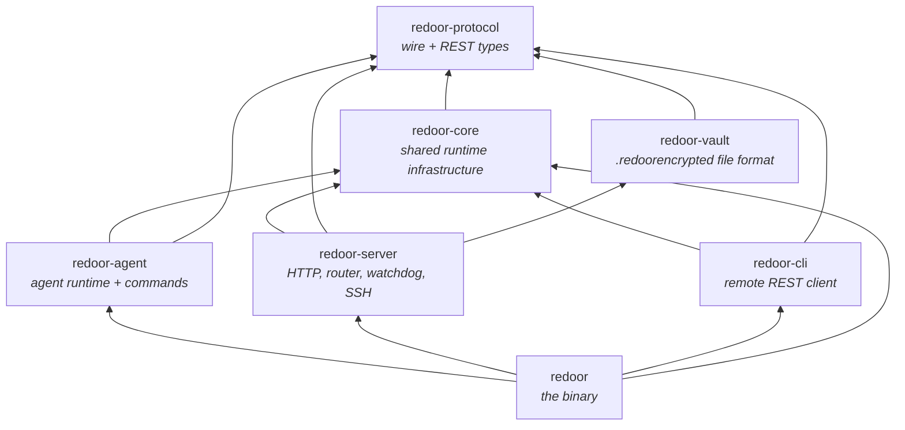
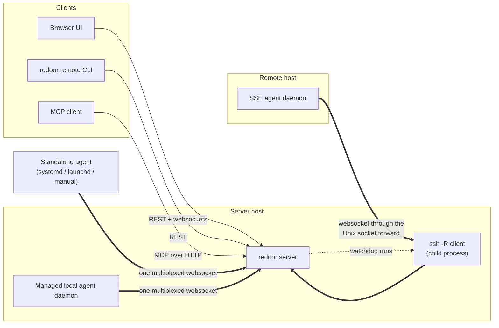
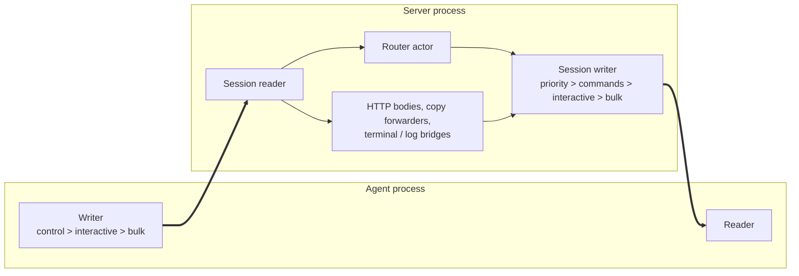

# Architecture

This document describes the high-level design of redoor and the reasons behind it. Details
live in the code and its comments; this file only names the concepts and where they live.

Redoor is a single `redoor` binary that plays several roles:

- **server**: REST API, browser UI, MCP endpoint and the websocket hub agents connect to
- **agent**: connects to a server and executes filesystem, exec, git, terminal, log and
  systemd commands on its host
- **remote CLI** (`redoor remote ...`): a REST client for scripting against a server,
  authenticated with an access token
- **service management**: installs the server, agent or a named relay as a systemd or launchd
  service
- **self-upgrade** (`redoor upgrade`): installs a release over the running binary and restarts
  the local redoor processes that run it

## Crates

The Rust code is a cargo workspace under `crates/`. The roles live in separate crates so the
compiler enforces that agent and server code never depend on each other.

Arrows point from a crate to what it depends on. The three role crates in the middle are
siblings that cannot import each other.

- **`redoor-protocol`**: the contract between all parties, with no runtime dependencies. It
  holds the agent websocket protocol (`wire/`), the typed ids and the REST request and
  response types (`api/`). `Command::policy()` is the single table that classifies every
  command (streaming direction, upload or not, how it is cancelled), read by both the
  server and the agent so they cannot disagree. Types marked `#[ts(export)]` generate the
  TypeScript interfaces in `bindings/`, so the UI and integration tests check the JSON from
  the other side.
- **`redoor-core`**: infrastructure more than one role needs: configuration, `RuntimeContext`,
  logging (with the signed-in user as a task-local), size-bounded rotating log files,
  filesystem safety (`safe_rm_all`, atomic renames, staging paths), stream credit
  primitives, TCP latency tuning, backoff and the release installer.
- **`redoor-vault`**: the only implementation of the `.redoorencrypted` format. It is its own
  crate so only roles that may hold file keys link it; the agent cannot, so "agents only
  ever see ciphertext" is enforced by the compiler.
- **`redoor-agent`**: the agent runtime (one event loop, a dispatcher that applies the
  command policy, cancellation registry, result ledger) and every command implementation:
  filesystem, transfers, git (gix), search, trash, terminals, live logs and systemd.
- **`redoor-server`**: Axum HTTP routes and auth, the router actor and per-agent session
  actors, the watchdog that supervises managed agents, SSH provisioning and relays, the
  terminal index, the vault store and built-in TLS. REST and MCP handlers are thin adapters
  over shared services (`TransferService`, `OutputStream`, `AgentSearch`, `AgentUpload`).
- **`redoor-cli`**: the `redoor remote` client over `reqwest`. It is the only client that
  streams local files and tar archives to and from devices; MCP keeps file content inline
  and capped at 64 KiB.
- **`redoor`**: the binary. It parses the CLI, dispatches to a role, and owns service
  backends (systemd, launchd), PID files and the `upgrade` command.

`redoor-agent` also links `libghostty-vt`, Ghostty's terminal emulator, built from source
with Zig as the headless emulator of persistent terminal sessions. It is built in
`ReleaseSafe` mode so bounds and overflow checks stay on, because it parses untrusted
terminal output.

## Processes and connections

Agents always open the connections. The server never dials an agent, so an agent can run
behind NAT, on a phone (Termux) or on a host only reachable over SSH.

- **Standalone agents** are started by the user or a service manager and connect with the
  agent token.
- **Managed agents** are `[[agents]]` entries in the server config, local or SSH-backed. They
  run as daemons supervised by the server's watchdog (see "Managed agents").
- **Relays** (`redoor agent relay`) start a plain agent over an SSH TCP forward, for agents
  of a remote server.
- **Browsers, the CLI and MCP clients** only use the REST API, `/mcp` and browser
  websockets. They never talk to agents directly; the server translates each request into
  agent commands.

The server can terminate TLS itself (`[server.tls]`, operator certificates or a self-signed
one), for private deployments without a reverse proxy.

## The agent connection

Each agent keeps exactly one websocket to the server at `/api/v1/agent/ws`. It carries JSON
control frames (`ServerToAgent` / `AgentToServer`) and binary stream frames (stream id,
`FIN` flag, at most 64 KiB of payload). Downloads, uploads, exec output, terminal
attachments and log streams are all streams multiplexed over that one connection.

**Control stays responsive during transfers.**

- **Lanes.** Each side has one writer that drains its lanes in strict priority: control
  frames, then interactive (terminal) frames, then bulk data. Since no data frame exceeds
  64 KiB, a control frame never waits behind more than one data frame, and typing stays
  responsive during downloads.
- **Kernel backlog.** Both ends set `TCP_NODELAY`, and `TCP_NOTSENT_LOWAT` on Linux, so the
  backlog waits in the lanes, where control frames can skip it, instead of in a multi-megabyte
  kernel send buffer.
- **Stream credit.** A sender may put a data frame on a stream only when it holds credit
  for that stream; the receiver returns credit as its consumer drains. Windows are small (4
  frames for transfers, 16 for terminals). This lets each reader hand frames to bounded
  per-stream queues without ever waiting, so a slow consumer (a slow browser download, a
  slow copy destination) stalls only its own stream, memory per stream is bounded, and a
  peer that violates credit fails only that stream.
- **Payload bypasses the router.** The router admits a stream and hands out a lease
  (cancel token, byte counters); frames then go straight from the session reader to the
  consumer. The router never awaits, so its mailbox never waits on a peer.

**Connection setup and mutual token proof.** Authentication and protocol negotiation happen
during the HTTP upgrade, so a client with the wrong token (`401`) or protocol version
(`426`) never gets a socket. The agent token never crosses the network: each side proves it
knows the token with an HMAC over fresh nonces, so an agent pointed at the wrong server
neither leaks the token nor accepts its commands. The `hello` frame is the only frame that
names the agent; every later frame is attributed to the connection it arrived on. Incompatible
wire changes bump the `redoor.vN` subprotocol; there is no compatibility with earlier
protocols. Refused mismatches are remembered so an agent of another release shows up in the
UI.

**Stale events are ignored.** Every connection has a socket id on the server and a
generation on the agent, so a delayed event from a replaced connection can never affect its
replacement.

## Device identity

Every device has an **id** (`dev_` + 100 random bits) that never changes and a **name** for
people. Everything stored refers to the id (config entries, token scopes, resume
manifests), so renaming a device never silently moves access to another device. Requests
accept either a name or an id; it is resolved once, before access control.

The id is owned by the server for managed agents (in `config.toml`), by the relay for
relayed agents, and by the agent itself for standalone agents (`<data_dir>/agent-id`). The
router detects cloned standalone agents that share an id by their eviction loop and rejects
the newcomers with a warning instead of letting them evict each other forever.

## Connection recovery

Every connection has exactly one owner of its recovery, and all owners retry on the same
backoff (1 s doubling to 30 s, with jitter):

- **Standalone agents** reconnect forever, since nobody else will restart them.
- **Relayed agents** exit and leave recovery to their relay, which restarts the SSH session.
- **Managed daemons** reconnect on their own, because they outlive SSH sessions and server
  restarts, and exit after an orphan limit without a connection.
- **The watchdog** owns the session to a managed daemon and replaces a daemon that does not
  come back.

## Managed agents

Managed agents (local or SSH) run as daemons that outlive SSH sessions and server restarts,
so their terminal sessions do too. The server's watchdog only runs the *session* to a
daemon: a local child, or `ssh -R <socket>` running `redoor agent managed` on the device.
That session runs an **ensure step**: it keeps the running daemon if its binary and settings
(a spec hash) match, otherwise replaces it, and reports back. A daemon whose `hello` does
not match the latest report is rejected as superseded.

- **One namespace per device** (`--app-name <server>-<device id>`) gives each daemon its own
  PID lock, logs and data. The PID file's lock is the only liveness proof.
- **The server starts no device on its own.** Desired-running lives in memory only, so
  starting a device is always the user's decision (an SSH device with a vault-encrypted key
  cannot start before a browser unlocks the vault). A local daemon that outlived a server
  restart reconnects and is adopted; SSH devices wait for the user's Start.
- **A stop wins every race.** Every start and stop bumps an attempt generation, and the
  router only commits a registration whose generation is still current.
- **SSH provisioning** probes the device, uploads the matching binary when needed and
  verifies it, on every start. Install paths identify the build (versioned for releases, a
  content hash for debug builds), so devices never hash binaries.
- **Config edits apply at runtime**: adding, editing and deleting devices rewrites
  `config.toml` (format-preserving, under a file lock) and replaces the supervisor.

## Upgrading in place

`redoor upgrade` and the server's update endpoint use the embedded `install.sh`, the one
downloader, which renames the new binary over the old path so running processes keep their
old image. Roles restart themselves on `SIGUSR2` by re-executing in place, which keeps their
PID, arguments and supervisor. The upgrade finds the processes running the replaced path,
signals all of them before waiting, and uses a detached helper when it runs inside a process
it is about to restart. Managed daemons are upgraded by the next ensure step after a server
with a different binary starts or adopts them. Standalone agents can be upgraded from the
server as a background job that streams the binary to them.

## Router and flows

The router actor is the single owner of agent registrations and in-flight work. Every request
sent to an agent belongs to exactly one **flow** in one `FlowTable`:

| Flow | What it is |
|---|---|
| `Command` | A one-shot request whose caller waits for the result |
| `Output` | A download, exec output, search or journal streaming to a consumer |
| `Upload` | An upload, archive upload or file edit into one agent |
| `Copy` | A copy or move, on one agent or across two |

Flows have explicit phase enums, so impossible states cannot be represented and phases decide
what can still be cancelled. A flow settles exactly once: on the agent's result, when the
caller gives up, on a user cancel or pause, when its agent disconnects, or on a credit
violation. Handlers reach agents only through `AgentClient::call`, where the request type
decides the response type and every call has a deadline.

**Request lifecycle.** Every request gets exactly one result, always after its stream data,
so flows settle on the result alone. `FIN` means the data is complete; a failed or cancelled
stream ends without it, so an HTTP body aborts visibly instead of looking like a short file.
A cancel can never overtake its command: a command still queued is withdrawn, a written one
is cancelled and answered by its normal result.

**Admission.** The bounded command lane rejects new work instead of buffering it, and the
router limits concurrent uploads per connection.

## Transfers

- **Downloads and exec output** are output streams with initial credit in the command, so
  output starts without a round trip. Exec's exit status is its result, ordered after the
  output.
- **Uploads** write into a self-deleting hidden staging path next to the destination.
  Publication (the atomic rename) is a separate step the router decides, so a cancelled
  upload never replaces the destination and an accepted one is never reported cancelled.
  Uploads never overwrite unless asked (`on_existing`), and can carry preconditions
  (`must_not_exist`, or the identity of the version read).
- **Copies between agents** join a source download and a destination upload with a forwarder
  that returns credit to the source only after the destination accepted the frame. A **move**
  is a copy followed by deleting the source if its identity still matches. Copies on one
  agent run entirely on that agent.
- **Resuming.** An interrupted file copy keeps a partial file and a manifest on the
  destination agent, so it can resume across server, agent and machine restarts with no
  server-side transfer database. The server signs the manifest with a key only it holds (so a
  compromised agent cannot make the server copy or delete arbitrary files), and reuses only a
  prefix whose segment hashes match on both agents. Resuming is always explicit.
- **Search** (path search and content grep) streams NDJSON matches while the agent still
  walks, so the browser shows results long before a large tree is done. JSON callers (REST,
  MCP) get the same stream collected into one response.
- **Progress** for downloads, uploads and copies is kept in the router's in-memory
  `TransferProgressStore`, read from the flows' leases, and kept as short-lived history.

## Terminals and live logs

A terminal is a session of the agent process, not of a browser socket or a connection. The
agent owns the shell's PTY and a mirror of its screen (`libghostty-vt`), so the shell
survives page reloads, network changes, dropped agent connections and server restarts, and
any browser can pick it up again with a snapshot of the screen.

- The agent reports its sessions after `hello` and on every change. The server keeps only an
  in-memory index (`TerminalRegistry`), so a restarted server learns the sessions again from
  each agent.
- One browser views a session at a time; attaching takes it over from the previous viewer.
- Terminal frames use the interactive lane, and stream credit holds back a shell whose viewer
  is slow, so memory stays bounded.
- Terminal and log routes are session-only, so tokens and MCP cannot open or take over shells.
- Live logs stream NDJSON log events over a stream of the same connection.

## Systemd units

The UI manages a device's systemd units (lists, status, actions, journal, linger) through
agent commands that run `systemctl`, `journalctl`, `loginctl` and `systemd-analyze` with a
fixed environment, never through a shell or D-Bus. A root agent manages every user's manager;
a non-root agent reads the system manager and manages only its own. The journal is a credited
NDJSON output stream. A unit has no page of its own; it is a tab of the file view of its unit
file. These routes are session-only; tokens use exec instead.

## Git

All Git work runs on the agent with gix in blocking tasks, and every response is bounded
(entries, bytes, patch budgets) because a reply is a single control frame. Long walks (status,
worktree status) are request-cancellable, so leaving a view stops the walk on the agent.

The browser can browse a revision or range (`rev` search key) read-only with the same
components as the worktree, list history, branches, tags and worktrees with offset paging,
and download or copy committed files and directories. Downloads stream blobs from the object
store instead of inflating whole objects in memory.

## Browser UI

The UI is a TanStack Router application embedded in the server binary.

- **Live updates are invalidation hints.** `/api/v1/ui/ws` carries payload-free events
  (`agents_changed`, `routes_changed`, `transfers_changed`, `terminals_changed`) that become
  TanStack Query invalidations. REST stays the single source of truth, so there are no deltas
  to keep consistent and a missed event only means a later refresh.
- **The query cache is the only server state.** Route loaders prime it; components read the
  same queries; mutations and events invalidate it under one key hierarchy per agent.
- **The authenticated app** lives under the pathless `_app` layout, whose shell hosts the
  session-scoped work; `/login` is outside it.
- **Device URLs carry names, everything else uses ids.** A device route resolves its name
  once, so an open page keeps acting on the device it was opened for.
- **Back and forward restore the view.** View state that changes page height is kept per
  history entry (`useHistoryEntryState`), so restored scroll positions land correctly.
- **Long-lived resources are classes created once in `main.tsx`** (`TerminalSessions`,
  `UploadQueue`, `EditorWorkspace`, `ShortcutRegistry`, `VaultSession`) and exposed through
  the router context, instead of work run from component effects.
- **Editor buffers** are one CodeMirror view with one state per open file. They are stored on
  the server per user, so editing can continue on another computer, and device text never
  replaces unsaved edits.
- **A new server build reloads the page**, since old lazily loaded chunks no longer exist.

## Vault and encrypted files

The vault holds the keys that encrypt `.redoorencrypted` files and managed SSH keys. Everyone
who signs in shares it. The browser creates, unlocks and rewraps every vault key; the server
stores only wrapped keys (`vault.json`) and never sees the vault key.

| Party | Holds | Never holds |
|---|---|---|
| Unlocked browser tab | The vault key as non-extractable `CryptoKey`s | |
| Browser storage | The vault key wrapped with a device secret | The device secret |
| Server memory | Device secrets bound to one login session; the file key of the file a request handles, for that request; decrypted SSH keys of running devices | The vault key |
| Server disk | Wrapped keys and a proof verifier; vault-encrypted SSH keys | The vault key |
| Devices and agents | Ciphertext | Any key |

- **Slots** (passkeys with the WebAuthn PRF extension, and an optional passphrase) each wrap
  the same vault key. Every change of the vault requires a proof of possession, so a stolen
  session cookie cannot add a passkey.
- **Generations.** Rotation creates a new vault key and chains the older ones under it; all
  writes use the current generation.
- **Idle lock.** A browser keeps the vault open across reloads only through a device secret
  the server holds in memory for that session and lock window, so a copied browser profile
  cannot open the vault once the window passed, the session ended or the server restarted.
- **Encrypted files** use a random file key per encryption, wrapped with the vault. The
  browser sends the unwrapped file key with each request, and the server encrypts and
  decrypts as a stream of authenticated 64 KiB chunks, so plaintext never touches disk on the
  server and agents only ever store ciphertext. Writes go through staging with a precondition
  on the version read. The server makes itself non-dumpable on Linux.

## SSH device keys

An SSH device can log in with an ed25519 key redoor creates for that device only, instead of
the server user's keys or a plaintext password. The key is restricted in `authorized_keys`,
revocable on its own, used only against a pinned host key, and encrypted with the vault when
one exists. A decrypted key is held in server memory only from a browser Start until the
device stops. `ssh` never reads the key: it gets signatures from an in-process ssh-agent
socket that serves that one key. `build_ssh_command` is the only place that creates an `ssh`
command, so no connection can bypass the host key and auth policies.

## Authentication and trust

Redoor has exactly one account with full access, by design: anyone who can sign in can
already run commands as the server's OS user, so per-user roles would only pretend to protect
anything. Several people and login methods lead into it; only UI state, editor buffers and the
name in logs are per person. Each client kind has its own credential, which only works on its
own endpoints:

| Client | Credential | Grants |
|---|---|---|
| Browser UI | `redoor_session` cookie from password or OIDC sign-in | REST API and browser websockets, full access, including session-only routes |
| `redoor remote` CLI, MCP clients, scripts | `redoor_at_...` access token | REST API and `/mcp`, limited by permissions and a device scope |
| Agents | Proof of the shared agent token | `/api/v1/agent/ws` only |
| Plain download links | One-time token | One file on one agent, once |

- **Login methods** are password users in the config file (`[[server.users]]`, re-read when
  the file changes) and optional OIDC.
- **Sessions** are files in the server data dir, each bound to the credential that created
  it (a password change or an OIDC config change revokes them). They expire after an idle
  period the user picks and slide only on real user activity or running transfers, never on
  background polling. Browser websockets close when their session ends.
- **Cookie rotation with reuse detection.** The session cookie's secret rotates while the
  user works. A browser presenting a secret the session already moved past proves two
  browsers share it, so the server revokes the session for both and tells the user, which
  makes a stolen cookie noisy and short-lived.
- **The signed-in user is logged.** A task-local carries the user through requests, spawned
  tasks and router messages, so log lines name who caused them.
- **Agents are only partly trusted.** The agent token proves "an agent of this server", not
  which agent. The server trusts returned content but never lets an agent affect the server or
  other agents: frames are attributed to their connection, credit and message sizes are
  bounded, names cannot be taken over, and resume manifests are signed and verified.
- **Browser protections**: `HttpOnly`/`SameSite=Lax` cookies, JSON content-type checks,
  `Origin` checks on websockets and sensitive routes, sandboxed raw file responses, and
  previews of HTML and SVG files in sandboxed iframes with an opaque origin.

### Access control

Every authenticated request has a `Principal`: a browser session (full access) or an access
token with a set of permissions (`files:read`, `files:write`, `files:delete`,
`commands:execute`, `agents:manage`) and a device scope (all devices or a list of ids).

- **One decision function.** `Principal::require` is called by REST routes, handlers and MCP
  tools alike, so REST and MCP cannot drift apart.
- **One route table** (`access/routes.rs`) classifies every route, and a route missing from it
  is session-only, so a new route is not reachable with a token until someone classifies it.
- **Session-only routes** are everything a token could use to widen its own access or that
  handles secrets: configuration, terminals, the vault and encrypted files, SSH keys and token
  management.
- **Limit of the model.** Permissions describe what a token may do through redoor, not what
  the device's OS user can reach; write or exec on the server's own local agent is equivalent
  to full access.
- Tokens are stored only as SHA-256 verifiers; the token embeds its id for O(1) lookup.

## Design rules

- **Memory is bounded.** All uploads, downloads and tar archives are streamed in 64 KiB
  frames through bounded channels. Nothing reads a whole file into memory.
- **Control stays responsive.** Payload never passes through the router mailbox, each writer
  sends control frames before data, and per-stream credit stops one slow consumer from
  blocking others.
- **One owner per concern.** `Command::policy()` classifies commands, the router owns flow
  lifecycle, `ApiError` owns HTTP status mapping, and each side's connection writer is the
  only place that encodes frames.
- **Stale events are ignored** through socket ids and generations.
- **The wire format is versioned.** Incompatible changes bump the `redoor.vN` subprotocol
  instead of carrying fallbacks. The integration tests speak the protocol through one shared
  fake agent (`tests/fake-agent.ts`).

## Integration test process lifetimes

Managed agent daemons outlive their server by design and run outside the process group the
test harness kills, so the harness also kills the daemons recorded under each test server's
home, and test servers give daemons a short orphan limit so leftovers end on their own.
Vitest runs isolated servers on worker-specific ports, and fixture requests to them send
`Connection: close` so no pooled socket outlives a killed server.
