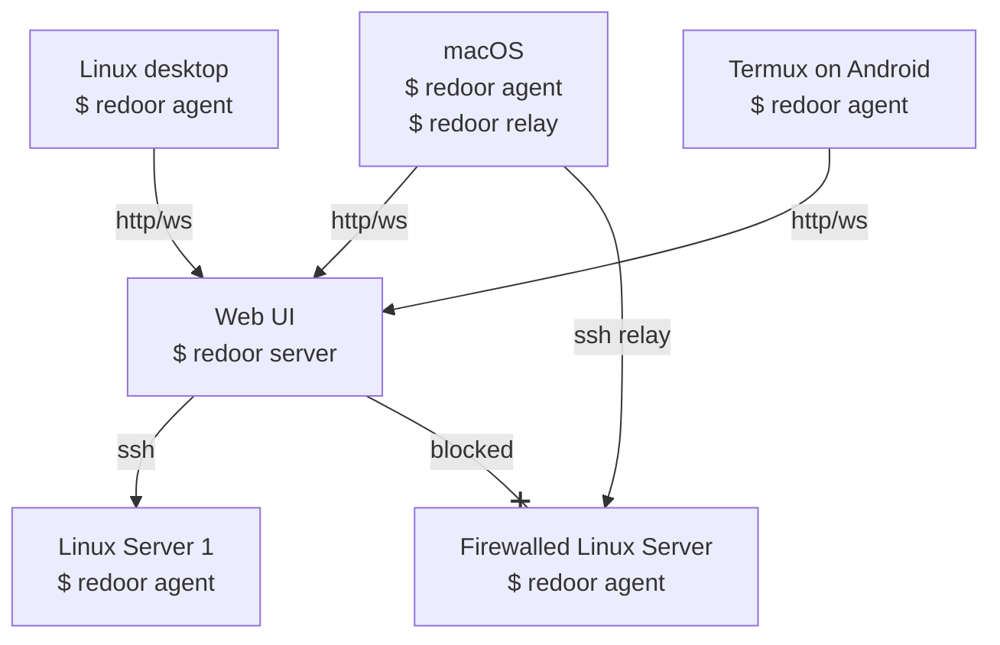

# redoor

Web based file browser, editor, git viewer and terminal for multiple devices.

Here's the thing. Today I work on multiple different devices: Servers, laptops, phones etc. and I need to be able to manage files on all of those and move the files between them. This is were Redoor comes in: It combines multiple devices behind a single interface. The devices can be accessed using direct SSH-connection or by spawning a Redoor Agent process on the device which connects to the Redoor Server.

Features

- File browser
- File editor with Git gutter and Vim-mode
- Git history viewer
- Terminal
- Streaming resumable file transfers
  - Download/upload files
  - Transfers files directly between your devices
- SSH key management secured by Passkey PRF based vaults
- Stateless MCP support to allow your agents you devices
- Remote CLI
- Login via static credentials, PAM, or OIDC (Pocket ID, Keycloak etc.)
- Easy deployment via a single static binary
- One click updates via the Web UI
- Automatic Systemd and Launchd config handling

### Architecture




## Install

For Linux, macOS, and Termux on Android.

```bash
bash -c "$(curl -fsSL https://raw.githubusercontent.com/esamattis/redoor/refs/heads/main/install.sh)"
```

This just puts the unified server/ui/agent/relay `redoor` binary in `~/.local/bin` (or `/usr/local/bin` as root). Or just manually download it from [releases](https://github.com/esamattis/redoor/releases).

Start with

```
$HOME/.local/bin/redoor server
```

and see `$HOME/.local/bin/redoor --help`

### Docker

Run the `linux/amd64` or `linux/arm64` container with one command:

```bash
docker run --rm --init --publish 127.0.0.1:7666:7666 ghcr.io/esamattis/redoor:latest
```

Open `http://127.0.0.1:7666` and log in with username `redoor` and password `redoor`.

These credentials and the agent token built into the image are only for a local demo. See [Docker Compose deployment](docs/docker.md) for persistent storage and private credentials.


## Configuration

Server and agent can share the same TOML file. Put it in `~/.config/redoor/config.toml` (or `/etc/redoor/config.toml` as root).

Full reference for every option: [docs/config.md](docs/config.md).

### Server

```toml
# Shared secret between the server and the agent
agent_token = "secret"

[server]
# Web UI login. On Linux, omit both to use PAM (system user).
# username = "admin"
# password = "long-private-password"

# port = 7666
# bind = "0.0.0.0" # default 127.0.0.1
# cookie_secure = false # set true behind HTTPS

## Automatically spawn agents via SSH
[[agents]]
target = "user@example.com"
name = "Linux Server"

[[agents]]
# local agent that runs on the same computer as the server
local = true
name = "local"
```

Run it

```bash
# Start immediately
redoor server

# or install and enable it at startup on Linux (works without root too)
redoor server systemd install --start
```

### Agent

```toml
# Shared secret between the server and the agent
agent_token = "secret"

[agent]
server = "http://127.0.0.1:7666"
name = "macbook"
```

Run it

```bash
# Start immediately
redoor agent

# or install and enable it at startup on Linux
redoor agent systemd install --start
```
